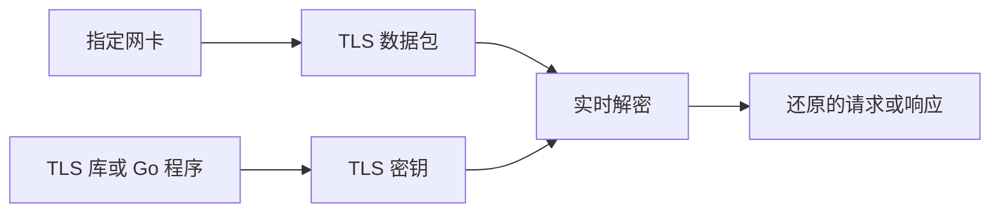

# 快速入门

先用自己的应用发起一次可重复的 HTTPS 请求。要让 eCapture v2.12.0 还原这次请求，需要先确认应用使用的 TLS 实现，以及承载流量的网卡。

1. [检查环境并安装 eCapture](1.1-requirements-and-installation.md)。加载探针前即可查看命令帮助。
2. [确认 TLS 实现](1.2-choosing-a-tls-probe.md)。根据应用选择 [OpenSSL/BoringSSL](1.3-first-openssl-and-boringssl-capture.md)、[Go crypto/tls](1.4-first-gotls-capture.md) 或 [GnuTLS](1.5-first-gnutls-capture.md)，先启动相应的探针，再发起请求。
3. 在终端查看请求和响应。如需同时保留结构化记录，可以追加 `--output stdout --output session.jsonl`。

## 从 v2.8.0 升级

v2.9.0 为三个 TLS 模块增加了基于网络包的文本数据源。从 v2.11.0 起，`--model text` 默认使用这一数据源，把单张网卡上的数据包与目标程序的 TLS 密钥配对，再解码应用消息。需要沿用原来的函数读写事件时，显式指定 `--text-source hook`。v2.12.0 更改了输出参数和接收协议，迁移脚本前可查看[输出目的地与迁移说明](../3-capture-modes/3.5-event-destinations-and-rotation.md)。

需要离线分析时，[pcapng 模式](../3-capture-modes/3.4-pcapng-mode.md)可以将网络包和密钥写入同一文件。已有独立抓包的场景，可以用[密钥日志模式](../3-capture-modes/3.3-keylog-mode.md)取得同一会话的密钥。[上游版本记录](https://github.com/gojue/ecapture/blob/v2.12.0/CHANGELOG.md)
