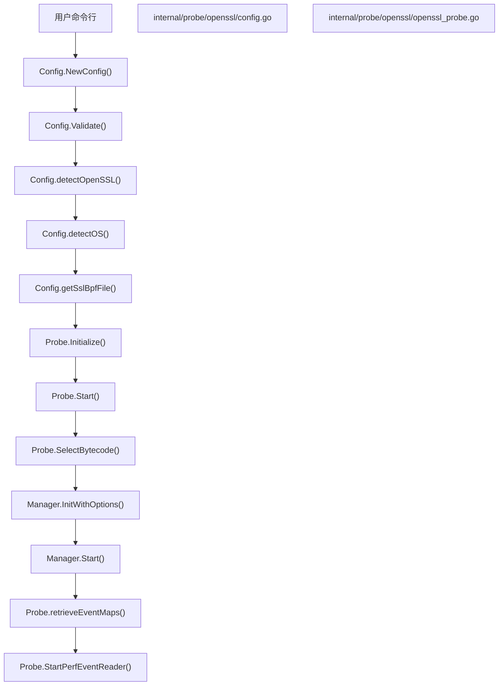
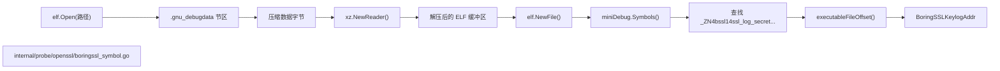

# TLS 捕获 (OpenSSL/BoringSSL)

<details>
<summary>相关源文件</summary>

以下文件被用作生成此维基页面的上下文：

- [internal/probe/gotls/gotls_probe.go](https://github.com/gojue/ecapture/blob/8c9caada/internal/probe/gotls/gotls_probe.go)
- [internal/probe/openssl/boringssl_symbol.go](https://github.com/gojue/ecapture/blob/8c9caada/internal/probe/openssl/boringssl_symbol.go)
- [internal/probe/openssl/boringssl_symbol_test.go](https://github.com/gojue/ecapture/blob/8c9caada/internal/probe/openssl/boringssl_symbol_test.go)
- [internal/probe/openssl/config.go](https://github.com/gojue/ecapture/blob/8c9caada/internal/probe/openssl/config.go)
- [internal/probe/openssl/config_ecandroid.go](https://github.com/gojue/ecapture/blob/8c9caada/internal/probe/openssl/config_ecandroid.go)
- [internal/probe/openssl/config_ecandroid_test.go](https://github.com/gojue/ecapture/blob/8c9caada/internal/probe/openssl/config_ecandroid_test.go)
- [internal/probe/openssl/config_test.go](https://github.com/gojue/ecapture/blob/8c9caada/internal/probe/openssl/config_test.go)
- [internal/probe/openssl/event_boringssl_keylog.go](https://github.com/gojue/ecapture/blob/8c9caada/internal/probe/openssl/event_boringssl_keylog.go)
- [internal/probe/openssl/event_boringssl_keylog_test.go](https://github.com/gojue/ecapture/blob/8c9caada/internal/probe/openssl/event_boringssl_keylog_test.go)
- [internal/probe/openssl/openssl_probe.go](https://github.com/gojue/ecapture/blob/8c9caada/internal/probe/openssl/openssl_probe.go)

</details>

---

## 目的与范围

本页面为 `ecapture` 中的 OpenSSL 和 BoringSSL TLS 捕获模块 (`tls`) 提供完整的技术文档。内容涵盖目标库自动发现、通过 `--libssl` 进行手动指定、版本映射策略、支持 `.gnu_debugdata` XZ 压缩符号解析的 Android BoringSSL 支持，以及在文本 (text)、密钥日志 (keylog) 和 pcapng 模式下的捕获设置与执行工作流。

Sources: [internal/probe/openssl/openssl_probe.go:44-59](https://github.com/gojue/ecapture/blob/8c9caada/internal/probe/openssl/openssl_probe.go#L44-L59), [internal/probe/openssl/config.go:42-66](https://github.com/gojue/ecapture/blob/8c9caada/internal/probe/openssl/config.go#L42-L66)

---

## 目标库发现与 `--libssl`

OpenSSL 探针通过定位承载 SSL/TLS 函数（如 `SSL_read`、`SSL_write`、`SSL_do_handshake` 或 BoringSSL 密钥日志钩子）的目标共享库 (`libssl.so`) 进行初始化。

如果用户没有通过 `--libssl` 提供显式路径，`ecapture` 将执行特定于平台的自动发现：
- **Linux:** 扫描标准系统库路径，并检查已加载的进程映射 (maps) 或共享对象。
- **Android:** 搜索 APEX 和系统路径，例如 `/apex/com.android.conscrypt/lib64/libssl.so`、`/apex/com.android.conscrypt/lib/libssl.so`、`/system/lib64/libssl.so` 以及 `/system/lib/libssl.so`。

Sources: [internal/probe/openssl/config.go:82-85](https://github.com/gojue/ecapture/blob/8c9caada/internal/probe/openssl/config.go#L82-L85), [internal/probe/openssl/config_ecandroid.go:36-61](https://github.com/gojue/ecapture/blob/8c9caada/internal/probe/openssl/config_ecandroid.go#L36-L61)

---

## 版本映射与字节码选择

一旦定位到 `libssl.so`，`ecapture` 会确定其版本并选择匹配的已编译 eBPF 字节码资产。该探针原生支持 OpenSSL 版本 `1.1.1`、`3.0` 和 `3.1`，以及各种 BoringSSL 发行版。

```
+--------------------+       +-----------------------+       +------------------------+
| 发现 OpensslPath    |------>| 检测版本/操作系统       |------>| 选择字节码("...")       |
| (Config.OpensslPath)|      | (Config.detectOS())   |       | (Config.GetBPFFileName)|
+--------------------+       +-----------------------+       +------------------------+
```

Sources: [internal/probe/openssl/config.go:35-40](https://github.com/gojue/ecapture/blob/8c9caada/internal/probe/openssl/config.go#L35-L40), [internal/probe/openssl/config.go:87-94](https://github.com/gojue/ecapture/blob/8c9caada/internal/probe/openssl/config.go#L87-L94), [internal/probe/openssl/openssl_probe.go:117-121](https://github.com/gojue/ecapture/blob/8c9caada/internal/probe/openssl/openssl_probe.go#L117-L121)

Sources: [internal/probe/openssl/config.go:35-40](https://github.com/gojue/ecapture/blob/8c9caada/internal/probe/openssl/config.go#L35-L40), [internal/probe/openssl/openssl_probe.go:117-121](https://github.com/gojue/ecapture/blob/8c9caada/internal/probe/openssl/openssl_probe.go#L117-L121)

---

## Android BoringSSL 支持与符号解析

在运行 BoringSSL 的 Android 平台上，用于主密钥日志记录的标准导出符号可能会被剥离 (stripped) 或优化掉。`ecapture` 通过解析包含 XZ 压缩的微型调试符号表的 `.gnu_debugdata` 节区来处理此问题。

函数 `findBoringSSLKeylogAddress` 打开 ELF 二进制文件，提取 `.gnu_debugdata`，使用 `github.com/ulikunitz/xz` 解压 XZ 流，解析内部 ELF 符号，并定位内部函数 `_ZN4bssl14ssl_log_secretEPK6ssl_stPKcNS_4SpanIKhEE` (`bssl::ssl_log_secret`) 的地址。

```
+-----------------------+     +----------------------+     +-------------------------+
| 打开 ELF 文件          |---->| 读取 .gnu_debugdata   |---->| XZ 解压流               |
| (elf.Open)            |     | (lib.Section)        |     | (xz.NewReader)          |
+-----------------------+     +----------------------+     +-------------------------+
                                                                        |
                                                                        v
+-----------------------+     +----------------------+     +-------------------------+
| 计算文件偏移           |<----| 匹配符号             |<----| 解析内部 ELF 符号        |
| (executableFileOffset)|     | (boringSSLKeylogSym) |     | (elf.NewFile)           |
+-----------------------+     +----------------------+     +-------------------------+
```

Sources: [internal/probe/openssl/boringssl_symbol.go:34-84](https://github.com/gojue/ecapture/blob/8c9caada/internal/probe/openssl/boringssl_symbol.go#L34-L84), [internal/probe/openssl/event_boringssl_keylog.go:34-70](https://github.com/gojue/ecapture/blob/8c9caada/internal/probe/openssl/event_boringssl_keylog.go#L34-L70)

Sources: [internal/probe/openssl/boringssl_symbol.go:34-84](https://github.com/gojue/ecapture/blob/8c9caada/internal/probe/openssl/boringssl_symbol.go#L34-L84), [internal/probe/openssl/event_boringssl_keylog.go:34-70](https://github.com/gojue/ecapture/blob/8c9caada/internal/probe/openssl/event_boringssl_keylog.go#L34-L70)

---

## 捕获设置与验证示例

OpenSSL 探针支持通过 `-m` / `--capturemode` 选择的三种不同捕获模式：
1. **文本模式 (`-m text`)**: 解码并流式传输通过 `SSL_read` 和 `SSL_write` 传递的明文数据。
2. **密钥日志模式 (`-m keylog`)**: 转储 NSS 兼容的密钥日志行（客户端随机数和机密），用于外部数据包解密。
3. **Pcapng 模式 (`-m pcapng` / `-m pcap`)**: 通过流量控制 (TC) 或套接字过滤器捕获网络数据包，并嵌入 TLS 解密机密块 (TLS Decryption Secrets Block)。

### 已验证的文本模式命令
```bash
sudo ecapture tls -m text
```

### 已验证的密钥日志模式命令
```bash
sudo ecapture tls -m keylog --keylogfile /tmp/tls.keys
```

### 已验证的 Pcapng 模式命令
```bash
sudo ecapture tls -m pcapng -i eth0 --pcapfile /tmp/capture.pcapng
```

Sources: [internal/probe/openssl/config.go:138-178](https://github.com/gojue/ecapture/blob/8c9caada/internal/probe/openssl/config.go#L138-L178), [internal/probe/openssl/openssl_probe.go:101-163](https://github.com/gojue/ecapture/blob/8c9caada/internal/probe/openssl/openssl_probe.go#L101-L163)

Sources: [internal/probe/openssl/config.go:138-178](https://github.com/gojue/ecapture/blob/8c9caada/internal/probe/openssl/config.go#L138-L178), [internal/probe/openssl/openssl_probe.go:101-163](https://github.com/gojue/ecapture/blob/8c9caada/internal/probe/openssl/openssl_probe.go#L101-L163)

---

## 架构与数据流

### 图 1：探针初始化与配置流程
此图将系统级初始化步骤映射到 `internal/probe/openssl` 中的代码组件。



Sources: [internal/probe/openssl/config.go:68-129](https://github.com/gojue/ecapture/blob/8c9caada/internal/probe/openssl/config.go#L68-L129), [internal/probe/openssl/openssl_probe.go:61-163](https://github.com/gojue/ecapture/blob/8c9caada/internal/probe/openssl/openssl_probe.go#L61-L163)

### 图 2：Android BoringSSL 符号解析数据流
此图展示了用于解析 Android 上隐藏的 BoringSSL 符号的流水线。



Sources: [internal/probe/openssl/boringssl_symbol.go:34-96](https://github.com/gojue/ecapture/blob/8c9caada/internal/probe/openssl/boringssl_symbol.go#L34-L96)

Sources: