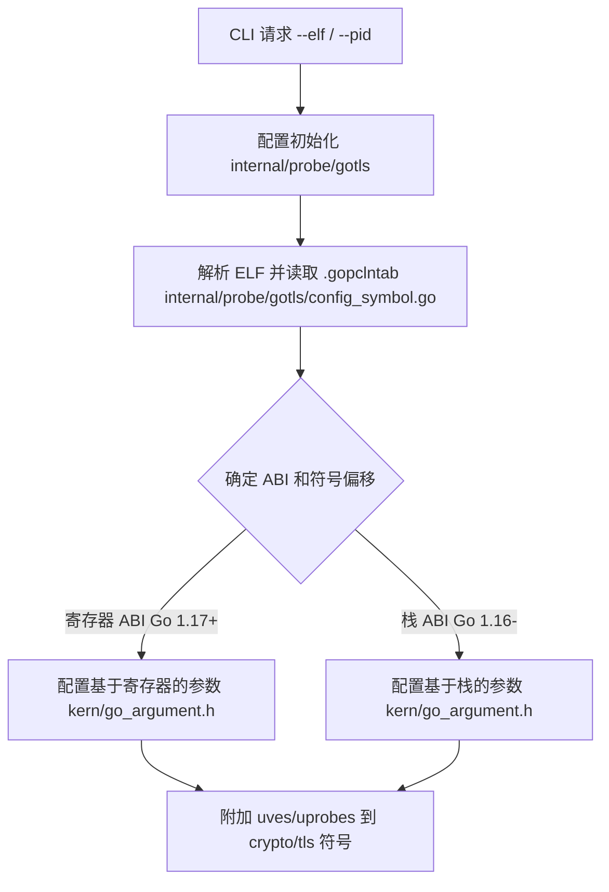
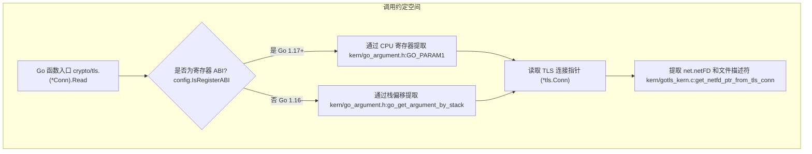

# GoTLS 捕获

<details>
<summary>相关源文件</summary>

以下文件被用作生成此维基页面的上下文参考：

- [internal/probe/gotls/config_symbol.go](https://github.com/gojue/ecapture/blob/8c9caada/internal/probe/gotls/config_symbol.go)
- [internal/probe/gotls/config_symbol_test.go](https://github.com/gojue/ecapture/blob/8c9caada/internal/probe/gotls/config_symbol_test.go)
- [internal/probe/gotls/event.go](https://github.com/gojue/ecapture/blob/8c9caada/internal/probe/gotls/event.go)
- [internal/probe/gotls/event_test.go](https://github.com/gojue/ecapture/blob/8c9caada/internal/probe/gotls/event_test.go)
- [internal/probe/gotls/gotls_probe.go](https://github.com/gojue/ecapture/blob/8c9caada/internal/probe/gotls/gotls_probe.go)
- [internal/probe/openssl/openssl_probe.go](https://github.com/gojue/ecapture/blob/8c9caada/internal/probe/openssl/openssl_probe.go)
- [kern/go_argument.h](https://github.com/gojue/ecapture/blob/8c9caada/kern/go_argument.h)
- [kern/gotls_kern.c](https://github.com/gojue/ecapture/blob/8c9caada/kern/gotls_kern.c)
- [kern/include/openssl_masterkey_common.h](https://github.com/gojue/ecapture/blob/8c9caada/kern/include/openssl_masterkey_common.h)
- [kern/include/tls_constants.h](https://github.com/gojue/ecapture/blob/8c9caada/kern/include/tls_constants.h)

</details>

本页面解释了 eCapture 中 `gotls` 捕获模块的技术实现、配置注意事项、符号与调用约定机制以及经过验证的操作流程。`gotls` 模块通过 eBPF uprobes 和 uretprobes 追踪 Go 二进制文件中的原生 TLS 连接，无需像 OpenSSL 那样依赖外部密码库。

Sources: [internal/probe/gotls/gotls_probe.go:1-69](https://github.com/gojue/ecapture/blob/8c9caada/internal/probe/gotls/gotls_probe.go#L1-L69), [kern/gotls_kern.c:1-50](https://github.com/gojue/ecapture/blob/8c9caada/kern/gotls_kern.c#L1-L50)

---

## 1. 目的与范围

`gotls` 模块针对使用标准库 `crypto/tls` 包编译的 Go 应用程序。由于 Go 二进制文件静态链接了其 TLS 实现和运行时支持，传统的动态库拦截（如挂钩 `libssl`）是无效的。相反，eCapture 将 eBPF 探针直接附加到目标 ELF 二进制文件中负责读取、写入和记录密钥的 Go 运行时函数上。

支持的功能包括：
- **文本模式 (`-m text`)**: 解码从 Go TLS 连接中读取和写入的应用层明文数据，并包含网络元组（IP、端口、文件描述符、进程元数据）。
- **密钥日志模式 (`-m keylog`)**: 在调用 `crypto/tls.(*Config).writeKeyLog` 时提取兼容 NSS 的密钥日志密钥（`CLIENT_RANDOM` 等）。
- **pcapng 模式 (`-m pcap` / `-m pcapng`)**: 从网络接口捕获数据包块，同时嵌入包含提取密钥的 TLS 解密密钥块（TLS Decryption Secrets Block），以便直接进行 Wireshark 检查。

Sources: [internal/probe/gotls/gotls_probe.go:46-50](https://github.com/gojue/ecapture/blob/8c9caada/internal/probe/gotls/gotls_probe.go#L46-L50), [internal/probe/gotls/event.go:33-74](https://github.com/gojue/ecapture/blob/8c9caada/internal/probe/gotls/event.go#L33-L74)

---

## 2. Go 二进制文件选择与环境要求

为了成功将探针附加到 Go 二进制文件，eCapture 要求目标进程或 ELF 文件路径包含 Go 调试和符号元数据（特别是 `.gopclntab` 或节数据）。对于缺少符号表的已去除符号（Stripped）二进制文件，需要外部符号表或通过链接器标志（`-ldflags="-w=false"`）保留的符号。

### 版本与架构支持
- **支持的 Go 版本**: Go 1.16 到最近的版本（包括 Go 1.17+ 基于寄存器的 ABI 和 Go 1.18+ 文本相对函数偏移表）。
- **架构**: AMD64 (`__TARGET_ARCH_x86`)、ARM64 (`__TARGET_ARCH_arm64`) 和 LoongArch (`__TARGET_ARCH_loongarch`)。
- **目标指定**: 通过命令行使用 `--pid` 指定运行中的进程，或使用 `--elf` 进行静态分析和二进制附加设置。


*图 2.1: Go 二进制文件选择与符号解析流程。*

Sources: [internal/probe/gotls/config_symbol.go:92-140](https://github.com/gojue/ecapture/blob/8c9caada/internal/probe/gotls/config_symbol.go#L92-L140), [kern/go_argument.h:1-128](https://github.com/gojue/ecapture/blob/8c9caada/kern/go_argument.h#L1-L128)

---

## 3. 符号解析与调用约定

Go 使用的特定调用约定在 Go 1.16 和 Go 1.17+ 之间发生了重大演变。理解这些约定对于 eBPF 参数提取至关重要。

### 挂钩函数
`gotls` 模块将探针附加到三个核心的 `crypto/tls` 内部方法：
1. **Read**: `crypto/tls.(*Conn).Read` —— 拦截传入的已解密应用数据。
2. **Write**: `crypto/tls.(*Conn).writeRecordLocked` —— 拦截加密前的传出应用数据。
3. **Keylog**: `crypto/tls.(*Config).writeKeyLog` —— 拦截 TLS 主密钥和随机值。

Sources: [internal/probe/gotls/gotls_probe.go:46-50](https://github.com/gojue/ecapture/blob/8c9caada/internal/probe/gotls/gotls_probe.go#L46-L50)

### ABI 注意事项（寄存器 vs 栈）
- **基于栈的 ABI (Go 1.16 及更早版本)**: 函数参数通过相对于栈指针寄存器 (`SP`) 的栈进行传递。参数检索从 `PT_REGS_SP(ctx) + (index * 8)` 读取。
- **基于寄存器的 ABI (Go 1.17 及更新版本)**: 函数参数通过 CPU 寄存器传递（AMD64 上为 `AX`, `BX`, `CX`, `DI`, `SI`, `R8`, `R9`, `R10`）。宏 `GO_PARAM1` 到 `GO_PARAM8` 直接从寄存器定义或通过 CO-RE 辅助函数提取值。


*图 3.1: 连接自然语言配置与 eBPF 代码结构的调用约定解析。*

Sources: [kern/go_argument.h:22-128](https://github.com/gojue/ecapture/blob/8c9caada/kern/go_argument.h#L22-L128), [kern/gotls_kern.c:110-146](https://github.com/gojue/ecapture/blob/8c9caada/kern/gotls_kern.c#L110-L146)

---

## 4. 实现与数据流

当应用程序调用 `crypto/tls.(*Conn).Read` 或 `writeRecordLocked` 时，附加的 uprobe 在内核上下文中执行，提取连接元数据（`netFD`、源/目的 IP、端口、文件描述符），并将有效负载拷贝到每个 CPU 的 eBPF 数组映射 (`gte_context_gen`) 中。

### eBPF 数据结构 (`struct go_tls_event`)
事件在内核空间中统一结构化，并通过 BPF 性能事件数组（`events` 和 `mastersecret_go_events`）传输到用户空间：

| 偏移量 | 字段名称 | 类型 | 描述 |
| :--- | :--- | :--- | :--- |
| 0 | `ts_ns` | `u64` | 单调时间戳 (`bpf_ktime_get_ns`) |
| 8 | `pid` / `tid` | `u32` / `u32` | 进程和线程 ID |
| 16 | `data_len` | `s32` | 有效负载长度 |
| 20 | `event_type` | `u8` | `0` = 写, `1` = 读 |
| 24 | `fd` | `u32` | 底层网络文件描述符 |
| 28 | `src_ip` / `dst_ip` | `u8[16]` | 源和目的 IP 地址 (IPv4/IPv6) |
| 44 / 64 | `src_port` / `dst_port` | `u16` / `u16` | 源和目的端口 |
| 68 | `comm` | `char[16]` | 进程命令名称 |
| 84 | `data` | `char[...]` | 有效负载缓冲区 |

Sources: [kern/gotls_kern.c:33-50](https://github.com/gojue/ecapture/blob/8c9caada/kern/gotls_kern.c#L33-L50), [internal/probe/gotls/event.go:33-74](https://github.com/gojue/ecapture/blob/8c9caada/internal/probe/gotls/event.go#L33-L74)

---

## 5. 验证捕获流程

### 文本模式流程
要从编译好的 Go 二进制文件 (`./my-go-server`) 中捕获明文 HTTP/TLS 流量：
```bash
sudo ./ecapture gotls -m text --pid 1234
```
**预期输出事件**:
```json
{
  "timestamp": 1710000000000000,
  "pid": 1234,
  "tid": 1235,
  "dataLen": 75,
  "eventType": 0,
  "fd": 7,
  "srcIP": "127.0.0.1",
  "srcPort": 54321,
  "dstIP": "127.0.0.1",
  "dstPort": 443,
  "ipVersion": 4,
  "comm": "my-go-server",
  "tuple": "127.0.0.1:54321->127.0.0.1:443",
  "data": "GET / HTTP/1.1\r\nHost: localhost\r\n\r\n"
}
```

Sources: [internal/probe/gotls/event.go:54-74](https://github.com/gojue/ecapture/blob/8c9caada/internal/probe/gotls/event.go#L54-L74)

### 密钥日志模式流程
提取 NSS 格式的 TLS 主密钥：
```bash
sudo ./ecapture gotls -m keylog --pid 1234 --keylogfile ./gotls_keys.log
```
**预期输出**:
```text
CLIENT_RANDOM 5d41402abc... 098f6bcd4621d373cade4e832627b4f6...
```

### pcapng 模式流程
捕获数据包块以及嵌入的解密密钥：
```bash
sudo ./ecapture gotls -m pcapng -i lo --pid 1234 --pcapfile ./gotls_capture.pcapng
```

Sources: [internal/probe/gotls/gotls_probe.go:62-67](https://github.com/gojue/ecapture/blob/8c9caada/internal/probe/gotls/gotls_probe.go#L62-L67)

---

## 6. 预期结果与解读

在评估 `gotls` 的捕获结果时：
1. **文本模式**: 验证明文字节是否与应用程序的请求/响应匹配。确保二进制文件未去除符号或构建 ID 匹配。
2. **密钥日志模式**: 生成标准的 NSS 密钥日志行。这些可以与 Wireshark 中的标准 `tcpdump` 捕获结合使用，路径为 **首选项 > 协议 > TLS > (Pre)-Master-Secret log filename**。
3. **pcapng 模式**: 生成一个自包含的伪影文件 (`.pcapng`)，其中包含链路层数据包和 TLS 解密密钥块 (DSB)，允许在 Wireshark 中立即检查，无需手动配置密钥文件。

Sources: [internal/probe/gotls/gotls_probe.go:46-68](https://github.com/gojue/ecapture/blob/8c9caada/internal/probe/gotls/gotls_probe.go#L46-L68)