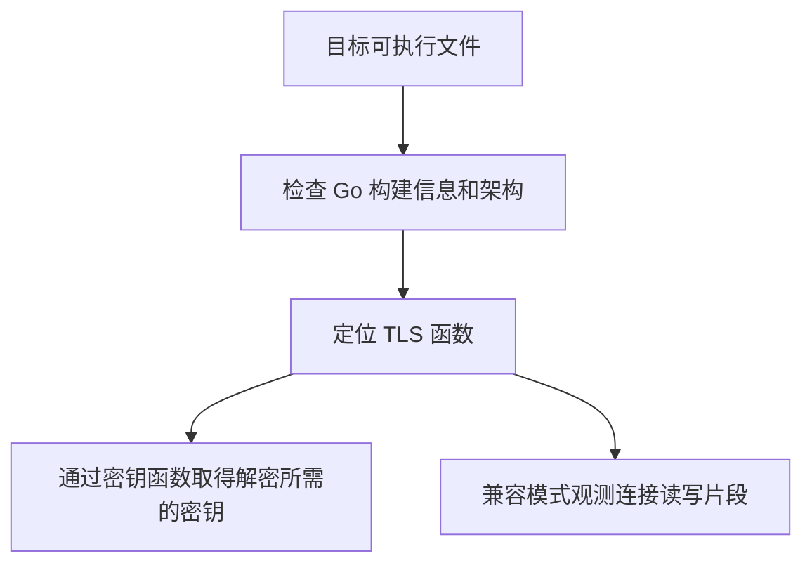

# GoTLS 捕获

`gotls`（别名 `tlsgo`）面向可执行文件内的 Go 标准库 `crypto/tls`。用 `--elfpath`（`-e`）指定实际运行的 Go 客户端或服务端。ELF 架构要与采集器匹配，Linux 上支持 `amd64`、`arm64` 或 `loong64`。Android 上使用与 Go 程序架构匹配的 amd64 或 arm64 采集器。[GoTLS 命令](https://github.com/gojue/ecapture/blob/v2.12.0/cli/cmd/gotls.go) · [ELF 检查逻辑](https://github.com/gojue/ecapture/blob/v2.12.0/internal/probe/gotls/config.go)

## 选择采集路径

```bash
sudo ecapture gotls --elfpath ./go-client --model text --text-source pcapng
sudo ecapture gotls --elfpath ./go-client --model keylog --keylogfile go.keys
sudo ecapture gotls --elfpath ./go-client --model pcapng --pcapfile go.pcapng
```

选择其中一条命令启动后，运行目标程序并新建连接。默认文本数据源将数据包与在 `crypto/tls.(*Config).writeKeyLog` 处观测到的密钥配对。HTTP 事件带有连接标识，有流 ID 时可用于区分并发请求。密钥日志模式保存 NSS 密钥，原生 pcapng 模式保存内嵌密钥的数据包。在两条涉及网络包的路径中，若实际流量走回环网卡或其他非默认路由，应使用 `-i` 指定网卡。[GoTLS 模式实现](https://github.com/gojue/ecapture/blob/v2.12.0/internal/probe/gotls/gotls_probe.go)

对于 Go HTTP/3 程序，抓包条件要包含 **UDP** 流量。`'tcp port 443'` 会排除 QUIC。上游 HTTP/3 用例使用 Go TLS 验证 QUIC v1/v2。可以向已知端点发起请求，再检查解码结果中的请求路径和响应。参见[文本解码及协议参数](../3-capture-modes/3.2-text-mode.md)。

## 如何定位 ELF 中的函数

采集器读取 Go 构建信息，定位目标 ELF 中的函数。根据构建方式，它可以从 ELF 符号或 Go 函数表查找位置，包括 PIE 二进制文件。仅仅移除 DWARF 不能判断程序是否可采集，关键是能否识别所需的 Go 元数据和目标函数。排查调用约定不匹配时，可查看启动日志的 `is_register_abi`。v2.12.0 探针仅在目标程序的 Go 主次版本严格高于 1.17 时使用寄存器传参路径，Go 1.17.x 在此版本中走栈传参路径。[ELF 与 ABI 处理](https://github.com/gojue/ecapture/blob/v2.12.0/internal/probe/gotls/config.go) · [Go 版本比较逻辑](https://github.com/gojue/ecapture/blob/v2.12.0/pkg/proc/proc.go) · [符号与指令查找](https://github.com/gojue/ecapture/blob/v2.12.0/internal/probe/gotls/config_symbol.go)



显式指定 `--text-source hook` 时，探针从 `crypto/tls.(*Conn).Read` 和 `crypto/tls.(*Conn).writeRecordLocked` 取得片段。如果旧集成以每次函数调用的 PID、方向和字节为单位解析数据，迁移时可用自己的测试请求对照新的 `TEXT` 事件。HTTP/2 可交错传输多个流，套接字读写的边界与消息边界可能不同。验证步骤见[初探 GoTLS 捕获](../1-getting-started/1.4-first-gotls-capture.md)。
