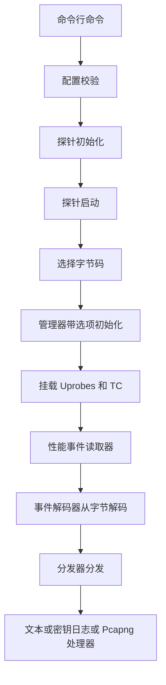
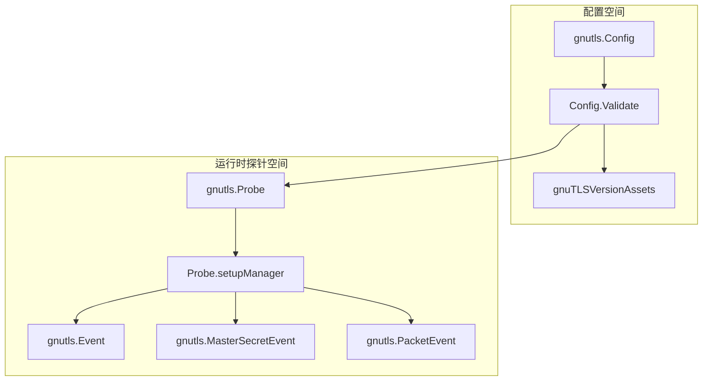

# GnuTLS 捕获

<details>
<summary>相关源文件</summary>

以下文件被用作生成此维基页面的上下文：

- [AGENTS.md](https://github.com/gojue/ecapture/blob/8c9caada/AGENTS.md)
- [docs/agent/architecture.md](https://github.com/gojue/ecapture/blob/8c9caada/docs/agent/architecture.md)
- [docs/agent/build-test.md](https://github.com/gojue/ecapture/blob/8c9caada/docs/agent/build-test.md)
- [docs/agent/probe-development.md](https://github.com/gojue/ecapture/blob/8c9caada/docs/agent/probe-development.md)
- [internal/probe/base/handlers/keylog_handler.go](https://github.com/gojue/ecapture/blob/8c9caada/internal/probe/base/handlers/keylog_handler.go)
- [internal/probe/base/handlers/keylog_handler_test.go](https://github.com/gojue/ecapture/blob/8c9caada/internal/probe/base/handlers/keylog_handler_test.go)
- [internal/probe/gnutls/config.go](https://github.com/gojue/ecapture/blob/8c9caada/internal/probe/gnutls/config.go)
- [internal/probe/gnutls/config_test.go](https://github.com/gojue/ecapture/blob/8c9caada/internal/probe/gnutls/config_test.go)
- [internal/probe/gnutls/event.go](https://github.com/gojue/ecapture/blob/8c9caada/internal/probe/gnutls/event.go)
- [internal/probe/gnutls/event_masterkey.go](https://github.com/gojue/ecapture/blob/8c9caada/internal/probe/gnutls/event_masterkey.go)
- [internal/probe/gnutls/event_packet.go](https://github.com/gojue/ecapture/blob/8c9caada/internal/probe/gnutls/event_packet.go)
- [internal/probe/gnutls/gnutls_probe.go](https://github.com/gojue/ecapture/blob/8c9caada/internal/probe/gnutls/gnutls_probe.go)
- [kern/gnutls.h](https://github.com/gojue/ecapture/blob/8c9caada/kern/gnutls.h)
- [kern/gnutls_masterkey.h](https://github.com/gojue/ecapture/blob/8c9caada/kern/gnutls_masterkey.h)

</details>

---

## 概述与范围

GnuTLS 捕获模块 (`gnutls`) 为动态或静态链接到 GNU Transport Layer Security (GnuTLS) 库 (`libgnutls.so`) 的应用程序提供非侵入式的明文、密钥日志（keylog）和数据包捕获功能 [internal/probe/gnutls/config.go:63-75](https://github.com/gojue/ecapture/blob/8c9caada/internal/probe/gnutls/config.go#L63-L75)。与 OpenSSL 或 GoTLS 不同，GnuTLS 在不同的小版本和补丁版本之间高度依赖内部结构布局的变化。因此，eCapture 采用了特定版本的 eBPF 字节码对象，并在初始化期间与检测到的目标库版本进行匹配 [internal/probe/gnutls/config.go:33-61](https://github.com/gojue/ecapture/blob/8c9caada/internal/probe/gnutls/config.go#L33-L61)。

Sources: [internal/probe/gnutls/config.go:33-75](https://github.com/gojue/ecapture/blob/8c9caada/internal/probe/gnutls/config.go#L33-L75)

---

## 目标库与版本支持

目标库通常位于标准系统路径，例如 `/usr/lib/x86_64-linux-gnu/libgnutls.so.30` [internal/probe/gnutls/config.go:63-75](https://github.com/gojue/ecapture/blob/8c9caada/internal/probe/gnutls/config.go#L63-L75)。在启动过程中，`Config.Validate()` 会检查目标二进制文件以确定精确的 GnuTLS 版本字符串（范围从 `3.6.12` 到 `3.8.9`）[internal/probe/gnutls/config.go:101-143](https://github.com/gojue/ecapture/blob/8c9caada/internal/probe/gnutls/config.go#L101-L143)。

从检测到的版本到已编译 eBPF 对象的映射由 `gnuTLSVersionAssets` 管理 [internal/probe/gnutls/config.go:33-61](https://github.com/gojue/ecapture/blob/8c9caada/internal/probe/gnutls/config.go#L33-L61)。例如，版本 `3.8.4` 到 `3.8.6` 解析为 `gnutls_3_8_4_kern.o`，而 `3.8.7` 到 `3.8.9` 解析为 `gnutls_3_8_7_kern.o` [internal/probe/gnutls/config.go:55-61](https://github.com/gojue/ecapture/blob/8c9caada/internal/probe/gnutls/config.go#L55-L61)。

### 版本支持表

| GnuTLS 版本范围 | 关联的 eBPF 字节码对象 | 关键挂载符号 |
| --- | --- | --- |
| `3.6.12` - `3.6.16` | `gnutls_3_6_12_kern.o` / `gnutls_3_6_13_kern.o` [internal/probe/gnutls/config.go:34-38](https://github.com/gojue/ecapture/blob/8c9caada/internal/probe/gnutls/config.go#L34-L38) | `gnutls_record_send`, `gnutls_record_recv`, 会话密钥提取器 |
| `3.7.0` - `3.7.11` | `gnutls_3_7_0_kern.o` / `gnutls_3_7_7_kern.o` [internal/probe/gnutls/config.go:39-50](https://github.com/gojue/ecapture/blob/8c9caada/internal/probe/gnutls/config.go#L39-L50) | `gnutls_record_send`, `gnutls_record_recv`, 会话密钥提取器 |
| `3.8.0` - `3.8.3` | `gnutls_3_7_7_kern.o` [internal/probe/gnutls/config.go:51-54](https://github.com/gojue/ecapture/blob/8c9caada/internal/probe/gnutls/config.go#L51-L54) | `gnutls_record_send`, `gnutls_record_recv`, 会话密钥提取器 |
| `3.8.4` - `3.8.6` | `gnutls_3_8_4_kern.o` [internal/probe/gnutls/config.go:55-57](https://github.com/gojue/ecapture/blob/8c9caada/internal/probe/gnutls/config.go#L55-L57) | `gnutls_record_send`, `gnutls_record_recv`, 会话密钥提取器 |
| `3.8.7` - `3.8.9` | `gnutls_3_8_7_kern.o` [internal/probe/gnutls/config.go:58-61](https://github.com/gojue/ecapture/blob/8c9caada/internal/probe/gnutls/config.go#L58-L61) | `gnutls_record_send`, `gnutls_record_recv`, 会话密钥提取器 |

Sources: [internal/probe/gnutls/config.go:33-143](https://github.com/gojue/ecapture/blob/8c9caada/internal/probe/gnutls/config.go#L33-L143)

---

## 平台限制与先决条件

- **操作系统**：仅限 Linux (`x86_64`, `aarch64`, `loongarch64`)。
- **Android 限制**：由于标准 Android 运行时中缺少 GnuTLS 软件包，GnuTLS 模块在 `variables.mk` 中被排除在 Android 构建 (`ANDROID=1`) 之外。
- **内核要求**：最低内核版本与通用 eBPF 要求一致（x86_64 >= 4.18, aarch64 >= 5.5, loongarch64 >= 6.6）。
- **权限**：运行捕获操作需要 `root` 权限或 `CAP_SYS_ADMIN` / `CAP_BPF` 能力。

Sources: [AGENTS.md:51-62](https://github.com/gojue/ecapture/blob/8c9caada/AGENTS.md#L51-L62), [docs/agent/architecture.md:50-52](https://github.com/gojue/ecapture/blob/8c9caada/docs/agent/architecture.md#L50-L52)

---

## 已验证的捕获模式与示例

GnuTLS 探针支持通过 `-m` / `--mode` 选择的三种主要运行模式：`text`（文本）、`keylog`（密钥日志）和 `pcapng` [internal/probe/gnutls/config.go:83-91](https://github.com/gojue/ecapture/blob/8c9caada/internal/probe/gnutls/config.go#L83-L91)。

### 文本模式捕获 (Text Mode)

文本模式拦截 `gnutls_record_send` 和 `gnutls_record_recv` 以解码明文应用数据负载 [internal/probe/gnutls/gnutls_probe.go:204-212](https://github.com/gojue/ecapture/blob/8c9caada/internal/probe/gnutls/gnutls_probe.go#L204-L212)。

```sh
sudo ./bin/ecapture gnutls -m text --gnutlspath /usr/lib/x86_64-linux-gnu/libgnutls.so.30
```

**预期输出：**
```text
[mono_ns=123456789000] PID:1234 TID:1234 Comm:curl WRITE (51 bytes):
GET / HTTP/1.1
Host: example.com
```

### 密钥日志模式捕获 (Keylog Mode)

密钥日志模式提取 TLS 主密钥（master secrets）和直接流量密钥（包括 TLS 1.3 流量密钥），并以 NSS Key Log 格式输出 [internal/probe/gnutls/event_masterkey.go:46-60](https://github.com/gojue/ecapture/blob/8c9caada/internal/probe/gnutls/event_masterkey.go#L46-L60)。

```sh
sudo ./bin/ecapture gnutls -m keylog -l gnutls_keys.log --gnutlspath /usr/lib/x86_64-linux-gnu/libgnutls.so.30
```

**预期输出 (`gnutls_keys.log`)：**
```text
CLIENT_HANDSHAKE_TRAFFIC_SECRET 0123456789abcdef... 9abcdef012345678...
SERVER_HANDSHAKE_TRAFFIC_SECRET 0123456789abcdef... 9abcdef012345678...
CLIENT_TRAFFIC_SECRET_0 0123456789abcdef... 9abcdef012345678...
SERVER_TRAFFIC_SECRET_0 0123456789abcdef... 9abcdef012345678...
```

### pcapng 模式捕获

pcapng 模式将指定网络接口上的流量控制 (TC) 数据包拦截与嵌入的 TLS 解密密钥块（TLS Decryption Secrets Blocks）相结合 [internal/probe/gnutls/gnutls_probe.go:179-186](https://github.com/gojue/ecapture/blob/8c9caada/internal/probe/gnutls/gnutls_probe.go#L179-L186)。

```sh
sudo ./bin/ecapture gnutls -m pcapng -i lo -w gnutls_capture.pcapng --gnutlspath /usr/lib/x86_64-linux-gnu/libgnutls.so.30
```

Sources: [internal/probe/gnutls/config.go:153-195](https://github.com/gojue/ecapture/blob/8c9caada/internal/probe/gnutls/config.go#L153-L195), [internal/probe/gnutls/gnutls_probe.go:175-212](https://github.com/gojue/ecapture/blob/8c9caada/internal/probe/gnutls/gnutls_probe.go#L175-L212), [internal/probe/gnutls/event_masterkey.go:46-60](https://github.com/gojue/ecapture/blob/8c9caada/internal/probe/gnutls/event_masterkey.go#L46-L60)

---

## 实现架构与数据流

以下图表说明了 GnuTLS 捕获初始化和事件解码的内部执行路径及代码实体映射。

### 架构数据流


Sources: [internal/probe/gnutls/config.go:121-151](https://github.com/gojue/ecapture/blob/8c9caada/internal/probe/gnutls/config.go#L121-L151), [internal/probe/gnutls/gnutls_probe.go:57-117](https://github.com/gojue/ecapture/blob/8c9caada/internal/probe/gnutls/gnutls_probe.go#L57-L117)

### 代码实体映射


Sources: [internal/probe/gnutls/config.go:33-100](https://github.com/gojue/ecapture/blob/8c9caada/internal/probe/gnutls/config.go#L33-L100), [internal/probe/gnutls/gnutls_probe.go:39-55](https://github.com/gojue/ecapture/blob/8c9caada/internal/probe/gnutls/gnutls_probe.go#L39-L55), [internal/probe/gnutls/event.go:41-49](https://github.com/gojue/ecapture/blob/8c9caada/internal/probe/gnutls/event.go#L41-L49), [internal/probe/gnutls/event_masterkey.go:49-60](https://github.com/gojue/ecapture/blob/8c9caada/internal/probe/gnutls/event_masterkey.go#L49-L60), [internal/probe/gnutls/event_packet.go:30-37](https://github.com/gojue/ecapture/blob/8c9caada/internal/probe/gnutls/event_packet.go#L30-L37)