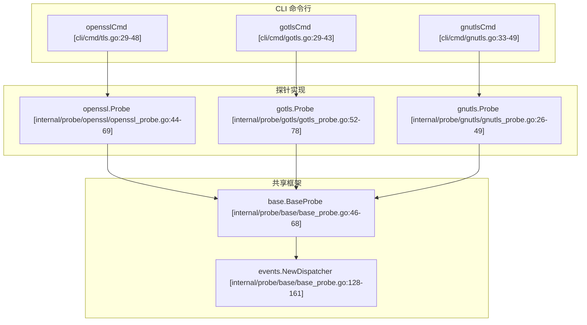

# 核心 TLS 模块

相关源文件

以下文件被用作生成此维基页面的上下文：

- [cli/cmd/gnutls.go](https://github.com/gojue/ecapture/blob/8c9caada/cli/cmd/gnutls.go)
- [cli/cmd/gotls.go](https://github.com/gojue/ecapture/blob/8c9caada/cli/cmd/gotls.go)
- [cli/cmd/nss.go](https://github.com/gojue/ecapture/blob/8c9caada/cli/cmd/nss.go)
- [cli/cmd/root.go](https://github.com/gojue/ecapture/blob/8c9caada/cli/cmd/root.go)
- [cli/cmd/tls.go](https://github.com/gojue/ecapture/blob/8c9caada/cli/cmd/tls.go)
- [internal/config/base_config.go](https://github.com/gojue/ecapture/blob/8c9caada/internal/config/base_config.go)
- [internal/domain/configuration.go](https://github.com/gojue/ecapture/blob/8c9caada/internal/domain/configuration.go)
- [internal/probe/base/base_probe.go](https://github.com/gojue/ecapture/blob/8c9caada/internal/probe/base/base_probe.go)
- [internal/probe/gotls/gotls_probe.go](https://github.com/gojue/ecapture/blob/8c9caada/internal/probe/gotls/gotls_probe.go)
- [internal/probe/openssl/openssl_probe.go](https://github.com/gojue/ecapture/blob/8c9caada/internal/probe/openssl/openssl_probe.go)

本页面为用户提供了 `eCapture` 中核心 TLS 拦截功能的总体概述：**tls** (OpenSSL/BoringSSL)、**gotls** (Go 原生 TLS) 以及 **gnutls** (GnuTLS)。这三个核心模块无需自定义 CA 证书或修改目标应用程序，即可提取 TLS 明文、加密密钥日志以及 pcapng 数据包捕获 [cli/cmd/tls.go:29-32](https://github.com/gojue/ecapture/blob/8c9caada/cli/cmd/tls.go#L29-L32), [cli/cmd/gotls.go:29-32](https://github.com/gojue/ecapture/blob/8c9caada/cli/cmd/gotls.go#L29-L32), [cli/cmd/gnutls.go:33-36](https://github.com/gojue/ecapture/blob/8c9caada/cli/cmd/gnutls.go#L33-L36)。

## 共享工作流与架构

尽管针对不同的加密库和运行时环境，所有核心 TLS 模块都共享由 eBPF 探针框架管理的统一生命周期。配置解析、eBPF 字节码加载、Map 轮询、事件解码和输出路由通过 `base.BaseProbe` 和 `events.NewDispatcher` 等共享组件进行协调 [internal/probe/base/base_probe.go:46-68](https://github.com/gojue/ecapture/blob/8c9caada/internal/probe/base/base_probe.go#L46-L68), [internal/probe/base/base_probe.go:128-161](https://github.com/gojue/ecapture/blob/8c9caada/internal/probe/base/base_probe.go#L128-L161)。

*Sources: [cli/cmd/tls.go:29-48](https://github.com/gojue/ecapture/blob/8c9caada/cli/cmd/tls.go#L29-L48), [cli/cmd/gotls.go:29-43](https://github.com/gojue/ecapture/blob/8c9caada/cli/cmd/gotls.go#L29-L43), [cli/cmd/gnutls.go:33-49](https://github.com/gojue/ecapture/blob/8c9caada/cli/cmd/gnutls.go#L33-L49), [internal/probe/openssl/openssl_probe.go:44-69](https://github.com/gojue/ecapture/blob/8c9caada/internal/probe/openssl/openssl_probe.go#L44-L69), [internal/probe/gotls/gotls_probe.go:52-78](https://github.com/gojue/ecapture/blob/8c9caada/internal/probe/gotls/gotls_probe.go#L52-L78), [internal/probe/base/base_probe.go:46-68](https://github.com/gojue/ecapture/blob/8c9caada/internal/probe/base/base_probe.go#L46-L68) *

## 模块对比

虽然各模块的输出模式（`text`、`keylog`、`pcapng`）保持一致，但它们的定位机制和运行时先决条件有显著不同：

| 模块 | 命令 | 目标发现方式 | 支持的运行时 / 库 | 平台支持 |
| :--- | :--- | :--- | :--- | :--- |
| **tls** | `ecapture tls` | `--libssl` 或自动搜索 [cli/cmd/tls.go:51](https://github.com/gojue/ecapture/blob/8c9caada/cli/cmd/tls.go#L51) | OpenSSL 1.0.x / 1.1.x / 3.x, BoringSSL [cli/cmd/tls.go:32](https://github.com/gojue/ecapture/blob/8c9caada/cli/cmd/tls.go#L32) | Linux (amd64/arm64/loong64), Android (BoringSSL) [cli/cmd/root.go:46](https://github.com/gojue/ecapture/blob/8c9caada/cli/cmd/root.go#L46) |
| **gotls** | `ecapture gotls` | `--elfpath` (ELF 二进制文件) [cli/cmd/gotls.go:46](https://github.com/gojue/ecapture/blob/8c9caada/cli/cmd/gotls.go#L46) | Go 标准库 (`crypto/tls`) 编译的二进制文件 | Linux, Android |
| **gnutls** | `ecapture gnutls` | `--gnutls` 或自动搜索 [cli/cmd/gnutls.go:52](https://github.com/gojue/ecapture/blob/8c9caada/cli/cmd/gnutls.go#L52) | GnuTLS 库 (`libgnutls.so`) [cli/cmd/gnutls.go:52](https://github.com/gojue/ecapture/blob/8c9caada/cli/cmd/gnutls.go#L52) | Linux, Android (Termux) [cli/cmd/gnutls.go:32-46](https://github.com/gojue/ecapture/blob/8c9caada/cli/cmd/gnutls.go#L32-L46) |

Sources: [cli/cmd/tls.go:32-51](https://github.com/gojue/ecapture/blob/8c9caada/cli/cmd/tls.go#L32-L51), [cli/cmd/gotls.go:46](https://github.com/gojue/ecapture/blob/8c9caada/cli/cmd/gotls.go#L46), [cli/cmd/gnutls.go:32-52](https://github.com/gojue/ecapture/blob/8c9caada/cli/cmd/gnutls.go#L32-L52), [cli/cmd/root.go:46](https://github.com/gojue/ecapture/blob/8c9caada/cli/cmd/root.go#L46)

---

## 2.1. TLS 捕获 (OpenSSL/BoringSSL)

`tls` 模块将 uprobes 挂载到 OpenSSL 和 BoringSSL 函数（如 `SSL_read`、`SSL_write` 和主密钥提取函数）上，以捕获加密负载和会话密钥。它支持自动发现库路径或通过 `--libssl` 手动指定 [cli/cmd/tls.go:33-51](https://github.com/gojue/ecapture/blob/8c9caada/cli/cmd/tls.go#L33-L51)。

有关详细的配置标志、版本映射、Android BoringSSL 设置以及经过验证的文本、密钥日志和 pcapng 示例，请参阅 [TLS 捕获 (OpenSSL/BoringSSL)](2.1-tls-capture-openssl-and-boringssl.md)。

Sources: [cli/cmd/tls.go:29-61](https://github.com/gojue/ecapture/blob/8c9caada/cli/cmd/tls.go#L29-L61), [internal/probe/openssl/openssl_probe.go:44-69](https://github.com/gojue/ecapture/blob/8c9caada/internal/probe/openssl/openssl_probe.go#L44-L69)

---

## 2.2. GoTLS 捕获

`gotls` 模块针对使用标准 `crypto/tls` 构建的 Go 二进制文件。由于 Go 将 TLS 例程静态编译到 ELF 二进制文件中，而不是依赖共享系统库，因此该模块需要通过 `--elfpath` [cli/cmd/gotls.go:46](https://github.com/gojue/ecapture/blob/8c9caada/cli/cmd/gotls.go#L46) 提供目标可执行文件的路径，并解析函数偏移量或符号（`crypto/tls.(*Conn).Read`、`crypto/tls.(*Conn).writeRecordLocked`）[internal/probe/gotls/gotls_probe.go:47-49](https://github.com/gojue/ecapture/blob/8c9caada/internal/probe/gotls/gotls_probe.go#L47-L49)。

有关 Go 版本兼容性、符号注意事项、寄存器 ABI 处理以及所有输出模式下可运行工作流的详细说明，请参阅 [GoTLS 捕获](2.2-gotls-capture.md)。

Sources: [cli/cmd/gotls.go:28-55](https://github.com/gojue/ecapture/blob/8c9caada/cli/cmd/gotls.go#L28-L55), [internal/probe/gotls/gotls_probe.go:46-78](https://github.com/gojue/ecapture/blob/8c9caada/internal/probe/gotls/gotls_probe.go#L46-L78)

---

## 2.3. GnuTLS 捕获

`gnutls` 模块对 GnuTLS (`libgnutls.so`) 函数调用进行插桩，以拦截明文和握手密钥 [cli/cmd/gnutls.go:33-52](https://github.com/gojue/ecapture/blob/8c9caada/cli/cmd/gnutls.go#L33-L52)。它适配了诸如 Android 上的 Termux 等应用程序和包管理器 [cli/cmd/gnutls.go:32-46](https://github.com/gojue/ecapture/blob/8c9caada/cli/cmd/gnutls.go#L32-L46)。

有关库路径发现、特定版本的补丁映射、平台限制以及经过验证的命令示例，请参阅 [GnuTLS 捕获](2.3-gnutls-capture.md)。

Sources: [cli/cmd/gnutls.go:31-60](https://github.com/gojue/ecapture/blob/8c9caada/cli/cmd/gnutls.go#L31-L60)