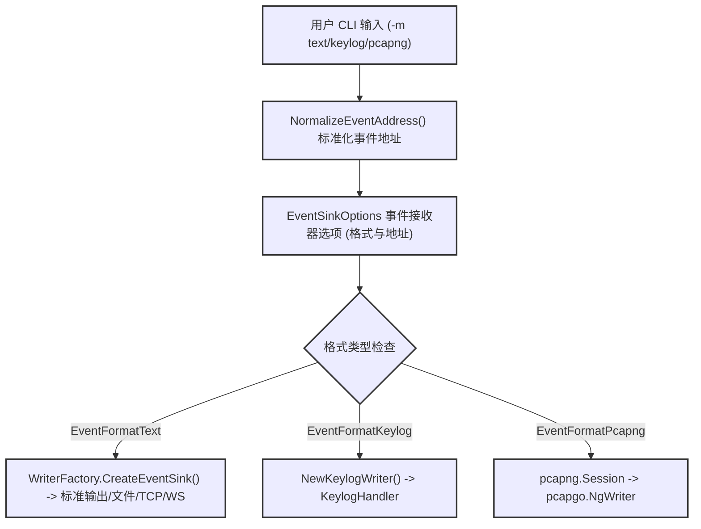
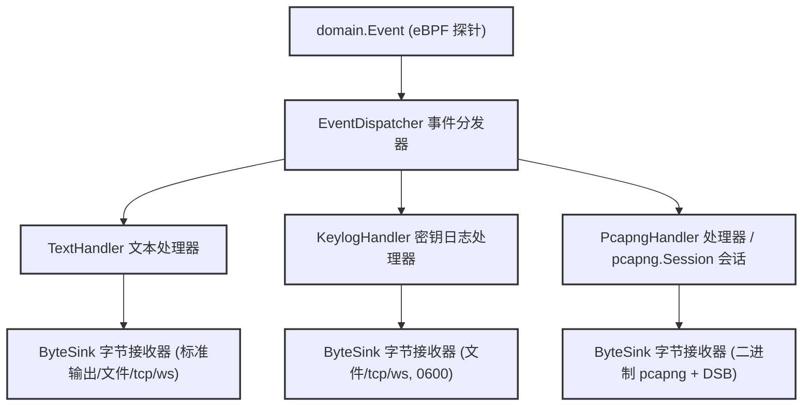

# 模式选择：Text、Keylog 或 pcapng

相关源文件

以下文件被用作生成此维基页面的上下文：

- [cli/cmd/output_flags.go](https://github.com/gojue/ecapture/blob/8c9caada/cli/cmd/output_flags.go)
- [cli/cmd/output_pipeline_test.go](https://github.com/gojue/ecapture/blob/8c9caada/cli/cmd/output_pipeline_test.go)
- [docs/agent/output-pipeline-refactor-taskbook.md](https://github.com/gojue/ecapture/blob/8c9caada/docs/agent/output-pipeline-refactor-taskbook.md)
- [docs/agent/output-pipeline.md](https://github.com/gojue/ecapture/blob/8c9caada/docs/agent/output-pipeline.md)
- [internal/output/writers/factory.go](https://github.com/gojue/ecapture/blob/8c9caada/internal/output/writers/factory.go)
- [internal/output/writers/pipeline_test.go](https://github.com/gojue/ecapture/blob/8c9caada/internal/output/writers/pipeline_test.go)
- [test/e2e/fixtures/ecaptureq_assert/main.go](https://github.com/gojue/ecapture/blob/8c9caada/test/e2e/fixtures/ecaptureq_assert/main.go)

本页面提供了一个技术决策框架，用于在 eCapture 核心 TLS 模块（[TLS 捕获 (OpenSSL/BoringSSL)](../2-core-tls-modules/2.1-tls-capture-openssl-and-boringssl.md)、[GoTLS 捕获](../2-core-tls-modules/2.2-gotls-capture.md) 和 [GnuTLS 捕获](../2-core-tls-modules/2.3-gnutls-capture.md)）提供的三种输出捕获模式（`text`、`keylog` 和 `pcapng`）之间进行选择。它详细介绍了每种模式相关的内部表示机制、目标位置要求、伪像结构以及操作注意事项。

---

## 1. 捕获模式决策矩阵

通过 `-m` 或 `--format` 配置核心 TLS 捕获会话时，必须选择与下游分析工作流匹配的表示格式。下表从关键架构维度对比了这三种模式：

| 维度 | 文本模式 (`text`) | 密钥日志模式 (`keylog`) | pcapng 模式 (`pcapng`) |
| :--- | :--- | :--- | :--- |
| **主要用例** | 即时明文检查、终端调试或简单的日志聚合。 | 在 Wireshark 中解密单独的报文捕获（例如通过 `tcpdump` 捕获）。 | 集成了网络数据块和嵌入式解密材料的一体化报文捕获。 |
| **产物内容** | UTF-8 格式的明文负载（HTTP、TLS 应用数据转录）。 | NSS Key Log 格式行（`CLIENT_RANDOM ...`）。 | 原始报文块与解密机密块 (DSB) 的组合。 |
| **目标位置规则** | 若为空则默认为 `stdout`；支持文件、TCP 流和二进制 WebSocket。 | 需要明确的目标位置（`stdout`、文件、TCP、WebSocket）；以 `0600` 权限截断文件。 | 需要明确的目标位置；生成无帧的二进制字节流；拒绝字节滚动（rotation）。 |
| **敏感性与安全性** | 普通敏感度；直接记录应用程序文本负载。 | 敏感；暴露能够解密所捕获流量的主会话密钥。 | 敏感；同时包含拦截的原始报文和会话解密密钥。 |
| **实现实体** | 通过 `TextHandler` 实现的 `internal/output/writers.EventFormatText` [docs/agent/output-pipeline.md:14](https://github.com/gojue/ecapture/blob/8c9caada/docs/agent/output-pipeline.md#L14), [internal/output/writers/factory.go:29](https://github.com/gojue/ecapture/blob/8c9caada/internal/output/writers/factory.go#L29) | 通过 `KeylogHandler` 实现的 `internal/output/writers.EventFormatKeylog` [docs/agent/output-pipeline.md:15](https://github.com/gojue/ecapture/blob/8c9caada/docs/agent/output-pipeline.md#L15), [internal/output/writers/factory.go:30](https://github.com/gojue/ecapture/blob/8c9caada/internal/output/writers/factory.go#L30) | 通过 `pcapng.Session` 实现的 `internal/output/writers.EventFormatPcapng` [docs/agent/output-pipeline.md:16](https://github.com/gojue/ecapture/blob/8c9caada/docs/agent/output-pipeline.md#L16), [internal/output/writers/factory.go:31](https://github.com/gojue/ecapture/blob/8c9caada/internal/output/writers/factory.go#L31) |

Sources: [docs/agent/output-pipeline.md:1-124](https://github.com/gojue/ecapture/blob/8c9caada/docs/agent/output-pipeline.md#L1-L124), [internal/output/writers/factory.go:26-144](https://github.com/gojue/ecapture/blob/8c9caada/internal/output/writers/factory.go#L26-L144), [docs/agent/output-pipeline-refactor-taskbook.md:67-94](https://github.com/gojue/ecapture/blob/8c9caada/docs/agent/output-pipeline-refactor-taskbook.md#L67-L94)

---

## 2. 模式选择到代码的映射

此图表将面向用户的模式标志连接到 eCapture 内部的配置结构和接收器（sink）构建逻辑。

Sources: [internal/output/writers/factory.go:48-144](https://github.com/gojue/ecapture/blob/8c9caada/internal/output/writers/factory.go#L48-L144), [docs/agent/output-pipeline-refactor-taskbook.md:67-115](https://github.com/gojue/ecapture/blob/8c9caada/docs/agent/output-pipeline-refactor-taskbook.md#L67-L115)

---

## 3. 模式详细分析

### 3.1 文本模式 (`text`)
文本模式直接从 eBPF uprobe/kprobe 挂钩点拦截解密后的应用缓冲区，并将其格式化为 UTF-8 可读字符串。
* **数据流：** 事件由 `TextHandler` 处理，该处理器使用 `String()` 或 `StringHex()` 表示法格式化负载，且不会受到操作日志的污染 [docs/agent/output-pipeline.md:14](https://github.com/gojue/ecapture/blob/8c9caada/docs/agent/output-pipeline.md#L14), [cli/cmd/output_pipeline_test.go:36](https://github.com/gojue/ecapture/blob/8c9caada/cli/cmd/output_pipeline_test.go#L36)。
* **目标位置：** 默认情况下，文本模式以 `stdout` 为目标。然而，它完全支持重定向到文件、TCP 监听器或二进制 WebSocket 流（`--eventaddr`）[docs/agent/output-pipeline.md:68](https://github.com/gojue/ecapture/blob/8c9caada/docs/agent/output-pipeline.md#L68)。
* **注意事项：** 文本模式不捕获原始 TCP/IP 报文头或底层分帧元数据；它记录的是 TLS 库挂钩报告的应用层负载和连接元组。

Sources: [docs/agent/output-pipeline.md:14](https://github.com/gojue/ecapture/blob/8c9caada/docs/agent/output-pipeline.md#L14), [cli/cmd/output_pipeline_test.go:33-46](https://github.com/gojue/ecapture/blob/8c9caada/cli/cmd/output_pipeline_test.go#L33-L46)

### 3.2 密钥日志模式 (`keylog`)
密钥日志模式提取由 OpenSSL、GoTLS 或 GnuTLS 协商的 TLS 主密钥（例如 `CLIENT_RANDOM` 或 TLS 1.3 的 `EXPORTER_SECRET` / 握手密钥）。
* **数据流：** 底层的 `KeylogHandler` 处理加密密钥材料事件，并通过 `KeylogWriter` 写入。`KeylogWriter` 包装了一个任意的 `ByteSink`，以确保严格的换行格式 (`\n`) 而不改变调用者缓冲区 [docs/agent/output-pipeline.md:15](https://github.com/gojue/ecapture/blob/8c9caada/docs/agent/output-pipeline.md#L15), [internal/output/writers/pipeline_test.go:77-104](https://github.com/gojue/ecapture/blob/8c9caada/internal/output/writers/pipeline_test.go#L77-L104)。
* **目标位置：** 密钥日志模式需要明确的目标位置（或使用旧有的 `--keylogfile` 别名）。文件创建时具有限制性的 `0600` 权限，并在启动时截断 [docs/agent/output-pipeline.md:81](https://github.com/gojue/ecapture/blob/8c9caada/docs/agent/output-pipeline.md#L81), [docs/agent/output-pipeline-refactor-taskbook.md:109](https://github.com/gojue/ecapture/blob/8c9caada/docs/agent/output-pipeline-refactor-taskbook.md#L109)。
* **注意事项：** 密钥日志模式 **不包含报文数据**。要检查流量，必须运行并行的报文捕获（如 `tcpdump` 或 Wireshark），并配置 Wireshark 加载生成的密钥日志文件 [docs/agent/output-pipeline.md:71](https://github.com/gojue/ecapture/blob/8c9caada/docs/agent/output-pipeline.md#L71)。

Sources: [docs/agent/output-pipeline.md:71](https://github.com/gojue/ecapture/blob/8c9caada/docs/agent/output-pipeline.md#L71), [docs/agent/output-pipeline-refactor-taskbook.md:75-81](https://github.com/gojue/ecapture/blob/8c9caada/docs/agent/output-pipeline-refactor-taskbook.md#L75-L81), [internal/output/writers/pipeline_test.go:77-104](https://github.com/gojue/ecapture/blob/8c9caada/internal/output/writers/pipeline_test.go#L77-L104)

### 3.3 pcapng 模式 (`pcapng`)
pcapng 模式构建符合标准的 PCAP Next Generation 捕获产物，将拦截的报文块与嵌入式解密机密块 (DSB) 相结合。
* **数据流：** `PcapngSession` 管理一个运行 `pcapgo.NgWriter` 的专用 goroutine。报文负载和解密密钥被排队、同步排序、根据请求刷新，并在关闭期间完全排空 [docs/agent/output-pipeline.md:16](https://github.com/gojue/ecapture/blob/8c9caada/docs/agent/output-pipeline.md#L16), [docs/agent/output-pipeline-refactor-taskbook.md:82-90](https://github.com/gojue/ecapture/blob/8c9caada/docs/agent/output-pipeline-refactor-taskbook.md#L82-L90)。
* **目标位置：** 需要明确的文件路径或网络目标。对于 pcapng 流，严格禁止字节流滚动（`--rotate`），因为这会破坏容器的分帧结构 [docs/agent/output-pipeline.md:81](https://github.com/gojue/ecapture/blob/8c9caada/docs/agent/output-pipeline.md#L81), [internal/output/writers/pipeline_test.go:148](https://github.com/gojue/ecapture/blob/8c9caada/internal/output/writers/pipeline_test.go#L148)。
* **注意事项：** 操作日志 (`--logaddr`) 和 pcapng 事件流 (`--eventaddr`) 不能同时以 `stdout` 为目标，因为混入文本日志消息会损坏二进制 pcapng 流 [docs/agent/output-pipeline.md:84](https://github.com/gojue/ecapture/blob/8c9caada/docs/agent/output-pipeline.md#L84), [internal/output/writers/factory.go:70-75](https://github.com/gojue/ecapture/blob/8c9caada/internal/output/writers/factory.go#L70-L75)。

Sources: [docs/agent/output-pipeline.md:16](https://github.com/gojue/ecapture/blob/8c9caada/docs/agent/output-pipeline.md#L16), [docs/agent/output-pipeline-refactor-taskbook.md:82-94](https://github.com/gojue/ecapture/blob/8c9caada/docs/agent/output-pipeline-refactor-taskbook.md#L82-L94), [internal/output/writers/factory.go:70-75](https://github.com/gojue/ecapture/blob/8c9caada/internal/output/writers/factory.go#L70-L75)

---

## 4. 输出流水线路由架构

下图展示了捕获的领域事件如何通过 `EventDispatcher` 流向不同的表示处理器，并输出到独立的 `ByteSink` 传输层。

Sources: [docs/agent/output-pipeline.md:14-18](https://github.com/gojue/ecapture/blob/8c9caada/docs/agent/output-pipeline.md#L14-L18), [docs/agent/output-pipeline-refactor-taskbook.md:67-94](https://github.com/gojue/ecapture/blob/8c9caada/docs/agent/output-pipeline-refactor-taskbook.md#L67-L94)

---

## 5. 注意事项与验证规则摘要

* **冲突检测：** 如果同时显式提供 `--eventaddr` 和带有冲突路径的旧模式标志（`--keylogfile` 或 `--pcapfile`），将触发验证失败 [internal/output/writers/factory.go:48-66](https://github.com/gojue/ecapture/blob/8c9caada/internal/output/writers/factory.go#L48-L66), [cli/cmd/output_pipeline_test.go:150-180](https://github.com/gojue/ecapture/blob/8c9caada/cli/cmd/output_pipeline_test.go#L150-L180)。
* **通道隔离：** 捕获的负载和加密机密与操作日志（`--logaddr` 和 eCaptureQ `PROCESS_LOG`）严格隔离。机密永远不会泄露到标准操作运行日志中 [docs/agent/output-pipeline.md:27-29](https://github.com/gojue/ecapture/blob/8c9caada/docs/agent/output-pipeline.md#L27-L29), [cli/cmd/output_pipeline_test.go:71-148](https://github.com/gojue/ecapture/blob/8c9caada/cli/cmd/output_pipeline_test.go#L71-L148)。
* **文件权限：** 敏感产物文件（`keylog` 和 `pcapng`）在创建时强制执行严格的 UNIX 文件权限 (`0600`) [internal/output/writers/factory.go:135-137](https://github.com/gojue/ecapture/blob/8c9caada/internal/output/writers/factory.go#L135-L137)。

Sources: [docs/agent/output-pipeline.md:27-29](https://github.com/gojue/ecapture/blob/8c9caada/docs/agent/output-pipeline.md#L27-L29), [internal/output/writers/factory.go:48-137](https://github.com/gojue/ecapture/blob/8c9caada/internal/output/writers/factory.go#L48-L137), [cli/cmd/output_pipeline_test.go:71-180](https://github.com/gojue/ecapture/blob/8c9caada/cli/cmd/output_pipeline_test.go#L71-L180)