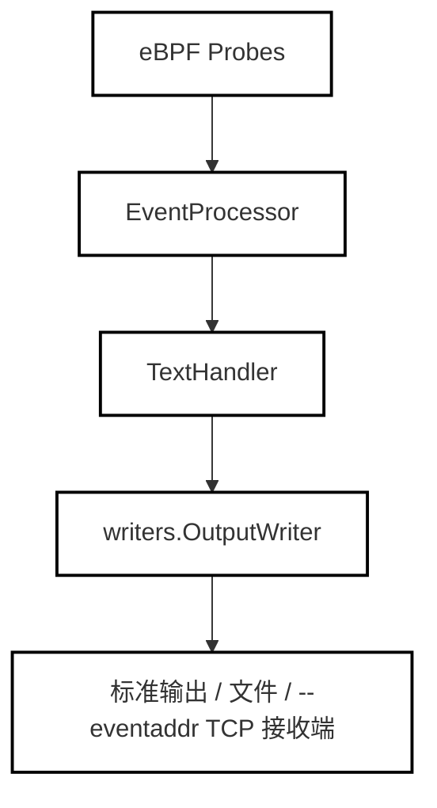

# 文本模式 (Text)

<details>
<summary>相关源码文件</summary>

以下文件被用作生成此维基页面的上下文：

- [internal/probe/base/handlers/text_handler.go](https://github.com/gojue/ecapture/blob/8c9caada/internal/probe/base/handlers/text_handler.go)
- [internal/probe/base/handlers/text_handler_test.go](https://github.com/gojue/ecapture/blob/8c9caada/internal/probe/base/handlers/text_handler_test.go)
- [pkg/event_processor/base_event.go](https://github.com/gojue/ecapture/blob/8c9caada/pkg/event_processor/base_event.go)
- [pkg/event_processor/http_request.go](https://github.com/gojue/ecapture/blob/8c9caada/pkg/event_processor/http_request.go)
- [pkg/event_processor/http_response.go](https://github.com/gojue/ecapture/blob/8c9caada/pkg/event_processor/http_response.go)
- [pkg/event_processor/iparser.go](https://github.com/gojue/ecapture/blob/8c9caada/pkg/event_processor/iparser.go)
- [pkg/event_processor/iworker.go](https://github.com/gojue/ecapture/blob/8c9caada/pkg/event_processor/iworker.go)
- [pkg/event_processor/processor.go](https://github.com/gojue/ecapture/blob/8c9caada/pkg/event_processor/processor.go)
- [pkg/event_processor/processor_test.go](https://github.com/gojue/ecapture/blob/8c9caada/pkg/event_processor/processor_test.go)

</details>

## 目的与范围
本页面详细介绍了 **文本模式** (`-m text`)，这是 eCapture 核心 TLS 捕获模块（`tls`、`gotls` 和 `gnutls`）的默认运行模式。文本模式通过 eBPF 探针拦截加密的 TLS 套接字读/写操作，在内存中解密或捕获负载，并将人类可读的明文事件直接打印到标准输出或指定的事件地址。它旨在对 HTTP 请求、响应及任意应用层负载进行即时交互式检查，无需外部抓包或解密密钥文件。

Sources:
- [internal/probe/base/handlers/text_handler.go:26-34](https://github.com/gojue/ecapture/blob/8c9caada/internal/probe/base/handlers/text_handler.go#L26-L34)
- [pkg/event_processor/iworker.go:175-229](https://github.com/gojue/ecapture/blob/8c9caada/pkg/event_processor/iworker.go#L175-L229)

---

## 验证过的文本模式命令
要以文本模式运行 eCapture，请指定模块（`tls`、`gotls` 或 `gnutls`）并配合 `-m text` 参数。

### OpenSSL / BoringSSL (`tls`)
```bash
ecapture tls -m text -p 1234
```
或者，指定特定的共享库路径：
```bash
ecapture tls -m text --libssl /usr/lib/x86_64-linux-gnu/libssl.so.1.1
```

### Go 原生 TLS (`gotls`)
```bash
ecapture gotls -m text --pid 5678
```

### GnuTLS (`gnutls`)
```bash
ecapture gnutls -m text -p 9012
```

Sources:
- [internal/probe/base/handlers/text_handler.go:49-57](https://github.com/gojue/ecapture/blob/8c9caada/internal/probe/base/handlers/text_handler.go#L49-L57)

---

## 默认标准输出与可选的 `--eventaddr`
默认情况下，文本模式通过 `writers.NewStdoutWriter()` 将所有格式化的明文事件路由到标准输出 (`stdout`)。

在分布式或自动化环境中运行时，您可以使用可选的 `--eventaddr` 标志重定向捕获的事件。与仅承载引擎运行日志的 `--logaddr` 不同，`--eventaddr` 将处理后的事件流传输到远程 TCP 接收端、WebSocket 端点或文件描述符。


*图 1：文本模式输出路由架构*

Sources:
- [internal/probe/base/handlers/text_handler.go:49-57](https://github.com/gojue/ecapture/blob/8c9caada/internal/probe/base/handlers/text_handler.go#L49-L57)
- [pkg/event_processor/processor.go:70-93](https://github.com/gojue/ecapture/blob/8c9caada/pkg/event_processor/processor.go#L70-L93)

---

## 预期的明文事件与格式化
当应用程序通过挂钩的 TLS 会话读取或写入数据时，eCapture 会分发一个二进制事件结构 (`BaseEvent`)，随后由 `eventWorker` 处理并由 `TextHandler` 格式化。

### 事件结构与布局
每个事件都会捕获元数据，包括进程 ID (`PID`)、线程 ID (`TID`)、进程名称 (`Comm`)、文件描述符 (`Fd`)、TLS 版本以及方向（`Received` 与 `Send`）。

```mermaid
graph TD
  A["用户命令 (-m text)"] --> B["internal/probe/base/handlers/TextHandler"]
  B --> C["pkg/event_processor/BaseEvent"]
  C -->|String()| D["人类可读明文"]
  C -->|StringHex()| E["十六进制转储视图 (--hex)"]

  classDef default fill:none,stroke:#000,stroke-width:2px;
```
*图 2：事件解码与格式化实体流*

通过 `tls` 或 `gotls` 捕获的 HTTP 请求的预期明文输出如下所示：
```text
PID:469929, Comm:curl, TID:469929, Version:TLS1_3_VERSION, Received 308 bytes, Payload:
GET / HTTP/1.1
Host: example.com
User-Agent: curl/7.88.1
Accept: */*
```

Sources:
- [pkg/event_processor/base_event.go:76-167](https://github.com/gojue/ecapture/blob/8c9caada/pkg/event_processor/base_event.go#L76-L167)
- [internal/probe/base/handlers/text_handler.go:61-111](https://github.com/gojue/ecapture/blob/8c9caada/internal/probe/base/handlers/text_handler.go#L61-L111)

---

## 简单验证流程
要验证文本模式捕获是否正常工作，请执行以下验证步骤：

1. **启动目标应用程序**：启动一个服务器，或者使用 OpenSSL、Go 或 GnuTLS 对 HTTPS 端点运行重复的客户端请求。
2. **执行 eCapture**：以 root 权限运行文本模式探针：
   ```bash
   sudo ecapture tls -m text -bb
   ```
3. **触发流量**：在另一个终端中执行请求：
   ```bash
   curl -Iv https://www.example.com/
   ```
4. **确认输出**：观察运行 eCapture 的终端。明文 HTTP 标头和请求体应立即出现，无需解密密钥或 Wireshark。

Sources:
- [pkg/event_processor/processor_test.go:31-114](https://github.com/gojue/ecapture/blob/8c9caada/pkg/event_processor/processor_test.go#L31-L114)
- [internal/probe/base/handlers/text_handler_test.go:133-157](https://github.com/gojue/ecapture/blob/8c9caada/internal/probe/base/handlers/text_handler_test.go#L133-L157)