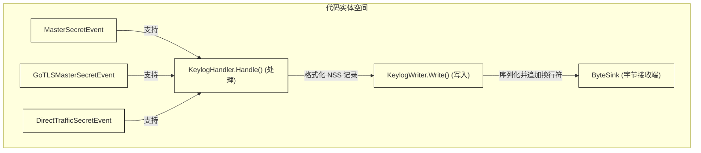
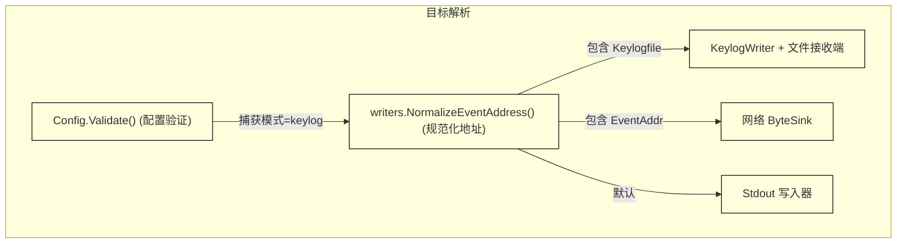

# 密钥日志模式 (Keylog)

<details>
<summary>相关源码文件</summary>

以下文件被用作生成此维基页面的上下文：

- [internal/output/writers/keylog_writer.go](https://github.com/gojue/ecapture/blob/8c9caada/internal/output/writers/keylog_writer.go)
- [internal/probe/base/handlers/keylog_handler.go](https://github.com/gojue/ecapture/blob/8c9caada/internal/probe/base/handlers/keylog_handler.go)
- [internal/probe/base/handlers/keylog_handler_test.go](https://github.com/gojue/ecapture/blob/8c9caada/internal/probe/base/handlers/keylog_handler_test.go)
- [internal/probe/gnutls/config.go](https://github.com/gojue/ecapture/blob/8c9caada/internal/probe/gnutls/config.go)
- [internal/probe/gnutls/config_test.go](https://github.com/gojue/ecapture/blob/8c9caada/internal/probe/gnutls/config_test.go)
- [internal/probe/gnutls/event.go](https://github.com/gojue/ecapture/blob/8c9caada/internal/probe/gnutls/event.go)
- [internal/probe/gnutls/event_masterkey.go](https://github.com/gojue/ecapture/blob/8c9caada/internal/probe/gnutls/event_masterkey.go)
- [internal/probe/gnutls/event_packet.go](https://github.com/gojue/ecapture/blob/8c9caada/internal/probe/gnutls/event_packet.go)

</details>

## 目的与范围
`ecapture` 中的密钥日志模式（Keylog Mode）旨在从用户态库（OpenSSL/BoringSSL 的 `tls`、Go 原生 crypto/tls 的 `gotls` 以及 GnuTLS 的 `gnutls`）中拦截 TLS 主密钥（master secrets）和临时流量密钥，而无需直接在 eBPF 内核空间中解密或捕获数据包负载。相反，eCapture 将这些加密密钥序列化为标准的 **NSS Key Log 格式**，并将其输出到标准输出（stdout）、文件或网络接收端（sink）。

该模式非常适用于需要最小化数据包捕获（`pcapng`）开销的场景，或者通过标准网络诊断工具（如 `tcpdump` 或云端数据包镜像）独立捕获网络数据包，随后在 Wireshark 等分析工具中结合导出的密钥日志文件进行解密分析的场景。

Sources: [internal/probe/base/handlers/keylog_handler.go:81-98](https://github.com/gojue/ecapture/blob/8c9caada/internal/probe/base/handlers/keylog_handler.go#L81-L98), [internal/probe/gnutls/config.go:154-173](https://github.com/gojue/ecapture/blob/8c9caada/internal/probe/gnutls/config.go#L154-L173)

---

## 1. 验证过的 Keylog 命令
要以密钥日志模式运行 eCapture，请在核心 TLS 探针中使用 `-m keylog`（或 `--mode keylog`）标志。

### OpenSSL / BoringSSL (`tls`)
```bash
ecapture tls -m keylog --keylogfile=/tmp/openssl_keylog.txt
```

### Go 原生 TLS (`gotls`)
```bash
ecapture gotls -m keylog --keylogfile=/tmp/gotls_keylog.txt --pid=1234
```

### GnuTLS (`gnutls`)
```bash
ecapture gnutls -m keylog --keylogfile=/tmp/gnutls_keylog.txt
```

Sources: [internal/probe/base/handlers/keylog_handler.go:81-120](https://github.com/gojue/ecapture/blob/8c9caada/internal/probe/base/handlers/keylog_handler.go#L81-L120), [internal/probe/gnutls/config.go:154-173](https://github.com/gojue/ecapture/blob/8c9caada/internal/probe/gnutls/config.go#L154-L173)

---

## 2. NSS Key Log 格式与实现
负责格式化和发送加密密钥的核心组件是 `KeylogHandler` [internal/probe/base/handlers/keylog_handler.go:81](https://github.com/gojue/ecapture/blob/8c9caada/internal/probe/base/handlers/keylog_handler.go#L81)，并由 `KeylogWriter` [internal/output/writers/keylog_writer.go:27](https://github.com/gojue/ecapture/blob/8c9caada/internal/output/writers/keylog_writer.go#L27) 提供支持。

### 支持的密钥类型
根据 TLS 版本和库的实现，eCapture 处理多种密钥结构：
1. **TLS 1.2 及更早版本 (`CLIENT_RANDOM`)**：输出 32 字节客户端随机数（client random）与 48 字节主密钥（master secret）的组合。
2. **TLS 1.3 (`TRAFFIC_SECRET` / 握手密钥)**：输出各个流量密钥，如 `CLIENT_HANDSHAKE_TRAFFIC_SECRET`、`SERVER_HANDSHAKE_TRAFFIC_SECRET`、`CLIENT_TRAFFIC_SECRET_0`、`SERVER_TRAFFIC_SECRET_0` 和 `EXPORTER_SECRET`。
3. **GoTLS 基于标签的格式**：利用 Go 内部密钥标签（`CLIENT_HANDSHAKE_TRAFFIC_SECRET`、`SERVER_HANDSHAKE_TRAFFIC_SECRET` 等）与客户端随机数配对 [internal/probe/base/handlers/keylog_handler.go:54-61](https://github.com/gojue/ecapture/blob/8c9caada/internal/probe/base/handlers/keylog_handler.go#L54-L61)。


*图 1：密钥日志事件摄取和格式化流水线，将事件映射到 `KeylogHandler` 和 `KeylogWriter`。*

Sources: [internal/probe/base/handlers/keylog_handler.go:37-120](https://github.com/gojue/ecapture/blob/8c9caada/internal/probe/base/handlers/keylog_handler.go#L37-L120), [internal/output/writers/keylog_writer.go:27-72](https://github.com/gojue/ecapture/blob/8c9caada/internal/output/writers/keylog_writer.go#L27-L72)

---

## 3. 目标规则与 `--keylogfile` 兼容性
密钥日志模式逐行写入记录，确保每个条目都以换行符（`\n`）结尾。

### 目标选项
- **默认（标准输出）**：如果既未指定 `--eventaddr` 也未指定 `--keylogfile`，密钥日志条目将直接流向标准输出。
- **文件输出 (`--keylogfile`)**：将密钥日志输出定向到特定文件路径。`--keylogfile` 作为一个兼容性别名，用于规范化事件目标接收端 [internal/probe/gnutls/config.go:166-173](https://github.com/gojue/ecapture/blob/8c9caada/internal/probe/gnutls/config.go#L166-L173)。
- **网络接收端 (`--eventaddr`)**：通过规范化地址格式支持 TCP 或 WebSocket 远程收集器 [internal/probe/gnutls/config.go:168](https://github.com/gojue/ecapture/blob/8c9caada/internal/probe/gnutls/config.go#L168)。


*图 2：密钥日志模式的配置验证和目标路由。*

Sources: [internal/probe/gnutls/config.go:154-173](https://github.com/gojue/ecapture/blob/8c9caada/internal/probe/gnutls/config.go#L154-L173), [internal/output/writers/keylog_writer.go:27-50](https://github.com/gojue/ecapture/blob/8c9caada/internal/output/writers/keylog_writer.go#L27-L50)

---

## 4. 配合 Wireshark 的独立数据包捕获
与 `pcapng` 模式（直接在数据包捕获文件中嵌入解密密钥）不同，密钥日志模式将数据包获取与密钥记录分离：
1. **捕获数据包**：使用 `tcpdump` 等工具独立记录网络流量：
   ```bash
   tcpdump -i eth0 -w /tmp/traffic.pcap 'tcp port 443'
   ```
2. **捕获密钥**：以密钥日志模式运行 eCapture：
   ```bash
   ecapture tls -m keylog --keylogfile=/tmp/keys.log
   ```
3. **在 Wireshark 中解密**：
   - 在 Wireshark 中打开 `/tmp/traffic.pcap`。
   - 导航至 **编辑 > 首选项 > 协议 > TLS** (Edit > Preferences > Protocols > TLS)。
   - 将 **(Pre)-Master-Secret log filename** 设置为 `/tmp/keys.log`。
   - Wireshark 将自动使用记录的密钥实时解密 TLS 会话。

Sources: [internal/probe/base/handlers/keylog_handler.go:81-98](https://github.com/gojue/ecapture/blob/8c9caada/internal/probe/base/handlers/keylog_handler.go#L81-L98)

---

## 5. 敏感文件处理与安全注意事项
由于加密密钥可以直接解密已记录或实时的 TLS 流，因此密钥日志文件属于高度敏感的安全产物：
- **文件权限**：使用 `--keylogfile` 时，确保创建的输出文件具有受限权限（例如 `0600`），以便无权限的本地用户无法读取主密钥。
- **存储**：避免将密钥日志存储在持久化或全局可读的存储卷上；首选临时安全目录（`/tmp/`）或通过 `--eventaddr` 流向加密的网络接收端。
- **清理**：在分析会话结束后立即清除密钥日志文件。

Sources: [internal/probe/base/handlers/keylog_handler.go:81-131](https://github.com/gojue/ecapture/blob/8c9caada/internal/probe/base/handlers/keylog_handler.go#L81-L131), [internal/output/writers/keylog_writer.go:51-72](https://github.com/gojue/ecapture/blob/8c9caada/internal/output/writers/keylog_writer.go#L51-L72)