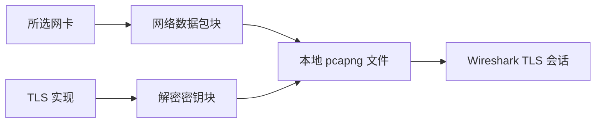

# pcapng 模式

选择 `--model pcapng`（别名 `-m pcap`）可将数据包与已取得的 TLS 密钥保存到同一份 Wireshark 文件中。必须通过 `--pcapfile`（`-w`）指定本地文件。网络包保留线上传输的密文，探针将密钥写入解密密钥块（DSB），Wireshark 根据这些块还原明文。

```bash
sudo ecapture tls --model pcapng --pcapfile openssl.pcapng
sudo ecapture gotls --elfpath ./go-client --model pcapng --pcapfile go.pcapng
sudo ecapture gnutls --model pcapng --pcapfile gnutls.pcapng
```

## 确认抓包网卡

省略 `-i` 时，eCapture 选择一张活动的以太网接口。先查找 IPv4 和 IPv6 默认路由，优先采用 metric 最低的可用路由。如果没有可用的默认路由，则依次参考收发字节计数之和及网卡的活动状态。启动日志会给出网卡及选择原因。回环流量指定 `-i lo`，其他接口可用 `--ifname NAME` 指定。`'tcp port 443'` 筛选经 TCP 传输的 HTTPS。采集 HTTP/3 时要包含 UDP。[网卡选择逻辑](https://github.com/gojue/ecapture/blob/v2.12.0/internal/config/capture_interface.go)

在握手前启动采集，新建测试请求，停止采集后打开文件。若能取得进程信息，eCapture 会记录 PID、进程名、最多 256 字节的进程参数及截断标记。抓包探针只对已知归属的数据包应用 PID、UID 和 cgroup 筛选；归属未知但符合网络过滤条件的包仍可能写入文件。可通过网卡、目标地址和端口进一步缩小范围。[数据包筛选逻辑](https://github.com/gojue/ecapture/blob/v2.12.0/kern/tc.h#L274-L309) · [Wireshark 进程字段](https://github.com/gojue/ecapture/blob/v2.12.0/utils/ecapture.lua)



## 本地文件与订阅端

以下命令将原生抓包保存到 `session.pcapng`，将运行日志保存到 `runtime.jsonl`。

```bash
sudo ecapture tls --model pcapng --pcapfile session.pcapng --output runtime.jsonl
```

还可追加 `--keylogfile session.keys` 独立保存 NSS 密钥。v2.12.0 在终端打印运行日志和带标记的字节数摘要。本地 JSON Lines 文件仅记录运行日志，TCP 和 WebSocket 则可以传送包含原生字节的 `PCAPNG` 事件。较晚连入的订阅者获得新的 pcapng 节及后续的数据包和密钥。为验证解密，请在测试握手前接入，再按 [Wireshark 解密工作流](3.6-wireshark-decryption-workflows.md)检查已知 HTTP 消息。[原生文件与订阅规范](https://github.com/gojue/ecapture/blob/v2.12.0/docs/event-forward-api.md)
