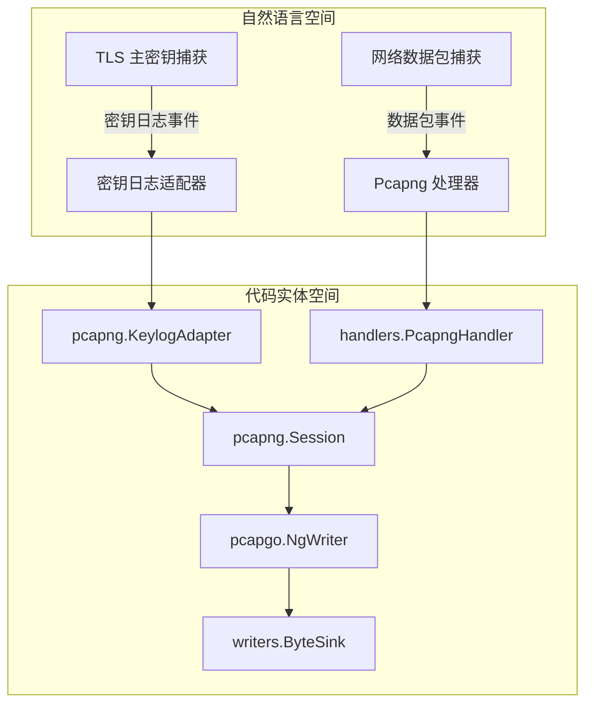
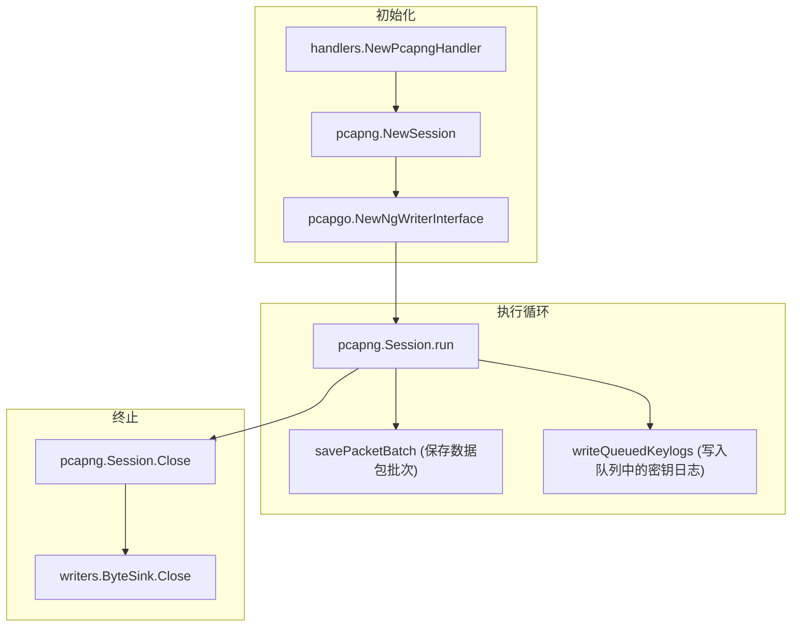

# pcapng 模式

<details>
<summary>相关源文件</summary>

以下文件被用作生成此维基页面的上下文：

- [internal/output/pcapng/destinations_test.go](https://github.com/gojue/ecapture/blob/8c9caada/internal/output/pcapng/destinations_test.go)
- [internal/output/pcapng/keylog_adapter.go](https://github.com/gojue/ecapture/blob/8c9caada/internal/output/pcapng/keylog_adapter.go)
- [internal/output/pcapng/session.go](https://github.com/gojue/ecapture/blob/8c9caada/internal/output/pcapng/session.go)
- [internal/output/pcapng/session_test.go](https://github.com/gojue/ecapture/blob/8c9caada/internal/output/pcapng/session_test.go)
- [internal/probe/base/handlers/pcapng_handler.go](https://github.com/gojue/ecapture/blob/8c9caada/internal/probe/base/handlers/pcapng_handler.go)
- [internal/probe/base/handlers/pcapng_handler_test.go](https://github.com/gojue/ecapture/blob/8c9caada/internal/probe/base/handlers/pcapng_handler_test.go)

</details>

## 目的与范围

本页面涵盖了 eCapture 的 `pcapng` 捕获模式（使用 `-m pcap` 或 `-m pcapng` 参数）的技术设计、配置和操作流程。该模式通过 eBPF 探针（如流量控制 (TC) 过滤器或套接字钩子）记录网络数据包，并同时从核心加密库（`tls`, `gotls`, `gnutls`）中捕获 TLS 主密钥（Master Secrets）。它将这两个数据流序列化为一个单一的 `pcapng` 制品，其中包含标准的数据包块（Packet Blocks）和嵌入的 TLS 解密密钥块（Decryption Secrets Blocks, DSB）。这种格式允许 Wireshark 等工具自动解密 HTTPS 和 TLS 流量，而无需额外的密钥日志（keylog）文件。

Sources: [internal/probe/base/handlers/pcapng_handler.go:88-101](https://github.com/gojue/ecapture/blob/8c9caada/internal/probe/base/handlers/pcapng_handler.go#L88-L101), [internal/output/pcapng/session.go:46-76](https://github.com/gojue/ecapture/blob/8c9caada/internal/output/pcapng/session.go#L46-L76)

---

## 核心 TLS 模块的验证命令

要使用 `pcapng` 格式执行捕获，请在选择目标模块（`tls`, `gotls` 或 `gnutls`）的同时指定 `-m pcap` 或 `-m pcapng`。

### OpenSSL 与 BoringSSL ([TLS 捕获 (OpenSSL/BoringSSL)](../2-core-tls-modules/2.1-tls-capture-openssl-and-boringssl.md))
```bash
ecapture tls -m pcapng --pcapfile capture.pcapng -i eth0
```

### Go 原生 TLS ([GoTLS 捕获](../2-core-tls-modules/2.2-gotls-capture.md))
```bash
ecapture gotls -m pcapng --pcapfile capture.pcapng --pid 12345
```

### GnuTLS ([GnuTLS 捕获](../2-core-tls-modules/2.3-gnutls-capture.md))
```bash
ecapture gnutls -m pcapng --pcapfile capture.pcapng -i eth0
```

Sources: [internal/probe/base/handlers/pcapng_handler.go:188-194](https://github.com/gojue/ecapture/blob/8c9caada/internal/probe/base/handlers/pcapng_handler.go#L188-L194), [internal/output/pcapng/session.go:78-166](https://github.com/gojue/ecapture/blob/8c9caada/internal/output/pcapng/session.go#L78-L166)

---

## 接口选择与输出规则

`pcapng` 会话通过调用 `net.Interfaces()` 检查系统网络接口来初始化，以构建接口描述块 (`NgInterface`) [internal/output/pcapng/session.go:84-133](https://github.com/gojue/ecapture/blob/8c9caada/internal/output/pcapng/session.go#L84-L133)。

- **接口选择 (`-i` / `--interface`)**: 用户指定的接口被设为主捕获接口 (`ifaceIdx`)。所有其他活动接口也会自动添加到 `pcapng` 文件头中，以便正确映射跨网桥或回环设备产生的数据包 [internal/output/pcapng/session.go:112-148](https://github.com/gojue/ecapture/blob/8c9caada/internal/output/pcapng/session.go#L112-L148)。
- **输出接收端 (Destination Sinks)**: 捕获的数据被写入 `ByteSink` 抽象层，该层支持多种输出目标，包括本地文件、TCP 流 (`tcp://host:port`)、WebSockets (`ws://host:port/`) 以及用于测试的内存缓冲区 [internal/output/pcapng/destinations_test.go:43-105](https://github.com/gojue/ecapture/blob/8c9caada/internal/output/pcapng/destinations_test.go#L43-L105)。

Sources: [internal/output/pcapng/session.go:78-148](https://github.com/gojue/ecapture/blob/8c9caada/internal/output/pcapng/session.go#L78-L148), [internal/output/pcapng/destinations_test.go:43-132](https://github.com/gojue/ecapture/blob/8c9caada/internal/output/pcapng/destinations_test.go#L43-L132)

---

## `--pcapfile` 兼容性与输出别名

在 `pcap` 或 `pcapng` 模式下运行时，`--pcapfile` 标志作为指定输出路径的向后兼容别名。在底层，CLI 解析此标志并初始化 `PcapngHandler`，该处理器包装了一个有状态的 `pcapng.Session` 并分配底层的 `ByteSink` [internal/probe/base/handlers/pcapng_handler.go:120-137](https://github.com/gojue/ecapture/blob/8c9caada/internal/probe/base/handlers/pcapng_handler.go#L120-L137)。

Sources: [internal/probe/base/handlers/pcapng_handler.go:120-137](https://github.com/gojue/ecapture/blob/8c9caada/internal/probe/base/handlers/pcapng_handler.go#L120-L137), [internal/output/pcapng/session.go:168-198](https://github.com/gojue/ecapture/blob/8c9caada/internal/output/pcapng/session.go#L168-L198)

---

## 数据包块与 TLS 解密密钥块 (DSB) 的实现

`Session` 结构体管理网络数据包 (`TcPacket`) 和 TLS 密钥日志条目的并发摄取 [internal/output/pcapng/session.go:47-76](https://github.com/gojue/ecapture/blob/8c9caada/internal/output/pcapng/session.go#L47-L76)。在高吞吐量突发期间，数据包通过非阻塞通知通道 (`queueReady`) 排队而不会丢失 [internal/output/pcapng/session.go:56-63](https://github.com/gojue/ecapture/blob/8c9caada/internal/output/pcapng/session.go#L56-L63)。密钥日志条目被转换为 TLS 解密密钥块 (`DSB_SECRETS_TYPE_TLS`) 并写入编码器流中 [internal/output/pcapng/session.go:220-234](https://github.com/gojue/ecapture/blob/8c9caada/internal/output/pcapng/session.go#L220-L234)。

### 架构流程：自然语言到代码实体



Sources: [internal/probe/base/handlers/pcapng_handler.go:139-169](https://github.com/gojue/ecapture/blob/8c9caada/internal/probe/base/handlers/pcapng_handler.go#L139-L169), [internal/output/pcapng/keylog_adapter.go:40-47](https://github.com/gojue/ecapture/blob/8c9caada/internal/output/pcapng/keylog_adapter.go#L40-L47), [internal/output/pcapng/session.go:168-230](https://github.com/gojue/ecapture/blob/8c9caada/internal/output/pcapng/session.go#L168-L230)

---

## Wireshark 检查与验证工作流

当生成的 `.pcapng` 文件加载到 Wireshark 中时：
1. Wireshark 解析分段首部块（Section Header Block）和接口描述块（Interface Description Blocks）。
2. 它会识别到嵌入的 **解密密钥块 (DSB)**，其中包含 NSS 密钥日志行（如 `CLIENT_TRAFFIC_SECRET_0` 等）。
3. 在解析后续的增强型数据包块 (`EPB`) 时，Wireshark 会自动使用嵌入的密钥来解密 TLS 1.3 和 TLS 1.2 的握手及应用数据记录。

### 会话生命周期与执行流程



Sources: [internal/probe/base/handlers/pcapng_handler.go:119-137](https://github.com/gojue/ecapture/blob/8c9caada/internal/probe/base/handlers/pcapng_handler.go#L119-L137), [internal/output/pcapng/session.go:78-166](https://github.com/gojue/ecapture/blob/8c9caada/internal/output/pcapng/session.go#L78-L166), [internal/output/pcapng/session_test.go:59-107](https://github.com/gojue/ecapture/blob/8c9caada/internal/output/pcapng/session_test.go#L59-L107)