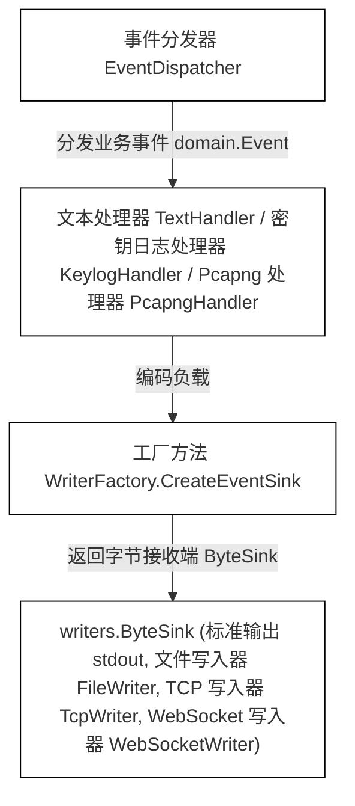
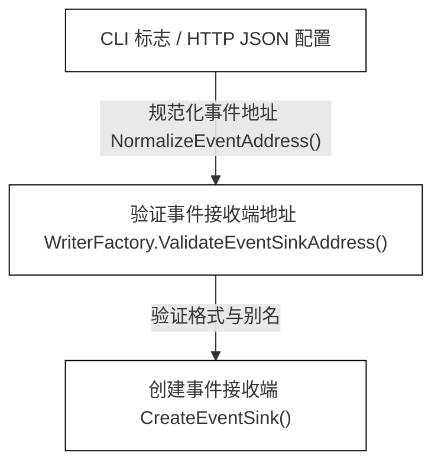

# 事件输出与滚动策略

<details>
<summary>相关源文件</summary>

以下文件被用作生成此维基页面的上下文：

- [docs/agent/output-pipeline-refactor-taskbook.md](https://github.com/gojue/ecapture/blob/8c9caada/docs/agent/output-pipeline-refactor-taskbook.md)
- [docs/agent/output-pipeline.md](https://github.com/gojue/ecapture/blob/8c9caada/docs/agent/output-pipeline.md)
- [internal/output/writers/factory.go](https://github.com/gojue/ecapture/blob/8c9caada/internal/output/writers/factory.go)
- [internal/output/writers/file_writer.go](https://github.com/gojue/ecapture/blob/8c9caada/internal/output/writers/file_writer.go)
- [internal/output/writers/pipeline_test.go](https://github.com/gojue/ecapture/blob/8c9caada/internal/output/writers/pipeline_test.go)
- [pkg/util/ws/client.go](https://github.com/gojue/ecapture/blob/8c9caada/pkg/util/ws/client.go)
- [pkg/util/ws/client_test.go](https://github.com/gojue/ecapture/blob/8c9caada/pkg/util/ws/client_test.go)
- [test/e2e/fixtures/ecaptureq_assert/main.go](https://github.com/gojue/ecapture/blob/8c9caada/test/e2e/fixtures/ecaptureq_assert/main.go)

</details>

本章节介绍了三大核心 TLS 模块（`tls`、`gotls` 和 `gnutls`）中捕获事件的输出目的地与滚动策略的架构、配置规则及运行时行为。内容详述了统一的 `--eventaddr` 标志、`writers.ByteSink` 抽象、支持的传输接收端（stdout、文件、TCP 和二进制 WebSocket）、特定模式的目的地要求、滚动限制、旧版标志别名，以及与操作日志（`--logaddr`）的严格隔离。

---

## 1. 统一的事件目的地标志 (`--eventaddr`)

在 `ecapture` 中，捕获的业务事件与操作诊断日志是解耦的。`--eventaddr` 标志（对应 agent 配置中的 `EventCollectorAddr`）作为 OpenSSL、GoTLS 和 GnuTLS 捕获模块中捕获事件的唯一主要目的地选择器 [docs/agent/output-pipeline.md:88-91](https://github.com/gojue/ecapture/blob/8c9caada/docs/agent/output-pipeline.md#L88-L91)。

CLI 的呈现模式（`-m text`、`-m keylog`、`-m pcap` 或 `-m pcapng`）控制数据编码格式，而 `--eventaddr` 则指定这些编码后的字节被传输到何处 [docs/agent/output-pipeline.md:90-91](https://github.com/gojue/ecapture/blob/8c9caada/docs/agent/output-pipeline.md#L90-L91)。


*图 1：事件目的地架构与代码实体映射*

Sources: [docs/agent/output-pipeline.md:14-18](https://github.com/gojue/ecapture/blob/8c9caada/docs/agent/output-pipeline.md#L14-L18), [docs/agent/output-pipeline.md:88-91](https://github.com/gojue/ecapture/blob/8c9caada/docs/agent/output-pipeline.md#L88-L91), [internal/output/writers/factory.go:77-80](https://github.com/gojue/ecapture/blob/8c9caada/internal/output/writers/factory.go#L77-L80)

---

## 2. 支持的接收端 (`ByteSink` 接收端)

所有原始事件目的地都实现了 `writers.ByteSink` 接口 [docs/agent/output-pipeline.md:33-43](https://github.com/gojue/ecapture/blob/8c9caada/docs/agent/output-pipeline.md#L33-L43)。该接口抽象了底层传输，使得 text、keylog 和 pcapng 处理器可以统一地写入数据，而无需关心目的地是控制台、磁盘文件、网络套接字还是 WebSocket 流 [docs/agent/output-pipeline.md:67-73](https://github.com/gojue/ecapture/blob/8c9caada/docs/agent/output-pipeline.md#L67-L73)。

```go
type ByteSink interface {
    io.Writer
    Name() string
    Flush() error
    Close() error
}
```
*Source: [docs/agent/output-pipeline.md:36-41](https://github.com/gojue/ecapture/blob/8c9caada/docs/agent/output-pipeline.md#L36-L41)*

`WriterFactory` 根据提供给 `--eventaddr` 的 URI 方案或目的地名称构建四种不同的传输类型：

1. **标准输出 (Stdout，使用 `stdout` 或文本模式下为空)**：使用 `NewStdoutWriter()` 直接写入标准输出 [internal/output/writers/factory.go:163-164](https://github.com/gojue/ecapture/blob/8c9caada/internal/output/writers/factory.go#L163-L164)。
2. **文件 (File，使用 `file://...` 或普通文件系统路径)**：使用 `NewFileWriter()` 写入本地磁盘，具有可配置的缓冲、截断和权限设置（敏感密钥/pcapng 使用 `0600` 权限） [internal/output/writers/factory.go:165-168](https://github.com/gojue/ecapture/blob/8c9caada/internal/output/writers/factory.go#L165-L168), [internal/output/writers/factory.go:129-137](https://github.com/gojue/ecapture/blob/8c9caada/internal/output/writers/factory.go#L129-L137)。
3. **TCP (`tcp://host:port`)**：使用 `NewTcpWriter()` 在 TCP 上建立有序的原始字节流 [internal/output/writers/factory.go:169-170](https://github.com/gojue/ecapture/blob/8c9caada/internal/output/writers/factory.go#L169-L170)。
4. **WebSocket (`ws://...` 或 `wss://...`)**：使用 `NewWebSocketWriter()` 传输二进制 WebSocket 帧 [internal/output/writers/factory.go:171-172](https://github.com/gojue/ecapture/blob/8c9caada/internal/output/writers/factory.go#L171-L172), [pkg/util/ws/client.go:23-36](https://github.com/gojue/ecapture/blob/8c9caada/pkg/util/ws/client.go#L23-L36)。接收端通过按到达顺序拼接帧负载来重建有序的产物 [docs/agent/output-pipeline.md:44-48](https://github.com/gojue/ecapture/blob/8c9caada/docs/agent/output-pipeline.md#L44-L48)。

Sources: [docs/agent/output-pipeline.md:33-48](https://github.com/gojue/ecapture/blob/8c9caada/docs/agent/output-pipeline.md#L33-L48), [internal/output/writers/factory.go:120-176](https://github.com/gojue/ecapture/blob/8c9caada/internal/output/writers/factory.go#L120-L176)

---

## 3. 模式特定的目的地与滚动规则

目的地要求和滚动能力根据捕获模式的不同而有严格区别：

| 模式 | 默认目的地 | 是否需要显式指定目的地？ | 是否支持滚动？ | 敏感权限 / 截断 |
| :--- | :--- | :--- | :--- | :--- |
| **text** | `stdout` (当 `--eventaddr` 为空时) | 否 | 是 (仅限文件后端) | 标准权限，根据配置追加/截断 |
| **keylog** | 无 | **是** | 是 (仅限文件后端) | `0600` 权限，启动时截断 [docs/agent/output-pipeline.md:81-82](https://github.com/gojue/ecapture/blob/8c9caada/docs/agent/output-pipeline.md#L81-L82) |
| **pcapng** | 无 | **是** | **否** (验证时将被拒绝) [internal/output/writers/factory.go:105-107](https://github.com/gojue/ecapture/blob/8c9caada/internal/output/writers/factory.go#L105-L107) | `0600` 权限，启动时截断 [docs/agent/output-pipeline.md:81-82](https://github.com/gojue/ecapture/blob/8c9caada/docs/agent/output-pipeline.md#L81-L82) |

### 验证与滚动限制
* **网络与 Pcapng 接收端**：滚动功能（`--max-size`、`--max-interval`）仅限于基于文件的 text 或 keylog 流 [docs/agent/output-pipeline.md:79-83](https://github.com/gojue/ecapture/blob/8c9caada/docs/agent/output-pipeline.md#L79-L83)。在 pcapng 流或网络接收端（`tcp://`、`ws://`）上配置滚动会在 `WriterFactory.ValidateEventSinkAddress()` 期间验证失败 [internal/output/writers/factory.go:105-116](https://github.com/gojue/ecapture/blob/8c9caada/internal/output/writers/factory.go#L105-L116)。
* **流完整性**：网络接收端遵循严格的错误策略。连接失败将终止流；不支持在活动的 pcapng 产物传输期间进行中间重连 [docs/agent/output-pipeline.md:47-48](https://github.com/gojue/ecapture/blob/8c9caada/docs/agent/output-pipeline.md#L47-L48)。

Sources: [docs/agent/output-pipeline.md:79-87](https://github.com/gojue/ecapture/blob/8c9caada/docs/agent/output-pipeline.md#L79-L87), [internal/output/writers/factory.go:92-116](https://github.com/gojue/ecapture/blob/8c9caada/internal/output/writers/factory.go#L92-L116)

---

## 4. 旧版输出别名与规范化

为了保持与旧版命令行界面的向后兼容性，`ecapture` 提供了直接映射到统一事件目的地系统的别名标志 [docs/agent/output-pipeline.md:94-98](https://github.com/gojue/ecapture/blob/8c9caada/docs/agent/output-pipeline.md#L94-L98)。


*图 2：规范化与验证工作流*

### 别名规则
* `--keylogfile`：在密钥日志模式 (`-m keylog`) 下运行阶段作为旧版主要文件别名 [docs/agent/output-pipeline.md:94-95](https://github.com/gojue/ecapture/blob/8c9caada/docs/agent/output-pipeline.md#L94-L95)。在 `pcapng` 模式下运行时，`--keylogfile` 作为一个单独的、可选的次要密钥日志产物，而 `--eventaddr` (或 `--pcapfile`) 则指向主要 pcapng 流 [docs/agent/output-pipeline.md:98](https://github.com/gojue/ecapture/blob/8c9caada/docs/agent/output-pipeline.md#L98)。
* `--pcapfile`：在 pcapng 模式 (`-m pcap` 或 `-m pcapng`) 下运行阶段作为旧版主要文件别名 [docs/agent/output-pipeline.md:96-97](https://github.com/gojue/ecapture/blob/8c9caada/docs/agent/output-pipeline.md#L96-L97)。
* **冲突检测**：如果显式地将 `--eventaddr` 及其对应的旧版主要标志（密钥日志模式下的 `--keylogfile` 或 pcapng 模式下的 `--pcapfile`）设置为不同的值，将返回验证错误 [docs/agent/output-pipeline.md:99-100](https://github.com/gojue/ecapture/blob/8c9caada/docs/agent/output-pipeline.md#L99-L100), [internal/output/writers/factory.go:60-65](https://github.com/gojue/ecapture/blob/8c9caada/internal/output/writers/factory.go#L60-L65)。重复调用 `NormalizeEventAddress()` 具有幂等性 [docs/agent/output-pipeline.md:103](https://github.com/gojue/ecapture/blob/8c9caada/docs/agent/output-pipeline.md#L103), [internal/output/writers/factory.go:48-66](https://github.com/gojue/ecapture/blob/8c9caada/internal/output/writers/factory.go#L48-L66)。

Sources: [docs/agent/output-pipeline.md:88-104](https://github.com/gojue/ecapture/blob/8c9caada/docs/agent/output-pipeline.md#L88-L104), [internal/output/writers/factory.go:48-66](https://github.com/gojue/ecapture/blob/8c9caada/internal/output/writers/factory.go#L48-L66)

---

## 5. 与操作日志 (`--logaddr`) 的隔离

`ecapture` 的核心架构不变性之一是操作诊断与捕获的负载数据之间的绝对隔离 [docs/agent/output-pipeline.md:27-29](https://github.com/gojue/ecapture/blob/8c9caada/docs/agent/output-pipeline.md#L27-L29)。

* **语义通道**：
  - 操作日志 (`OperationalLogRecord`) 携带状态更新、启动警告和调试指标 [docs/agent/output-pipeline.md:10-13](https://github.com/gojue/ecapture/blob/8c9caada/docs/agent/output-pipeline.md#L10-L13)。它们默认输出到 `stderr`，并可选地分发到 `--logaddr` 或 eCaptureQ 的 `PROCESS_LOG` [docs/agent/output-pipeline.md:10-13](https://github.com/gojue/ecapture/blob/8c9caada/docs/agent/output-pipeline.md#L10-L13)。
  - 捕获的事件 (`domain.Event`) 携带明文负载、TLS 会话密钥或网络数据包块 [docs/agent/output-pipeline.md:14-18](https://github.com/gojue/ecapture/blob/8c9caada/docs/agent/output-pipeline.md#L14-L18)。它们专门通过事件处理器路由到 `--eventaddr` [docs/agent/output-pipeline.md:14-18](https://github.com/gojue/ecapture/blob/8c9caada/docs/agent/output-pipeline.md#L14-L18)。
* **安全与隐私**：捕获的明文负载和 TLS 加密密钥**绝不能**进入 `--logaddr` 或 eCaptureQ 的 `PROCESS_LOG` [docs/agent/output-pipeline.md:27-29](https://github.com/gojue/ecapture/blob/8c9caada/docs/agent/output-pipeline.md#L27-L29)。
* **通道碰撞预防**：写入 `stdout` 的二进制 pcapng 流不能与操作日志共享 stdout。通过 `ValidateChannelSeparation()` 进行起飞前验证，如果同时配置操作日志和二进制 pcapng 输出使用 `stdout`，该配置将被拒绝 [docs/agent/output-pipeline.md:84-87](https://github.com/gojue/ecapture/blob/8c9caada/docs/agent/output-pipeline.md#L84-L87), [internal/output/writers/factory.go:70-75](https://github.com/gojue/ecapture/blob/8c9caada/internal/output/writers/factory.go#L70-L75)。

Sources: [docs/agent/output-pipeline.md:7-30](https://github.com/gojue/ecapture/blob/8c9caada/docs/agent/output-pipeline.md#L7-L30), [docs/agent/output-pipeline.md:84-87](https://github.com/gojue/ecapture/blob/8c9caada/docs/agent/output-pipeline.md#L84-L87), [internal/output/writers/factory.go:68-75](https://github.com/gojue/ecapture/blob/8c9caada/internal/output/writers/factory.go#L68-L75)