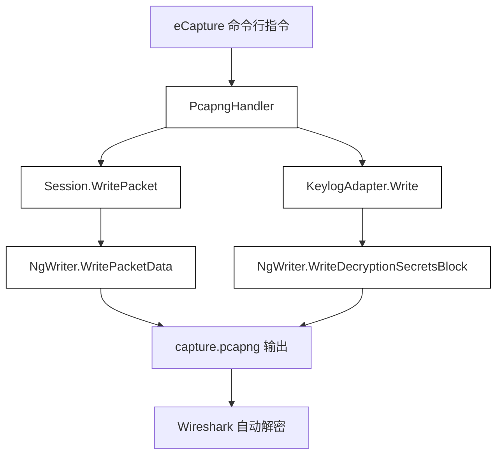
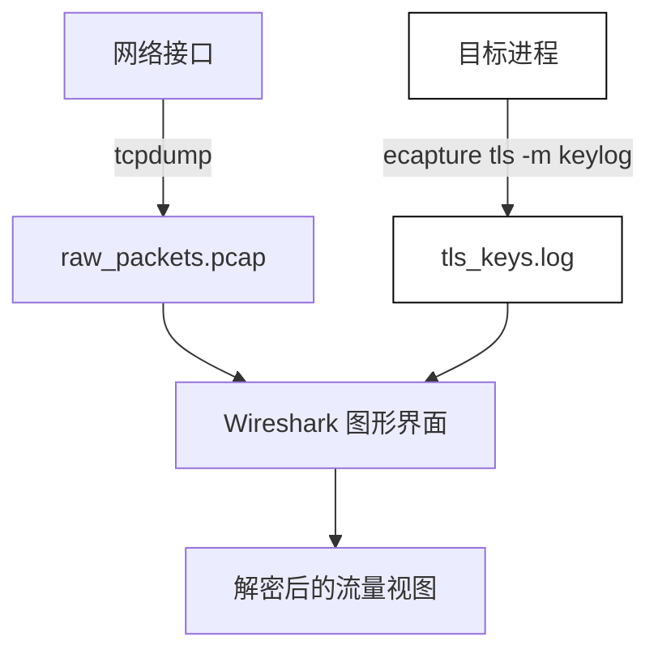
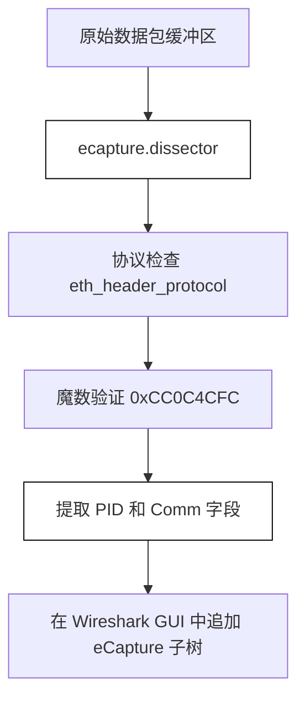

# Wireshark 解密工作流

<details>
<summary>相关源文件</summary>

以下文件被用作生成此维基页面的上下文：

- [CONTRIBUTING.md](https://github.com/gojue/ecapture/blob/8c9caada/CONTRIBUTING.md)
- [images/ecapture-pid.png](https://github.com/gojue/ecapture/blob/8c9caada/images/ecapture-pid.png)
- [images/ecapture-wireshark-lua-plugin.png](https://github.com/gojue/ecapture/blob/8c9caada/images/ecapture-wireshark-lua-plugin.png)
- [internal/output/pcapng/destinations_test.go](https://github.com/gojue/ecapture/blob/8c9caada/internal/output/pcapng/destinations_test.go)
- [internal/output/pcapng/keylog_adapter.go](https://github.com/gojue/ecapture/blob/8c9caada/internal/output/pcapng/keylog_adapter.go)
- [internal/output/pcapng/session.go](https://github.com/gojue/ecapture/blob/8c9caada/internal/output/pcapng/session.go)
- [internal/output/pcapng/session_test.go](https://github.com/gojue/ecapture/blob/8c9caada/internal/output/pcapng/session_test.go)
- [internal/probe/base/handlers/pcapng_handler.go](https://github.com/gojue/ecapture/blob/8c9caada/internal/probe/base/handlers/pcapng_handler.go)
- [utils/ecapture.lua](https://github.com/gojue/ecapture/blob/8c9caada/utils/ecapture.lua)

</details>

本页面详细介绍了如何通过 eCapture 使用 Wireshark 检查捕获的 TLS 流量。它对比了 eCapture 支持的两种主要的 Wireshark 兼容分析工作流：打开一个包含嵌入式解密密钥块 (Decryption Secrets Blocks, DSBs) 的自包含 `pcapng` 捕获文件，以及将标准网络数据包捕获（`pcap`/`pcapng`）与独立的密钥日志文件相结合。同时，本页还强调了在何种情况下直接在终端使用文本模式是更简单的诊断选择。

---

## 1. 嵌入式密钥工作流 (`pcapng` 模式)

当 eCapture 运行在 `pcapng` 模式（`-m pcapng`）时，它通过流量控制 (TC) 探针或套接字过滤器捕获原始网络数据包，并通过 uprobes 捕获运行时的 TLS 主密钥（master secrets）。它将这些事件交织成一个单一的、同步的流 [internal/output/pcapng/session.go:46-76](https://github.com/gojue/ecapture/blob/8c9caada/internal/output/pcapng/session.go#L46-L76)。

底层的会话编码器会在按时间顺序排列的数据包块之前或同时，使用 Wireshark 标准的解密密钥块 (DSB) 格式将 TLS 密钥写入流中 [internal/output/pcapng/session.go:220-234](https://github.com/gojue/ecapture/blob/8c9caada/internal/output/pcapng/session.go#L220-L234)。

### 可验证步骤

1. **以 `pcapng` 模式启动 eCapture**:
   ```bash
   ecapture tls -m pcapng --libssl /lib/x86_64-linux-gnu/libssl.so.3 -w capture.pcapng
   ```
2. **生成目标 TLS 流量**（例如，使用 `curl` 或测试客户端访问 HTTPS 端点）。
3. **停止 eCapture** (Ctrl+C) 以刷新缓冲区并完成 `pcapng` 文件的写入 [internal/probe/base/handlers/pcapng_handler.go:171-189](https://github.com/gojue/ecapture/blob/8c9caada/internal/probe/base/handlers/pcapng_handler.go#L171-L189)。
4. **在 Wireshark 中打开捕获文件**:
   ```bash
   wireshark capture.pcapng
   ```
5. **验证解密**: Wireshark 会自动读取嵌入的 DSB 数据包，提取会话密钥，并填充 *Transport Layer Security* 协议树以显示解密后的应用数据，无需配置外部密钥日志。


*图 1：从 eCapture 处理器到 Wireshark 的嵌入式密钥数据流。*

Sources: [internal/output/pcapng/session.go:46-234](https://github.com/gojue/ecapture/blob/8c9caada/internal/output/pcapng/session.go#L46-L234), [internal/probe/base/handlers/pcapng_handler.go:88-189](https://github.com/gojue/ecapture/blob/8c9caada/internal/probe/base/handlers/pcapng_handler.go#L88-L189), [internal/output/pcapng/keylog_adapter.go:20-47](https://github.com/gojue/ecapture/blob/8c9caada/internal/output/pcapng/keylog_adapter.go#L20-L47)

---

## 2. 独立捕获与密钥日志工作流

或者，您可以独立记录网络数据包和 TLS 主密钥。当已经部署了网络监控基础设施（如 `tcpdump` 或专用硬件分路器），或者您希望将密钥导入现有的数据包追踪记录时，这种方式非常有用。

### 可验证步骤

1. **使用 `tcpdump` 捕获数据包**:
   ```bash
   tcpdump -i any -w raw_packets.pcap port 443
   ```
2. **使用 eCapture 在密钥日志模式下捕获 TLS 密钥**:
   ```bash
   ecapture tls -m keylog --keylogfile tls_keys.log
   ```
3. **配置 Wireshark**:
   - 打开 Wireshark 并加载 `raw_packets.pcap`。
   - 导航至 **编辑 > 首选项 > 协议 > TLS** (Edit > Preferences > Protocols > TLS)。
   - 在 **(Pre)-Master-Secret log filename** 字段中，浏览并选择 `tls_keys.log`。
   - 点击 **确定** (OK) 以解密追踪记录。


*图 2：独立捕获与密钥日志集成流水线。*

Sources: [internal/output/pcapng/destinations_test.go:43-132](https://github.com/gojue/ecapture/blob/8c9caada/internal/output/pcapng/destinations_test.go#L43-L132)

---

## 3. 何时文本模式更简单

虽然 Wireshark 提供了深度包检测和协议分析，但在进行快速调试、容器故障排查或自动化日志摄取时，`text` 模式 (`-m text`) 通常是首选。

* **无需后期处理**: 明文 HTTP 请求、SQL 查询或自定义载荷会直接打印到 `stdout` 或通过 `--eventaddr` 转发，无需打开 GUI 或配置解密密钥 [internal/probe/base/handlers/pcapng_handler.go:1-55](https://github.com/gojue/ecapture/blob/8c9caada/internal/probe/base/handlers/pcapng_handler.go#L1-L55)。
* **即时反馈**: 有助于验证 uprobes 是否成功挂载到目标函数，而无需设置网络捕获接口。
* **低开销**: 避免捕获无关的 TCP 后台噪声、帧头部或有状态的数据包队列。

Sources: [internal/probe/base/handlers/pcapng_handler.go:32-55](https://github.com/gojue/ecapture/blob/8c9caada/internal/probe/base/handlers/pcapng_handler.go#L32-L55)

---

## 4. Wireshark Lua 解析器集成

eCapture 包含一个自定义的 Wireshark Lua 后置解析器插件 (`ecapture.lua`)，它可以将进程元数据（如 PID 和命令名称）注入到捕获的数据包尾部 [utils/ecapture.lua:1-65](https://github.com/gojue/ecapture/blob/8c9caada/utils/ecapture.lua#L1-L65)。

### 插件特性
* **魔数验证**: 通过魔数常量 `0xCC0C4CFC` 识别经由 eCapture 增强的帧 [utils/ecapture.lua:11-51](https://github.com/gojue/ecapture/blob/8c9caada/utils/ecapture.lua#L11-L51)。
* **进程信息丰富化**: 扩展数据包详情树，显示来源进程 ID 和命令名称 (`Comm`) [utils/ecapture.lua:16-58](https://github.com/gojue/ecapture/blob/8c9caada/utils/ecapture.lua#L16-L58)。

为 Wireshark 安装该插件：
1. 将 `utils/ecapture.lua` 复制到您的个人 Wireshark 插件目录（例如，Linux 上的 `~/.local/lib/wireshark/plugins/`）。
2. 重启 Wireshark 或按 `Ctrl+Shift+R` 重新加载 Lua 插件。


*图 3：Wireshark 中 Lua 解析器的执行流程。*

Sources: [utils/ecapture.lua:9-65](https://github.com/gojue/ecapture/blob/8c9caada/utils/ecapture.lua#L9-L65)