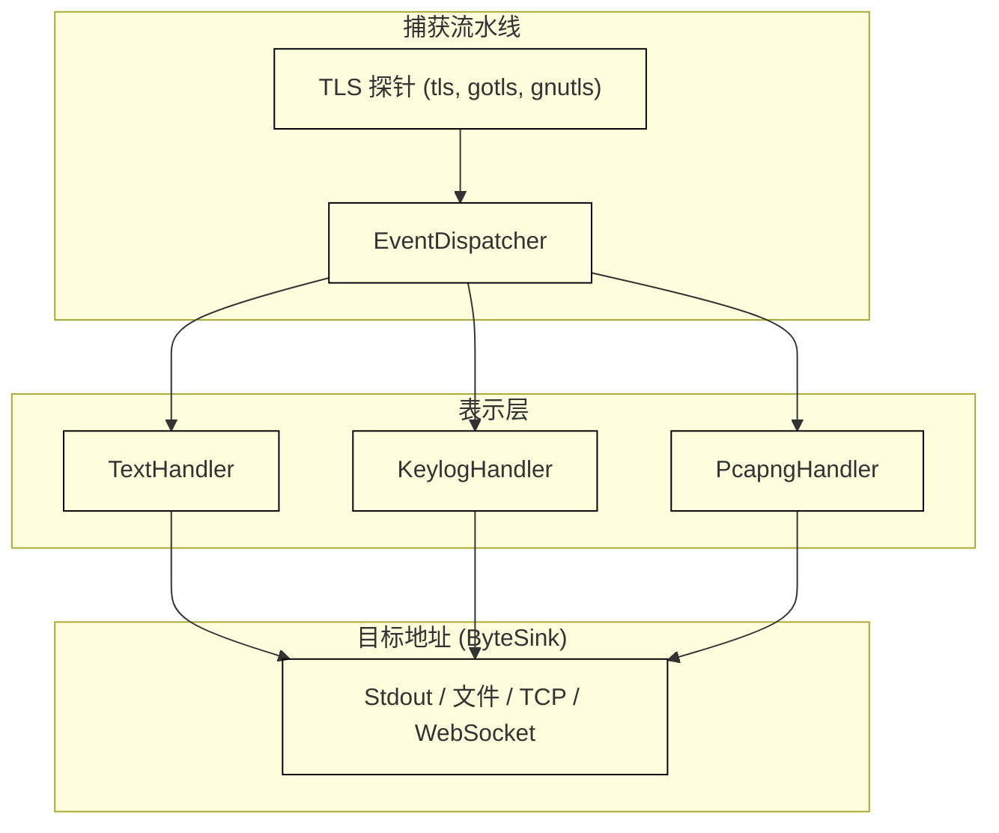
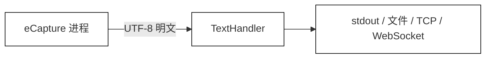
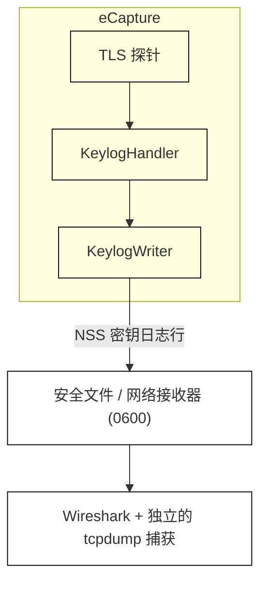
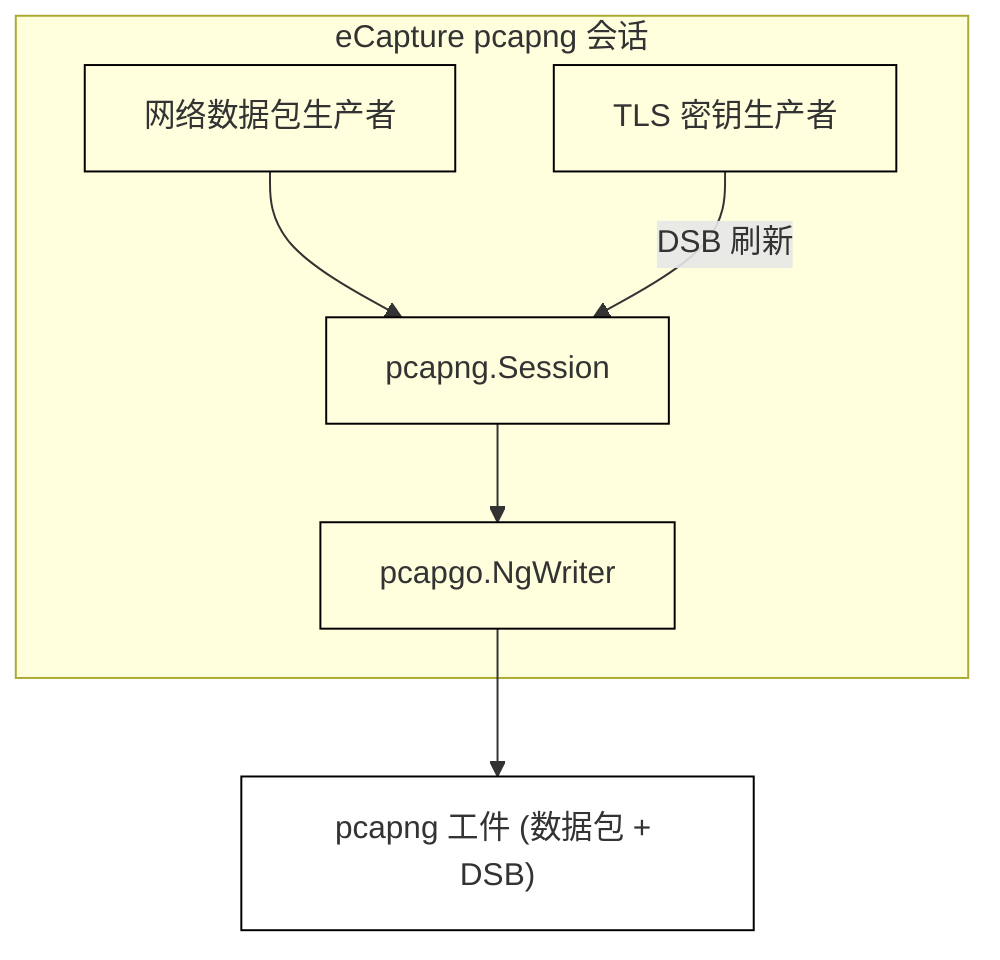

# 捕获模式

相关源文件

以下文件被用作生成此维基页面的上下文：

- [cli/cmd/output_flags.go](https://github.com/gojue/ecapture/blob/8c9caada/cli/cmd/output_flags.go)
- [cli/cmd/output_pipeline_test.go](https://github.com/gojue/ecapture/blob/8c9caada/cli/cmd/output_pipeline_test.go)
- [docs/agent/output-pipeline-refactor-taskbook.md](https://github.com/gojue/ecapture/blob/8c9caada/docs/agent/output-pipeline-refactor-taskbook.md)
- [docs/agent/output-pipeline.md](https://github.com/gojue/ecapture/blob/8c9caada/docs/agent/output-pipeline.md)
- [internal/output/writers/factory.go](https://github.com/gojue/ecapture/blob/8c9caada/internal/output/writers/factory.go)
- [internal/output/writers/pipeline_test.go](https://github.com/gojue/ecapture/blob/8c9caada/internal/output/writers/pipeline_test.go)
- [internal/probe/base/handlers/text_handler.go](https://github.com/gojue/ecapture/blob/8c9caada/internal/probe/base/handlers/text_handler.go)
- [internal/probe/base/handlers/text_handler_test.go](https://github.com/gojue/ecapture/blob/8c9caada/internal/probe/base/handlers/text_handler_test.go)
- [test/e2e/fixtures/ecaptureq_assert/main.go](https://github.com/gojue/ecapture/blob/8c9caada/test/e2e/fixtures/ecaptureq_assert/main.go)

本页面作为 eCapture 核心 TLS 模块（`tls`、`gotls` 和 `gnutls`）支持的三种核心捕获模式——`text`、`keylog` 和 `pcapng` 的高级用户指南 [docs/agent/output-pipeline.md:1-103](https://github.com/gojue/ecapture/blob/8c9caada/docs/agent/output-pipeline.md#L1-L103)。eCapture 将表示策略（数据以何种格式存储）与传输路由（输出发送到何处）解耦，利用原始字节接收器（`ByteSink`），如标准输出、文件、TCP 流或二进制 WebSocket [docs/agent/output-pipeline.md:20-48](https://github.com/gojue/ecapture/blob/8c9caada/docs/agent/output-pipeline.md#L20-L48)。

有关各模式的深入技术细节、目标地址管理或报文格式工作流，请参阅以下子页面：
- [模式选择：Text、Keylog 或 pcapng](3.1-choosing-text-keylog-or-pcapng.md)
- [文本模式 (Text)](3.2-text-mode.md)
- [密钥日志模式 (Keylog)](3.3-keylog-mode.md)
- [pcapng 模式](3.4-pcapng-mode.md)
- [事件输出与滚动策略](3.5-event-destinations-and-rotation.md)
- [Wireshark 解密工作流](3.6-wireshark-decryption-workflows.md)

---

## 捕获模式概述

eCapture 通过显式的处理器表示法来处理捕获的 TLS 流量，允许操作员选择所需的精确工件格式进行检查 [docs/agent/output-pipeline.md:14-18](https://github.com/gojue/ecapture/blob/8c9caada/docs/agent/output-pipeline.md#L14-L18)。

*图 1：事件分发与表示路由架构 [docs/agent/output-pipeline.md:14-18](https://github.com/gojue/ecapture/blob/8c9caada/docs/agent/output-pipeline.md#L14-L18) [internal/output/writers/factory.go:77-176](https://github.com/gojue/ecapture/blob/8c9caada/internal/output/writers/factory.go#L77-L176)*

Sources: [docs/agent/output-pipeline.md:7-25](https://github.com/gojue/ecapture/blob/8c9caada/docs/agent/output-pipeline.md#L7-L25), [internal/output/writers/factory.go:77-176](https://github.com/gojue/ecapture/blob/8c9caada/internal/output/writers/factory.go#L77-L176)

---

## 3.1 模式选择：Text、Keylog 或 pcapng

选择正确的模式取决于您是否需要即时的明文分析、使用 Wireshark 进行实时数据包检查，或者是加密密钥日志记录 [docs/agent/output-pipeline.md:66-73](https://github.com/gojue/ecapture/blob/8c9caada/docs/agent/output-pipeline.md#L66-L73)。

| 模式 | 表示形式 | 主要目标地址要求 | 典型用例 |
| :--- | :--- | :--- | :--- |
| **`text`** | UTF-8 明文（已解密的读/写负载） | 默认为 `stdout`；支持文件和网络 [docs/agent/output-pipeline.md:93-94](https://github.com/gojue/ecapture/blob/8c9caada/docs/agent/output-pipeline.md#L93-L94) | 即时终端检查、轻量级调试、脚本解析 [docs/agent/output-pipeline.md:70](https://github.com/gojue/ecapture/blob/8c9caada/docs/agent/output-pipeline.md#L70) |
| **`keylog`** | NSS 密钥日志行 (`CLIENT_RANDOM ...`) | 需要显式目标地址 (`--eventaddr` 或 `--keylogfile`) [docs/agent/output-pipeline.md:94-95](https://github.com/gojue/ecapture/blob/8c9caada/docs/agent/output-pipeline.md#L94-L95) | 在 Wireshark 中解密独立的数据包捕获 (`tcpdump`) [docs/agent/output-pipeline.md:71](https://github.com/gojue/ecapture/blob/8c9caada/docs/agent/output-pipeline.md#L71) |
| **`pcapng`** | 数据包块 + 内嵌 TLS 解密密钥块 (DSB) | 需要显式目标地址 (`--eventaddr` 或 `--pcapfile`) [docs/agent/output-pipeline.md:96-97](https://github.com/gojue/ecapture/blob/8c9caada/docs/agent/output-pipeline.md#L96-L97) | 单文件数据包分析，其中数据包和解密密钥捆绑在一起 [docs/agent/output-pipeline.md:72](https://github.com/gojue/ecapture/blob/8c9caada/docs/agent/output-pipeline.md#L72) |

有关详细的权衡和决策标准，请参阅 [模式选择：Text、Keylog 或 pcapng](3.1-choosing-text-keylog-or-pcapng.md)。

Sources: [docs/agent/output-pipeline.md:66-73](https://github.com/gojue/ecapture/blob/8c9caada/docs/agent/output-pipeline.md#L66-L73), [internal/output/writers/factory.go:90-116](https://github.com/gojue/ecapture/blob/8c9caada/internal/output/writers/factory.go#L90-L116)

---

## 3.2 文本模式 (Text)

文本模式直接从函数进入/退出钩子中捕获解密的应用程序层数据（如 HTTP/1.x、HTTP/2 或自定义 TLS 协议）[internal/probe/base/handlers/text_handler.go:26-41](https://github.com/gojue/ecapture/blob/8c9caada/internal/probe/base/handlers/text_handler.go#L26-L41)。默认情况下，文本事件流向标准输出 (`stdout`) [docs/agent/output-pipeline.md:93](https://github.com/gojue/ecapture/blob/8c9caada/docs/agent/output-pipeline.md#L93)，但可以通过 `--eventaddr` 进行重定向 [docs/agent/output-pipeline.md:88-91](https://github.com/gojue/ecapture/blob/8c9caada/docs/agent/output-pipeline.md#L88-L91)。

*图 2：文本模式数据流 [internal/probe/base/handlers/text_handler.go:26-111](https://github.com/gojue/ecapture/blob/8c9caada/internal/probe/base/handlers/text_handler.go#L26-L111) [docs/agent/output-pipeline.md:70](https://github.com/gojue/ecapture/blob/8c9caada/docs/agent/output-pipeline.md#L70)*

有关语法、针对 `tls`、`gotls` 和 `gnutls` 的经验证命令以及验证流程，请参阅 [文本模式 (Text)](3.2-text-mode.md)。

Sources: [docs/agent/output-pipeline.md:68-70](https://github.com/gojue/ecapture/blob/8c9caada/docs/agent/output-pipeline.md#L68-L70), [internal/probe/base/handlers/text_handler.go:26-111](https://github.com/gojue/ecapture/blob/8c9caada/internal/probe/base/handlers/text_handler.go#L26-L111)

---

## 3.3 密钥日志模式 (Keylog)

密钥日志模式以 NSS 密钥日志格式提取协商的 TLS 会话主密钥 [docs/agent/output-pipeline.md:71](https://github.com/gojue/ecapture/blob/8c9caada/docs/agent/output-pipeline.md#L71)。它需要一个显式的目标地址——通过 `--eventaddr` 或旧版别名 `--keylogfile` 提供 [docs/agent/output-pipeline.md:94-95](https://github.com/gojue/ecapture/blob/8c9caada/docs/agent/output-pipeline.md#L94-L95)。

*图 3：密钥日志模式与独立数据包解密工作流 [docs/agent/output-pipeline.md:71-82](https://github.com/gojue/ecapture/blob/8c9caada/docs/agent/output-pipeline.md#L71-L82)*

有关权限处理、密钥日志规范和 Wireshark 指令，请参阅 [密钥日志模式 (Keylog)](3.3-keylog-mode.md)。

Sources: [docs/agent/output-pipeline.md:71](https://github.com/gojue/ecapture/blob/8c9caada/docs/agent/output-pipeline.md#L71), [docs/agent/output-pipeline.md:79-82](https://github.com/gojue/ecapture/blob/8c9caada/docs/agent/output-pipeline.md#L79-L82), [internal/output/writers/pipeline_test.go:77-104](https://github.com/gojue/ecapture/blob/8c9caada/internal/output/writers/pipeline_test.go#L77-L104)

---

## 3.4 pcapng 模式

pcapng 模式在捕获网络数据包的同时嵌入 **TLS 解密密钥块 (DSB)** [docs/agent/output-pipeline.md:72](https://github.com/gojue/ecapture/blob/8c9caada/docs/agent/output-pipeline.md#L72)。这会生成一个自包含的捕获工件，Wireshark 可以自动解密 TLS 流，而无需单独的密钥日志文件 [docs/agent/output-pipeline.md:72](https://github.com/gojue/ecapture/blob/8c9caada/docs/agent/output-pipeline.md#L72)。

*图 4：pcapng 会话架构与解密密钥块集成 [docs/agent/output-pipeline.md:72](https://github.com/gojue/ecapture/blob/8c9caada/docs/agent/output-pipeline.md#L72)*

有关网卡选择规则、文件截断策略和验证命令，请参阅 [pcapng 模式](3.4-pcapng-mode.md)。

Sources: [docs/agent/output-pipeline.md:72](https://github.com/gojue/ecapture/blob/8c9caada/docs/agent/output-pipeline.md#L72), [docs/agent/output-pipeline-refactor-taskbook.md:82-93](https://github.com/gojue/ecapture/blob/8c9caada/docs/agent/output-pipeline-refactor-taskbook.md#L82-L93)

---

## 3.5 事件输出与滚动策略

eCapture 严格区分捕获事件的目标地址 (`--eventaddr`) 与运行日志的目标地址 (`--logaddr`) [docs/agent/output-pipeline.md:27-30](https://github.com/gojue/ecapture/blob/8c9caada/docs/agent/output-pipeline.md#L27-L30)。捕获的负载和加密密钥绝不会写入运行日志或错误通道 [docs/agent/output-pipeline.md:27-30](https://github.com/gojue/ecapture/blob/8c9caada/docs/agent/output-pipeline.md#L27-L30)。

- **支持的接收器**: `stdout`、本地文件（`file://` 或普通路径）、有序 TCP 连接 (`tcp://host:port`) 以及二进制 WebSocket 流 (`ws://`, `wss://`) [docs/agent/output-pipeline.md:44-48](https://github.com/gojue/ecapture/blob/8c9caada/docs/agent/output-pipeline.md#L44-L48), [internal/output/writers/factory.go:120-176](https://github.com/gojue/ecapture/blob/8c9caada/internal/output/writers/factory.go#L120-L176)。
- **滚动限制**: 基于文件的文本和密钥日志流支持滚动（`--rotatesize`, `--rotateinterval`），而网络接收器和 `pcapng` 流不支持字节流滚动策略 [docs/agent/output-pipeline.md:79-81](https://github.com/gojue/ecapture/blob/8c9caada/docs/agent/output-pipeline.md#L79-L81), [internal/output/writers/pipeline_test.go:148-149](https://github.com/gojue/ecapture/blob/8c9caada/internal/output/writers/pipeline_test.go#L148-L149)。

有关完整语法选项、旧版标志别名（`--keylogfile`, `--pcapfile`）和通道分离检查，请参阅 [事件输出与滚动策略](3.5-event-destinations-and-rotation.md)。

Sources: [docs/agent/output-pipeline.md:27-104](https://github.com/gojue/ecapture/blob/8c9caada/docs/agent/output-pipeline.md#L27-L104), [internal/output/writers/factory.go:90-176](https://github.com/gojue/ecapture/blob/8c9caada/internal/output/writers/factory.go#L90-L176)

---

## 3.6 Wireshark 解密工作流

通过 Wireshark 分析加密流量可以根据所选的捕获模式通过两种不同的方法实现：

1. **自包含 pcapng 工作流**: 直接在 Wireshark 中打开由 eCapture 生成的 `.pcapng` 文件。由于文件包含内嵌的解密密钥块 (DSB)，Wireshark 会自动解密 TLS 流量，无需额外配置。
2. **密钥日志与数据包捕获工作流**: 在运行 eCapture 的 `keylog` 模式以导出 NSS 密钥日志文件的同时，通过 `tcpdump` 等标准工具收集数据包。在 Wireshark 中，通过 **首选项 (Preferences) > 协议 (Protocols) > TLS > (Pre)-Master-Secret log filename** 将生成的数据包捕获文件与密钥日志文件结合使用。

有关分步验证程序和故障排查指南，请参阅 [Wireshark 解密工作流](3.6-wireshark-decryption-workflows.md)。

Sources: [docs/agent/output-pipeline.md:70-72](https://github.com/gojue/ecapture/blob/8c9caada/docs/agent/output-pipeline.md#L70-L72), [docs/agent/output-pipeline-refactor-taskbook.md:82-93](https://github.com/gojue/ecapture/blob/8c9caada/docs/agent/output-pipeline-refactor-taskbook.md#L82-L93)