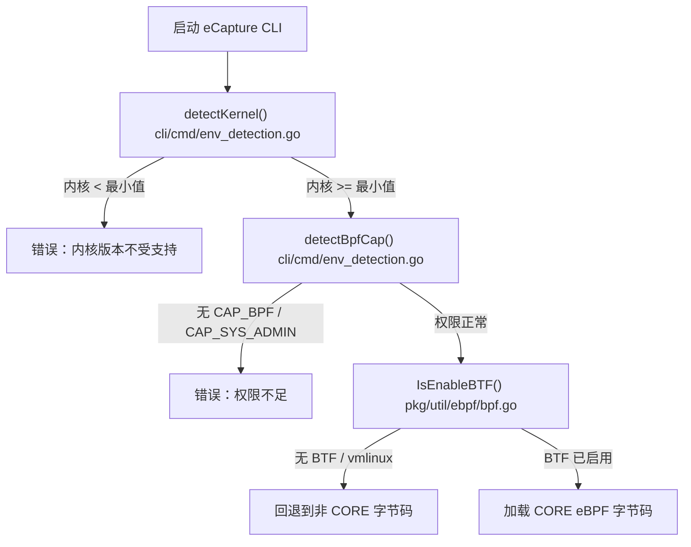
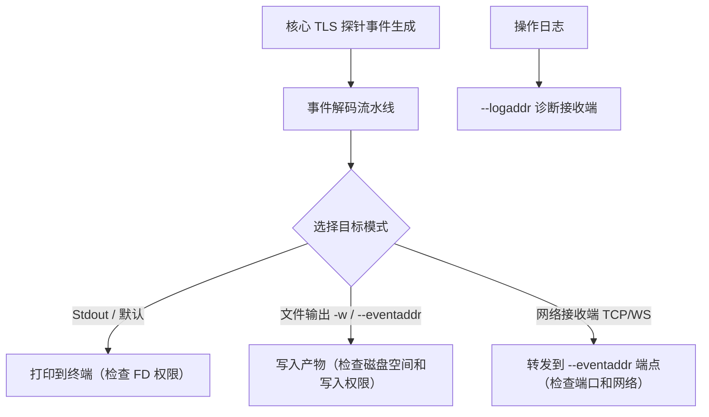

# TLS 故障排查

相关源文件

以下文件被用作生成此维基页面的上下文：

- [.github/ISSUE_TEMPLATE/bug_report.md](https://github.com/gojue/ecapture/blob/8c9caada/.github/ISSUE_TEMPLATE/bug_report.md)
- [SECURITY.md](https://github.com/gojue/ecapture/blob/8c9caada/SECURITY.md)
- [cli/cmd/env_detection.go](https://github.com/gojue/ecapture/blob/8c9caada/cli/cmd/env_detection.go)
- [cli/cmd/upgrade.go](https://github.com/gojue/ecapture/blob/8c9caada/cli/cmd/upgrade.go)
- [docs/README.md](https://github.com/gojue/ecapture/blob/8c9caada/docs/README.md)
- [docs/defense-detection.md](https://github.com/gojue/ecapture/blob/8c9caada/docs/defense-detection.md)
- [docs/example-outputs.md](https://github.com/gojue/ecapture/blob/8c9caada/docs/example-outputs.md)
- [docs/minimum-privileges.md](https://github.com/gojue/ecapture/blob/8c9caada/docs/minimum-privileges.md)
- [docs/release-verification.md](https://github.com/gojue/ecapture/blob/8c9caada/docs/release-verification.md)
- [pkg/util/ebpf/bpf.go](https://github.com/gojue/ecapture/blob/8c9caada/pkg/util/ebpf/bpf.go)
- [pkg/util/ebpf/bpf_linux.go](https://github.com/gojue/ecapture/blob/8c9caada/pkg/util/ebpf/bpf_linux.go)
- [pkg/util/ebpf/bpf_test.go](https://github.com/gojue/ecapture/blob/8c9caada/pkg/util/ebpf/bpf_test.go)

## 目的与范围

本维基页面为在所有三种操作模式（`text`、`keylog` 和 `pcapng`）下使用 eCapture 核心 TLS 模块（OpenSSL/BoringSSL 的 `tls`、Go 原生 TLS 的 `gotls` 和 GnuTLS 的 `gnutls`）时遇到的问题提供全面的诊断清单。它涵盖了常见的故障领域，包括内核要求、BPF/BTF 支持、权限级别、库/二进制文件不匹配、符号解析、接口配置和事件目标错误。

---

## 1. 内核版本、BTF 与权限错误

eCapture 严重依赖现代 eBPF 特性、uprobes 和内核 BTF (BPF Type Format) 元数据。该领域的启动失败通常在环境检测期间显现 [cli/cmd/env_detection.go:74-86](https://github.com/gojue/ecapture/blob/8c9caada/cli/cmd/env_detection.go#L74-L86)。

### 常见症状与诊断
* **内核版本不匹配**: 
  * *错误消息*: `the Linux/Android kernel version ... is not supported; require ... or newer` [cli/cmd/env_detection.go:36-38](https://github.com/gojue/ecapture/blob/8c9caada/cli/cmd/env_detection.go#L36-L38)。
  * *原因*: 宿主机内核版本低于架构最低要求（x86_64 要求 Linux 4.18+，aarch64 要求 Linux 5.5+，LoongArch64 要求 Linux 6.6+）[cli/cmd/env_detection.go:43-54](https://github.com/gojue/ecapture/blob/8c9caada/cli/cmd/env_detection.go#L43-L54)。
  * *解决方案*: 升级宿主机内核或在受支持的平台上运行。
* **缺失 BPF 权限**:
  * *错误消息*: `the current user does not have CAP_BPF to load bpf programs. Please run as root or use sudo or add the --privileged=true flag for Docker` [cli/cmd/env_detection.go:67-69](https://github.com/gojue/ecapture/blob/8c9caada/cli/cmd/env_detection.go#L67-L69)。
  * *原因*: 进程缺少 `CAP_BPF`、`CAP_PERFMON` 或 `CAP_SYS_ADMIN` 能力 [cli/cmd/env_detection.go:64-66](https://github.com/gojue/ecapture/blob/8c9caada/cli/cmd/env_detection.go#L64-L66)。
  * *解决方案*: 使用 `sudo` 运行，使用 `setcap` 分配能力（`cap_bpf,cap_perfmon,cap_sys_ptrace=eip`），或在 Docker 中传递适当的能力标志 [docs/minimum-privileges.md:45-58](https://github.com/gojue/ecapture/blob/8c9caada/docs/minimum-privileges.md#L45-L58) [docs/minimum-privileges.md:79-90](https://github.com/gojue/ecapture/blob/8c9caada/docs/minimum-privileges.md#L79-L90)。
* **BTF / 内核配置错误**:
  * *原因*: `/sys/kernel/btf/vmlinux` 和备用 ELF vmlinux 文件都无法访问，且 `CONFIG_DEBUG_INFO_BTF` 已禁用 [pkg/util/ebpf/bpf.go:89-98](https://github.com/gojue/ecapture/blob/8c9caada/pkg/util/ebpf/bpf.go#L89-L98) [pkg/util/ebpf/bpf.go:118-143](https://github.com/gojue/ecapture/blob/8c9caada/pkg/util/ebpf/bpf.go#L118-L143)。
  * *解决方案*: 确保您的内核在编译时启用了 BTF 支持（`CONFIG_DEBUG_INFO_BTF=y`）或安装提供 `vmlinux` 的内核调试包。

Sources: [cli/cmd/env_detection.go:26-86](https://github.com/gojue/ecapture/blob/8c9caada/cli/cmd/env_detection.go#L26-L86), [pkg/util/ebpf/bpf.go:89-143](https://github.com/gojue/ecapture/blob/8c9caada/pkg/util/ebpf/bpf.go#L89-L143), [docs/minimum-privileges.md:120-135](https://github.com/gojue/ecapture/blob/8c9caada/docs/minimum-privileges.md#L120-L135)

---

## 2. 库、二进制文件与符号解析不匹配

当 eCapture 无法将 uprobes 附加到目标二进制文件或共享库时，将无法捕获事件。

### 常见症状与诊断
* **缺失共享库**:
  * *原因*: 无法自动定位目标 OpenSSL (`libssl.so`) 或 GnuTLS 库路径，或者通过 `--libssl` 提供的自定义路径不存在。
  * *解决方案*: 使用 `--libssl` 指定共享库的绝对路径，或确保应用程序与受支持的库版本动态链接。
* **Go 二进制文件中的符号被剥离 (`gotls`)**:
  * *原因*: 目标 Go 二进制文件在编译时剥离了符号表（`-ldflags="-s"`），导致 eCapture 无法定位内部 Go TLS 函数和加密原语偏移量。
  * *解决方案*: 重新编译或检查未剥离符号的 Go 二进制文件，或使用 Go 模块内省标志来匹配函数偏移量。
* **版本不匹配**:
  * *原因*: 为 OpenSSL 1.1.x 编译的字节码资产被加载到 OpenSSL 3.x 运行时环境中（或反之亦然）。
  * *解决方案*: 确保 eCapture 自动匹配或显式选择与目标库主/次版本对应的正确字节码文件（例如 `openssl_3_0_0_kern_core.o`）[docs/example-outputs.md:38](https://github.com/gojue/ecapture/blob/8c9caada/docs/example-outputs.md#L38)。

---

## 3. 空事件与缺失密钥

如果 eCapture 成功启动但未产生明文事件或解密密钥：

### 排查清单
1. **流量生成**: 确保有活跃的 HTTPS/TLS 流量流经目标进程。空闲的应用程序不会产生 uprobe 命中。
2. **进程定位 (`--pid`)**: 如果将捕获范围限制在特定的进程 ID，请验证该 PID 是否正确，以及该进程是否正在积极发起新的 TLS 握手（在 eCapture 启动前已建立的连接在重新协商或重启之前不会被解密）。
3. **密码套件支持**: 
  * 在 `pcapng` 或 `keylog` 模式下，确保所使用的密码套件受 eCapture 的密钥提取逻辑支持（例如非 TLS 1.3 或特定的 TLS 1.3 密钥排期钩子）。无法通过软件 uprobes 拦截不受支持的自定义加密库或硬件卸载的加密引擎。

---

## 4. 不完整的 Pcapng 与接口 / 流量控制错误

在 `pcapng` 模式（`-m pcap` 或 `-m pcapng`）下运行时，网络数据包捕获依赖于流量控制 (TC) 附加或网络接口数据包嗅探。

### 常见症状与诊断
* **缺失 `CAP_NET_ADMIN`**:
  * *原因*: Pcapng 模式需要在指定的网络接口 (`-i`) 上设置 TC 过滤器，这需要 `CAP_NET_ADMIN` [docs/minimum-privileges.md:13-16](https://github.com/gojue/ecapture/blob/8c9caada/docs/minimum-privileges.md#L13-L16) [docs/minimum-privileges.md:32-33](https://github.com/gojue/ecapture/blob/8c9caada/docs/minimum-privileges.md#L32-L33)。
  * *解决方案*: 使用 `sudo` 运行或添加 `cap_net_admin` 能力 [docs/minimum-privileges.md:54](https://github.com/gojue/ecapture/blob/8c9caada/docs/minimum-privileges.md#L54)。
* **无效的接口名称**:
  * *错误消息*: 找不到接口或无法附加 TC 分类器。
  * *解决方案*: 使用 `ip link` 验证可用的网络接口，并将正确的接口标识符传递给 `-i`。
* **Wireshark 中缺失密钥块**:
  * *原因*: 数据包已从网络接口捕获，但由于 `libssl` 中的符号不匹配导致 TLS 握手密钥提取失败，从而导致 pcapng 文件包含原始加密数据包，而没有 TLS 解密密钥块 (DSB)。
  * *解决方案*: 确认控制台日志报告密钥日志记录器初始化成功（例如 `master key keylogger has been set`）[docs/example-outputs.md:30](https://github.com/gojue/ecapture/blob/8c9caada/docs/example-outputs.md#L30) 且 `CLIENT_RANDOM save success` [docs/example-outputs.md:133](https://github.com/gojue/ecapture/blob/8c9caada/docs/example-outputs.md#L133)。

---

## 5. 目标与接收端 (Sinks) 错误

操作日志和捕获的事件通过不同的配置参数进行路由。

### 目标规则与故障排查
* **`--eventaddr` 对比 `--logaddr`**:
  * `--eventaddr` 将捕获的有效载荷事件（明文、密钥日志或 pcapng 字节流）传输到 stdout、文件、TCP 或 WebSocket 接收端。
  * `--logaddr` 仅传输操作诊断日志。不要混淆这两个端点。
* **文件权限和磁盘空间错误**:
  * *原因*: 由于权限不足或磁盘耗尽，写入捕获产物（`-w output.pcapng` 或基于文件的 `--eventaddr`）失败。
  * *解决方案*: 验证目标目录的写入权限并监控可用磁盘空间，特别是在高吞吐量的 pcapng 捕获会话期间。

Sources: [docs/example-outputs.md:23-25](https://github.com/gojue/ecapture/blob/8c9caada/docs/example-outputs.md#L23-L25), [docs/README.md:27-30](https://github.com/gojue/ecapture/blob/8c9caada/docs/README.md#L27-L30)

---
Sources: [cli/cmd/env_detection.go:26-86](https://github.com/gojue/ecapture/blob/8c9caada/cli/cmd/env_detection.go#L26-L86), [pkg/util/ebpf/bpf.go:89-143](https://github.com/gojue/ecapture/blob/8c9caada/pkg/util/ebpf/bpf.go#L89-L143), [docs/minimum-privileges.md:13-58](https://github.com/gojue/ecapture/blob/8c9caada/docs/minimum-privileges.md#L13-L58), [docs/example-outputs.md:23-38](https://github.com/gojue/ecapture/blob/8c9caada/docs/example-outputs.md#L23-L38)