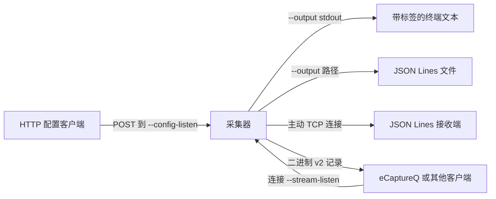

# 集成与部署

## 将接收程序迁移到 v2.12

同一采集器可以同时写入多个目标，每个目标各传一次 `--output`。需要保留终端显示时，把 `stdout` 也列为目标。捕获数据和运行日志共用 v2 的 `LogEntry`。在 JSON Lines 中，两者的 `log_type` 值分别为 `LOG_TYPE_EVENT` 和 `LOG_TYPE_PROCESS_LOG`。

| v2.12 之前 | 现行配置 |
| --- | --- |
| `--logaddr` / `-l` 和 `--eventaddr` | 每个终端、文件或主动 TCP 连接各指定一次 `--output`。文件和 TCP 每行传输一条 ProtoJSON 记录。 |
| `--ecaptureq` 或主动 WebSocket 推送 | 使用 `--stream-listen ws://127.0.0.1:28256/`，让客户端连接采集器订阅。v1 接收端需升级至 v2 协议。需要采集器主动连接时可选 TCP。 |
| `--listen` | 用 `--config-listen HOST:PORT` 开启 HTTP 配置服务。 |
| `--eventroratesize` / `--eventroratetime` | 从启动配置中删除这两个轮转参数。v2.12 没有对应的 CLI 参数。 |

下例将解码文本同时写到终端和 JSON Lines 文件，并启动订阅端点。订阅和配置服务都默认关闭。两者没有内置 TLS 或应用层认证，部署时应绑定回环地址或受访问控制的网络。

```sh
sudo ecapture tls --model text --text-source pcapng \
  --output stdout --output capture.jsonl \
  --stream-listen ws://127.0.0.1:28256/ --config-listen 127.0.0.1:28257
```

示例中的 HTTP 配置服务使用了 eCaptureQ Web 界面的默认地址。若两者部署在同一台机器，仅需通过 Q 订阅时可省略 `--config-listen`；需要在线修改采集设置时，请为配置服务另选空闲端口，例如 `127.0.0.1:28258`。[eCaptureQ 连接设置](/q/zh/data-sources/)



TCP 接收程序监听采集器的连接，按换行组装完整记录再解码。WebSocket 客户端连接采集器，协商 `ecapture.v2` 子协议，每条二进制消息解码成一条 `LogEntry`。新订阅依次收到心跳、`collector_info` 快照、近期运行日志和实时事件。可从快照辨认主机、构建版本、模块、模式和输出目标。服务端不会回放历史事件。[协议参考](https://github.com/gojue/ecapture/blob/v2.12.0/protobuf/PROTOCOLS-zh_Hans.md) · [Go 接收端示例](https://github.com/gojue/ecapture/blob/v2.12.0/examples/ecaptureq_client/README.md)

## 原生文件和重连

keylog 模式必须用 `--keylogfile` 指定本地文件，pcapng 模式必须用 `--pcapfile` 指定本地文件。原生文件路径须与 JSON 输出文件分开，这两种模式下 JSON 文件仅含运行日志。TCP 和 WebSocket 接收端均可重建原生文件。按格式解码事件，将 `keylog.data` 或 `pcapng.data` 字节依次追加到对应文件。一条消息可能只含某行或某个 pcapng 块的一部分。

重载会排空并关闭上一轮捕获的网络连接。采集器会重新连接 TCP，WebSocket 客户端需主动重新订阅。接收端每次连接都应新建文件。中途订阅 pcapng 只会收到新段头、接口描述以及后续的包和密钥。WebSocket 端在成功排空、正常关闭（1000）并验证本地格式、刷盘后才可完成文件。TCP EOF 本身没有成功状态，需要其他完成信号才能确认，否则应保留为部分文件。[输出与订阅接口](https://github.com/gojue/ecapture/blob/v2.12.0/docs/event-forward-api-zh_Hans.md)

## 运行时调整捕获配置

向当前探针的端点发送包含 JSON 的 `POST`。OpenSSL/BoringSSL 使用 `/tls`、`/openssl` 或 `/boringssl`，Go TLS 使用 `/gotls`，Linux GnuTLS 使用 `/gnutls`。请求体会替换当前捕获配置，请重新提供需要保留的过滤条件、目标路径和模式。若要用上面启动的 OpenSSL 采集器观察本机回环流量，请向其配置监听器的 `POST /tls` 接口发送以下请求体。

```json
{"capturemode":"text","text_source":"pcapng","ifname":"lo"}
```

若采集器启动时选用的是 `gotls`，则向 `POST /gotls` 发送以下请求体，并换成实际可执行文件路径。GoTLS 的可执行文件路径和捕获模式使用该模块专用的 JSON 字段名。

```json
{"elf_path":"/opt/demo/go-client","capture_mode":"text","text_source":"pcapng","ifname":"lo"}
```

更改输出目标或监听地址需要重启 eCapture。核心模块的配置接口会拒绝新旧输出路由字段，即使显式传入 `null`。首次启动进程时，`--pcapfile` 和 `--keylogfile` 会清空同名原生文件。HTTP 重载或回滚时，如果复用原生文件路径，则会追加内容。`--output` 指定的 JSON Lines 文件在进程重新启动时也会追加。要将捕获结果分开保存，请选择新路径。[文件打开模式](https://github.com/gojue/ecapture/blob/v2.12.0/internal/output/writers/factory.go)

| HTTP 响应 | 含义 |
| --- | --- |
| 200，code 0 | 替换后的探针已经启动。 |
| 400，code 4 | 请求体无法解码、包含禁用的路由字段，或当前平台缺少对应配置工厂。 |
| 400，code 5 | 校验或探针切换失败。校验失败会保留当前探针，切换过程启动失败则应检查日志确认回滚结果。 |
| 503，code 6 | 更新队列已满，稍后退避重试。 |

[HTTP 配置接口和各模块字段](https://github.com/gojue/ecapture/blob/v2.12.0/docs/remote-config-update-api-zh_Hans.md)

## 衡量部署开销

Linux OpenSSL 基准会比较同一本地负载在启用和关闭采集时的表现。文本模式在回环设备采集 TC 包和 TLS 密钥，从 v2 JSON Lines 提取 `TEXT`，分别统计唯一请求和响应标记。评估时应分别观察标记缺失、内核丢失样本和延迟。用户态微基准 `go test -run '^$' -bench '^BenchmarkTLSDataEvent' -benchmem ./internal/probe/openssl` 只测量解码和格式化开销。结果目录可能含有明文、TLS 密钥及进程参数，应限制访问权限。[基准方法和选项](https://github.com/gojue/ecapture/blob/v2.12.0/docs/performance-benchmarks.md)
