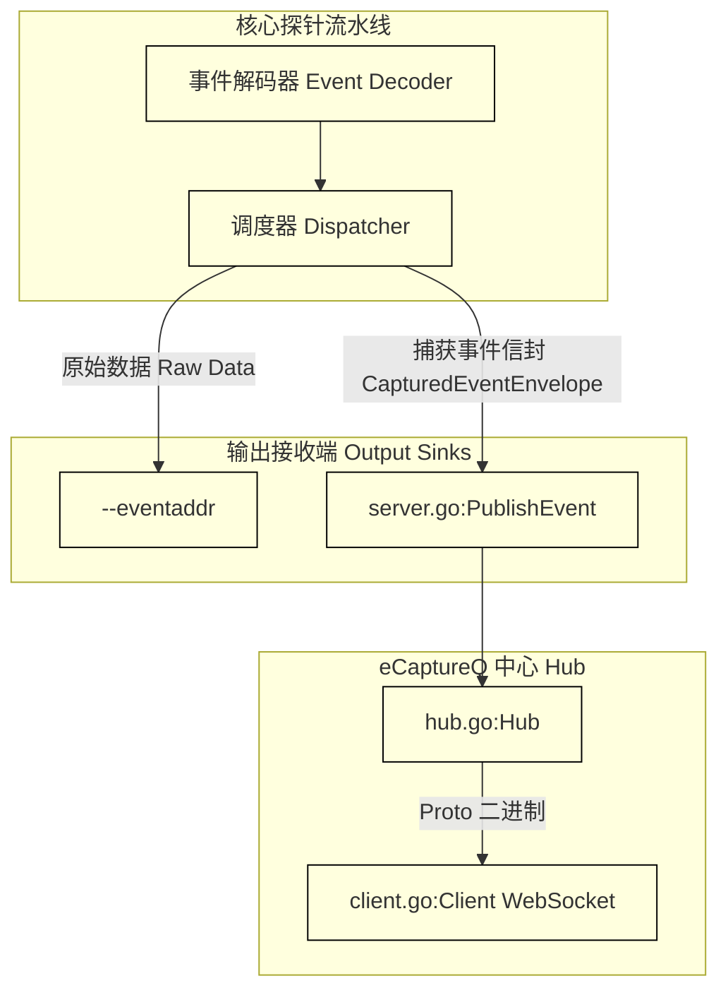
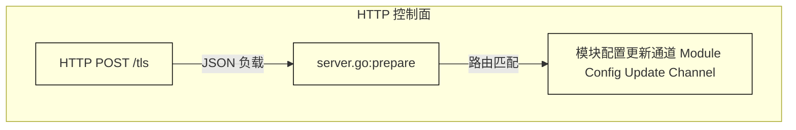

# 集成与部署

<details>
<summary>相关源文件</summary>

以下文件被用作生成此维基页面的上下文：

- [cli/http/logger.go](https://github.com/gojue/ecapture/blob/8c9caada/cli/http/logger.go)
- [cli/http/resp.go](https://github.com/gojue/ecapture/blob/8c9caada/cli/http/resp.go)
- [docs/event-forward-api.md](https://github.com/gojue/ecapture/blob/8c9caada/docs/event-forward-api.md)
- [docs/performance-benchmarks.md](https://github.com/gojue/ecapture/blob/8c9caada/docs/performance-benchmarks.md)
- [docs/remote-config-update-api-zh_Hans.md](https://github.com/gojue/ecapture/blob/8c9caada/docs/remote-config-update-api-zh_Hans.md)
- [docs/remote-config-update-api.md](https://github.com/gojue/ecapture/blob/8c9caada/docs/remote-config-update-api.md)
- [internal/probe/openssl/event_benchmark_test.go](https://github.com/gojue/ecapture/blob/8c9caada/internal/probe/openssl/event_benchmark_test.go)
- [pkg/ecaptureq/client.go](https://github.com/gojue/ecapture/blob/8c9caada/pkg/ecaptureq/client.go)
- [pkg/ecaptureq/hub.go](https://github.com/gojue/ecapture/blob/8c9caada/pkg/ecaptureq/hub.go)
- [pkg/ecaptureq/server.go](https://github.com/gojue/ecapture/blob/8c9caada/pkg/ecaptureq/server.go)
- [protobuf/gen/v1/ecaptureq.pb.go](https://github.com/gojue/ecapture/blob/8c9caada/protobuf/gen/v1/ecaptureq.pb.go)
- [protobuf/proto/v1/ecaptureq.proto](https://github.com/gojue/ecapture/blob/8c9caada/protobuf/proto/v1/ecaptureq.proto)
- [test/benchmark/tls/fixtures/c/openssl_client.c](https://github.com/gojue/ecapture/blob/8c9caada/test/benchmark/tls/fixtures/c/openssl_client.c)
- [test/benchmark/tls/fixtures/server/main.go](https://github.com/gojue/ecapture/blob/8c9caada/test/benchmark/tls/fixtures/server/main.go)
- [test/benchmark/tls/run_benchmark.sh](https://github.com/gojue/ecapture/blob/8c9caada/test/benchmark/tls/run_benchmark.sh)

</details>

## 目的与范围
本文档为部署和集成 eCapture 的核心 TLS 捕获模块（`tls`、`gotls` 和 `gnutls`）提供生产环境指导。内容详述了使用 `--eventaddr` 进行事件转发的机制、附加的 `eCaptureQ` 流式传输、通过 HTTP 实现的运行时动态配置、敏感产物管理，以及使用内置基准测试工具进行的性能评估策略。

Sources: [docs/event-forward-api.md:1-20](https://github.com/gojue/ecapture/blob/8c9caada/docs/event-forward-api.md#L1-L20), [docs/performance-benchmarks.md:1-12](https://github.com/gojue/ecapture/blob/8c9caada/docs/performance-benchmarks.md#L1-L12)

---

## 1. 事件转发：`--eventaddr` 与 `eCaptureQ`

eCapture 将操作日志（`--logaddr`）、原始捕获事件流（`--eventaddr`）以及结构化实时发布（`--ecaptureq`）进行了分离。

### 使用 `--eventaddr` 进行原始事件转发
`--eventaddr` 参数指定了由[捕获模式](../3-capture-modes/index.md)（text、NSS Key Log 或 pcapng）选定的主要捕获事件表现形式的去向。
- **支持的目标**：标准输出、本地文件路径、TCP 套接字（`tcp://host:port`）或 WebSocket 连接（`ws://host:port/path`）。
- **行为**：TCP 目标接收有序的原始字节流。WebSocket 接收端接收有序的二进制帧，下游接收者可将其拼接成单个完整产物。

Sources: [docs/event-forward-api.md:34-45](https://github.com/gojue/ecapture/blob/8c9caada/docs/event-forward-api.md#L34-L45)

### 通过 `eCaptureQ` 进行附加结构化流传输
`--ecaptureq` 参数会启动一个 WebSocket 服务器，将结构化运行时日志和捕获的业务事件作为 Protobuf 编码的 `LogEntry` 消息进行流式传输 [docs/event-forward-api.md:46-60](https://github.com/gojue/ecapture/blob/8c9caada/docs/event-forward-api.md#L46-L60)。

`eCaptureQ` 与 `--eventaddr` 并行工作：`--eventaddr` 写入原始格式（如 pcapng 或 text），而 `eCaptureQ` 通过 `pkg/ecaptureq/server.go` 发布类型化的领域事件 [docs/event-forward-api.md:61-71](https://github.com/gojue/ecapture/blob/8c9caada/docs/event-forward-api.md#L61-L71)。


*图 1：从事件解码到 `eCaptureQ` 发布中心（`pkg/ecaptureq/server.go` 和 `pkg/ecaptureq/hub.go`）的事件转发数据流。*

Sources: [docs/event-forward-api.md:1-71](https://github.com/gojue/ecapture/blob/8c9caada/docs/event-forward-api.md#L1-L71), [pkg/ecaptureq/server.go:144-184](https://github.com/gojue/ecapture/blob/8c9caada/pkg/ecaptureq/server.go#L144-L184), [pkg/ecaptureq/hub.go:40-64](https://github.com/gojue/ecapture/blob/8c9caada/pkg/ecaptureq/hub.go#L40-L64)

---

## 2. 通过 HTTP 进行运行时动态配置

eCapture 支持通过暴露 HTTP 控制服务器来更新运行时配置参数，而无需重启进程 [docs/remote-config-update-api.md:1-21](https://github.com/gojue/ecapture/blob/8c9caada/docs/remote-config-update-api.md#L1-L21)。

### 启用与端点
- **启用方式**：传递 `--listen` 参数（例如 `--listen 127.0.0.1:28256`）[docs/remote-config-update-api.md:6-7](https://github.com/gojue/ecapture/blob/8c9caada/docs/remote-config-update-api.md#L6-L7)。
- **端点**：所有配置路由均为 HTTP `POST` 请求，接收与内部配置结构体匹配的 JSON 负载 [docs/remote-config-update-api.md:9-28](https://github.com/gojue/ecapture/blob/8c9caada/docs/remote-config-update-api.md#L9-L28)。
  - `/tls`、`/openssl`、`/boringssl` — OpenSSL / BoringSSL 捕获模块
  - `/gotls` — Go 原生 TLS 捕获模块
  - `/gnutls` — GnuTLS 捕获模块


*图 2：HTTP 控制请求路由至模块配置通道。*

### 响应状态码
响应返回 `cli/http/resp.go` 中定义的统一 JSON 状态结构 [docs/remote-config-update-api.md:100-119](https://github.com/gojue/ecapture/blob/8c9caada/docs/remote-config-update-api.md#L100-L119)：

| 状态码常量 | 数值 | 描述 |
| --- | ---: | --- |
| `RespOK` | `0` | 配置成功接收并应用 |
| `RespErrorInvaildRequest` | `1` | HTTP 请求格式无效 |
| `RespErrorInternalServer` | `2` | 内部服务器错误 |
| `RespErrorNotFound` | `3` | 未找到模块资源 |
| `RespConfigDecodeFailed` | `4` | JSON 配置解码失败 |
| `RespConfigCheckFailed` | `5` | 配置语义校验失败 |
| `RespSendToChanFailed` | `6` | 内部通道缓冲区已满（需重试） |

Sources: [docs/remote-config-update-api.md:1-132](https://github.com/gojue/ecapture/blob/8c9caada/docs/remote-config-update-api.md#L1-L132), [cli/http/resp.go:1-35](https://github.com/gojue/ecapture/blob/8c9caada/cli/http/resp.go#L1-L35)

---

## 3. 敏感产物管理与安全

捕获的明文、NSS 密钥日志文件以及包含嵌入式 TLS 解密密钥块的 pcapng 文件都包含高度敏感的安全数据。

- **存储权限**：基准测试和捕获产物目录必须使用严格的文件权限（`0700`）进行限制，以防止未经授权的本地访问 [docs/performance-benchmarks.md:93-117](https://github.com/gojue/ecapture/blob/8c9caada/docs/performance-benchmarks.md#L93-L117)。
- **脱敏与清理**：捕获的明文日志在分析后必须进行审查、脱敏并安全清除。切勿将捕获的流量产物提交至版本控制仓库 [docs/performance-benchmarks.md:115-116](https://github.com/gojue/ecapture/blob/8c9caada/docs/performance-benchmarks.md#L115-L116)。

Sources: [docs/performance-benchmarks.md:93-117](https://github.com/gojue/ecapture/blob/8c9caada/docs/performance-benchmarks.md#L93-L117)

---

## 4. 性能评估与基准测试

eCapture 提供了两个验证层来评估性能开销和事件丢失情况：用户态微基准测试和端到端内核基准测试 [docs/performance-benchmarks.md:1-12](https://github.com/gojue/ecapture/blob/8c9caada/docs/performance-benchmarks.md#L1-L12)。

### 用户态微基准测试
用户态微基准测试在不加载 eBPF 字节码的情况下，测量 OpenSSL 用户态解码和文本输出流水线的效率 [docs/performance-benchmarks.md:5-6](https://github.com/gojue/ecapture/blob/8c9caada/docs/performance-benchmarks.md#L5-L6)。使用 Go 测试台运行它们：

```bash
go test -run '^$' -bench '^BenchmarkTLSDataEvent' -benchmem \
  ./internal/probe/openssl
```

诸如 `BenchmarkTLSDataEventDecode` [internal/probe/openssl/event_benchmark_test.go:29-45](https://github.com/gojue/ecapture/blob/8c9caada/internal/probe/openssl/event_benchmark_test.go#L29-L45) 等函数用于验证每次事件解码迭代的负载吞吐量和内存分配。

Sources: [docs/performance-benchmarks.md:13-31](https://github.com/gojue/ecapture/blob/8c9caada/docs/performance-benchmarks.md#L13-L31), [internal/probe/openssl/event_benchmark_test.go:29-45](https://github.com/gojue/ecapture/blob/8c9caada/internal/probe/openssl/event_benchmark_test.go#L29-L45)

### 端到端内核基准测试
端到端基准测试套件（`test/benchmark/tls/run_benchmark.sh`）用于评估高负载下真实的 uprobe 挂载、perf-buffer 环形缓冲区压力、解码器调度以及文件写入吞吐量 [docs/performance-benchmarks.md:7-11](https://github.com/gojue/ecapture/blob/8c9caada/docs/performance-benchmarks.md#L7-L11)。

关键可调参数包括：
- `BENCH_MAP_PAGES`：配置传递给 `--mapsize` 的每个 CPU 的 perf 读取器页面数量 [docs/performance-benchmarks.md:65-74](https://github.com/gojue/ecapture/blob/8c9caada/docs/performance-benchmarks.md#L65-L74)。注意这是页面数量而非字节数（例如，在 4 KiB 页面的系统上，8192 个页面等于每个 CPU 32 MiB）。
- `BENCH_FAIL_ON_LOSS`：设置为 `1` 以强制执行零丢失回归门禁，检查缺失的请求/响应标记或非零的 `perf_lost_samples` [docs/performance-benchmarks.md:67-111](https://github.com/gojue/ecapture/blob/8c9caada/docs/performance-benchmarks.md#L67-L111)。

Sources: [docs/performance-benchmarks.md:32-137](https://github.com/gojue/ecapture/blob/8c9caada/docs/performance-benchmarks.md#L32-L137), [test/benchmark/tls/run_benchmark.sh:1-124](https://github.com/gojue/ecapture/blob/8c9caada/test/benchmark/tls/run_benchmark.sh#L1-L124)