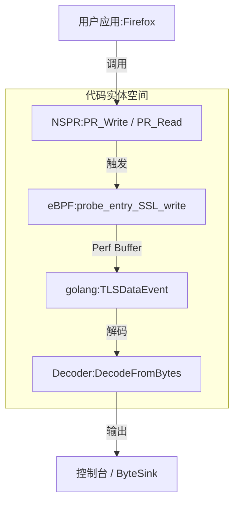
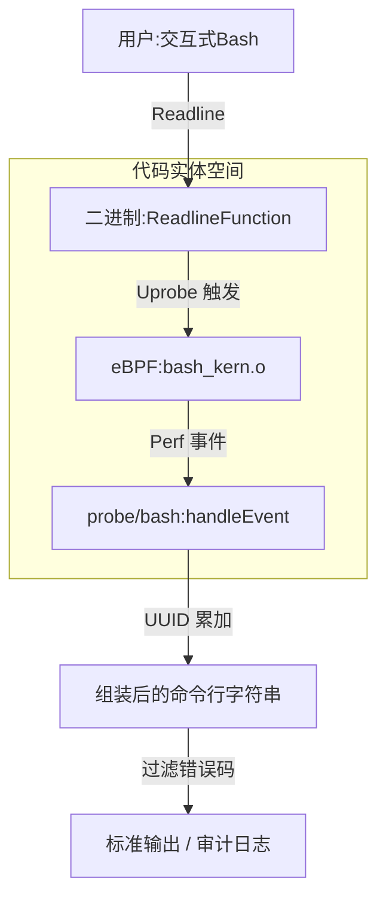
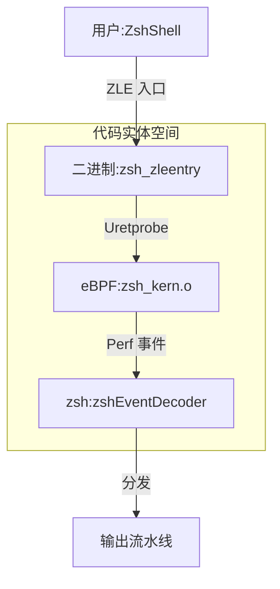
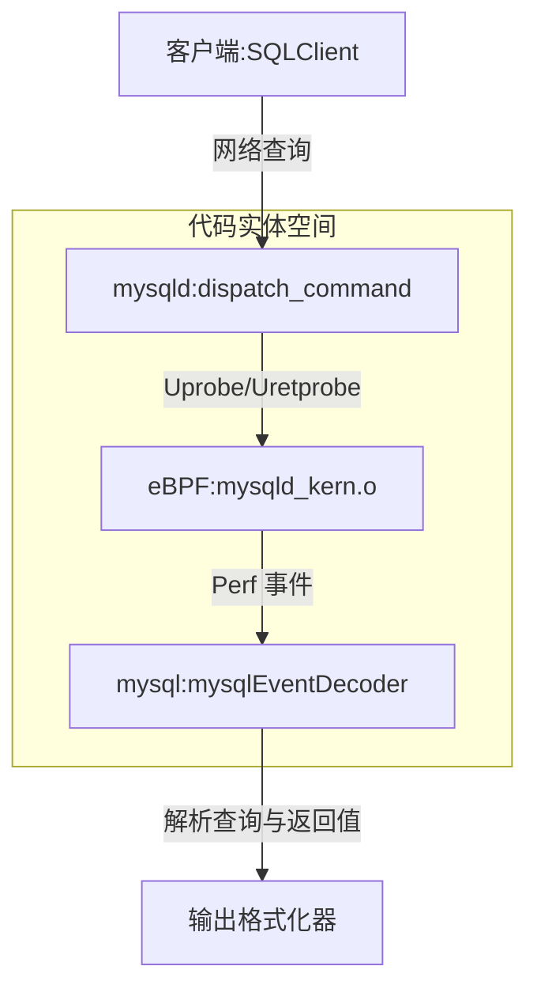
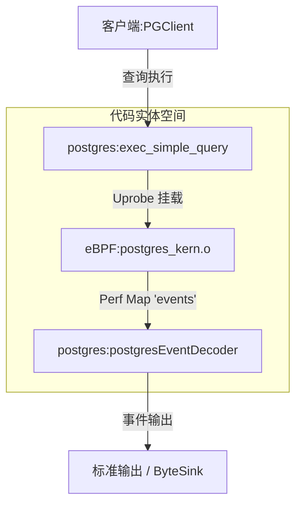

# 其他模块

相关源文件

以下文件被用作生成此维基页面的上下文：

- [cli/cmd/bash.go](https://github.com/gojue/ecapture/blob/8c9caada/cli/cmd/bash.go)
- [cli/cmd/common_config_test.go](https://github.com/gojue/ecapture/blob/8c9caada/cli/cmd/common_config_test.go)
- [cli/cmd/mysqld.go](https://github.com/gojue/ecapture/blob/8c9caada/cli/cmd/mysqld.go)
- [cli/cmd/postgres.go](https://github.com/gojue/ecapture/blob/8c9caada/cli/cmd/postgres.go)
- [cli/cmd/zsh.go](https://github.com/gojue/ecapture/blob/8c9caada/cli/cmd/zsh.go)
- [internal/probe/bash/bash_probe.go](https://github.com/gojue/ecapture/blob/8c9caada/internal/probe/bash/bash_probe.go)
- [internal/probe/mysql/mysql_probe.go](https://github.com/gojue/ecapture/blob/8c9caada/internal/probe/mysql/mysql_probe.go)
- [internal/probe/mysql/mysql_test.go](https://github.com/gojue/ecapture/blob/8c9caada/internal/probe/mysql/mysql_test.go)
- [internal/probe/nspr/event.go](https://github.com/gojue/ecapture/blob/8c9caada/internal/probe/nspr/event.go)
- [internal/probe/nspr/nspr_probe.go](https://github.com/gojue/ecapture/blob/8c9caada/internal/probe/nspr/nspr_probe.go)
- [internal/probe/nspr/nspr_probe_test.go](https://github.com/gojue/ecapture/blob/8c9caada/internal/probe/nspr/nspr_probe_test.go)
- [internal/probe/postgres/postgres_probe.go](https://github.com/gojue/ecapture/blob/8c9caada/internal/probe/postgres/postgres_probe.go)
- [internal/probe/zsh/zsh_probe.go](https://github.com/gojue/ecapture/blob/8c9caada/internal/probe/zsh/zsh_probe.go)

## 目的与范围

虽然 eCapture 的核心能力集中在对 OpenSSL、BoringSSL、Go 原生 TLS 和 GnuTLS 的 TLS 拦截，但该平台还为非 TLS 工作负载提供了专门的 eBPF 探针。这些非核心模块将 eCapture 的审计和可观测性功能扩展到了 Shell 命令执行（Bash 和 Zsh）、备选密码库（NSS/NSPR）以及数据库查询监控（MySQL/MariaDB 和 PostgreSQL）。

本页面作为所有非核心探针覆盖范围的完整参考，详细介绍了它们支持的目标二进制文件和库、配置标志、内部实现以及事件数据流。

Sources: [cli/cmd/bash.go:27-40](https://github.com/gojue/ecapture/blob/8c9caada/cli/cmd/bash.go#L27-L40), [cli/cmd/zsh.go:30-42](https://github.com/gojue/ecapture/blob/8c9caada/cli/cmd/zsh.go#L30-L42), [cli/cmd/mysqld.go:30-46](https://github.com/gojue/ecapture/blob/8c9caada/cli/cmd/mysqld.go#L30-L46), [cli/cmd/postgres.go:30-42](https://github.com/gojue/ecapture/blob/8c9caada/cli/cmd/postgres.go#L30-L42), [internal/probe/nspr/nspr_probe.go:37-82](https://github.com/gojue/ecapture/blob/8c9caada/internal/probe/nspr/nspr_probe.go#L37-L82)

---

## 非核心探针概览

下表总结了 eCapture 中可用的非核心探针、它们的目标应用、CLI 命令入口点以及主要的 eBPF 挂载目标。

| 模块名称 | CLI 命令 | 支持的目标 | 关键钩子函数 / 事件 | 主要源文件 |
| :--- | :--- | :--- | :--- | :--- |
| **NSS/NSPR** | `nspr` (内部工厂) | Firefox, Thunderbird, `libnspr4.so`, `libnss3.so` | `PR_Write`, `PR_Read`, SSL 主密钥 | [`internal/probe/nspr/nspr_probe.go:37-82`()] |
| **Bash** | `bash` | `/bin/bash`, Readline 库 | Readline 入口、返回及 exit/exec | [`cli/cmd/bash.go:27-40`(), `internal/probe/bash/bash_probe.go:38-81`()] |
| **Zsh** | `zsh` | `/bin/zsh`, ZLE 入口 | `zsh_zleentry` uretprobe | [`cli/cmd/zsh.go:30-42`(), `internal/probe/zsh/zsh_probe.go:37-79`()] |
| **MySQL** | `mysqld` | MySQL 5.6, 5.7, 8.0, MariaDB 10.5+ | `dispatch_command` 查询执行 | [`cli/cmd/mysqld.go:30-46`(), `internal/probe/mysql/mysql_probe.go:37-85`()] |
| **PostgreSQL** | `postgres` | PostgreSQL 10+ | `exec_simple_query` 查询执行 | [`cli/cmd/postgres.go:30-42`(), `internal/probe/postgres/postgres_probe.go:37-65`()] |

Sources: [cli/cmd/bash.go:27-40](https://github.com/gojue/ecapture/blob/8c9caada/cli/cmd/bash.go#L27-L40), [cli/cmd/zsh.go:30-42](https://github.com/gojue/ecapture/blob/8c9caada/cli/cmd/zsh.go#L30-L42), [cli/cmd/mysqld.go:30-46](https://github.com/gojue/ecapture/blob/8c9caada/cli/cmd/mysqld.go#L30-L46), [cli/cmd/postgres.go:30-42](https://github.com/gojue/ecapture/blob/8c9caada/cli/cmd/postgres.go#L30-L42), [internal/probe/nspr/nspr_probe.go:37-82](https://github.com/gojue/ecapture/blob/8c9caada/internal/probe/nspr/nspr_probe.go#L37-L82)

---

## 1. NSS/NSPR 探针

NSS/NSPR 探针用于捕获基于 Mozilla 网络安全服务 (NSS) 和 Netscape 可移植运行环境 (NSPR) 构建的应用程序（如 Mozilla Firefox 和 Thunderbird）的 TLS 流量和加密密钥。

### 支持的目标与配置
该探针以 `libnspr4.so`（用于套接字 I/O 操作）和 `libnss3.so`（用于会话密钥派生）为目标。配置通过 `nspr.Config` 管理，指定 NSS 和 NSPR 共享库的路径。

### 实现与数据流
探针在 NSPR 库内的 `PR_Write` 和 `PR_Read` 上建立 `uprobe` 和 `uretprobe` 挂载，同时包含用于提取主密钥的钩子 [`internal/probe/nspr/nspr_probe.go:193-224`()]。捕获的有效负载被结构化为 `TLSDataEvent` 缓冲区，与 eBPF 字节码中定义的 C 结构体布局相匹配 [`internal/probe/nspr/event.go:41-77`()]。

Sources: [internal/probe/nspr/nspr_probe.go:37-224](https://github.com/gojue/ecapture/blob/8c9caada/internal/probe/nspr/nspr_probe.go#L37-L224), [internal/probe/nspr/event.go:41-77](https://github.com/gojue/ecapture/blob/8c9caada/internal/probe/nspr/event.go#L41-L77)

---

## 2. Bash 审计探针

Bash 探针通过拦截输入到 Bash shell 的交互式命令行来提供安全审计。

### 支持的目标与配置
CLI 命令 `bash` 初始化 `bash.Probe`，自动解析环境中的活动 shell 二进制文件，或通过 `--bash` 和 `--readlineso` 标志接受显式路径 [`cli/cmd/bash.go:27-40`()]。

### 实现与数据流
探针挂载到 Bash 的 Readline 集成中。多行命令和命令执行状态在用户空间使用唯一的事件 UUID 进行跟踪和组装 [`internal/probe/bash/bash_probe.go:173-212`()]。

Sources: [cli/cmd/bash.go:27-40](https://github.com/gojue/ecapture/blob/8c9caada/cli/cmd/bash.go#L27-L40), [internal/probe/bash/bash_probe.go:38-212](https://github.com/gojue/ecapture/blob/8c9caada/internal/probe/bash/bash_probe.go#L38-L212)

---

## 3. Zsh 审计探针

与 Bash 模块类似，Zsh 探针监控 Zsh 环境中的交互式命令执行。

### 支持的目标与配置
通过 `zsh` 命令初始化，`zsh.Probe` 接受 `--zsh` 标志来定位目标 Zsh 二进制文件 [`cli/cmd/zsh.go:30-42`()]。

### 实现与数据流
探针向 `setupManager` 中配置的 Zsh ZLE 入口函数 (`zsh_zleentry`) 挂载一个 `uretprobe` [`internal/probe/zsh/zsh_probe.go:180-214`()]。拦截的按键输入和执行的命令通过 `zshEventDecoder` 进行解析，并转发到输出流水线。

Sources: [cli/cmd/zsh.go:30-42](https://github.com/gojue/ecapture/blob/8c9caada/cli/cmd/zsh.go#L30-L42), [internal/probe/zsh/zsh_probe.go:37-214](https://github.com/gojue/ecapture/blob/8c9caada/internal/probe/zsh/zsh_probe.go#L37-L214)

---

## 4. MySQL / MariaDB 查询探针

MySQL 探针监控针对 MySQL 和 MariaDB 数据库服务器执行的 SQL 查询，无需配置查询日志。

### 支持的目标与配置
支持的目标包括 MySQL 5.6, 5.7, 8.0 以及 MariaDB 10.5+ [`cli/cmd/mysqld.go:30-46`()]。配置通过 `-m` / `--mysqld` 接受 mysqld 二进制路径，通过 `-f` / `--funcname` 覆盖函数名，并通过 `--offset` 接受二进制偏移量 [`cli/cmd/mysqld.go:39-46`()]。

### 实现与数据流
探针向查询分发函数（如 `dispatch_command`）挂载 uprobes 和 uretprobes [`internal/probe/mysql/mysql_probe.go:189-235`()]。查询字符串、连接 PID 以及执行返回值 (`DispatchCommandReturn`) 会被捕获并解码 [`internal/probe/mysql/mysql_test.go:46-66`()]。

Sources: [cli/cmd/mysqld.go:30-46](https://github.com/gojue/ecapture/blob/8c9caada/cli/cmd/mysqld.go#L30-L46), [internal/probe/mysql/mysql_probe.go:37-235](https://github.com/gojue/ecapture/blob/8c9caada/internal/probe/mysql/mysql_probe.go#L37-L235), [internal/probe/mysql/mysql_test.go:46-66](https://github.com/gojue/ecapture/blob/8c9caada/internal/probe/mysql/mysql_test.go#L46-L66)

---

## 5. PostgreSQL 查询探针

PostgreSQL 探针捕获由 PostgreSQL 数据库服务器进程执行的 SQL 查询。

### 支持的目标与配置
目标为 PostgreSQL 服务器二进制文件 10 及以上版本 [`cli/cmd/postgres.go:30-42`()]。通过 `postgres.Config` 进行配置，接受二进制路径 (`--postgres`) 和目标钩子函数 (`--funcname`) [`cli/cmd/postgres.go:36-41`()].

### 实现与数据流
探针向查询执行函数（例如 `exec_simple_query`）挂载 uprobes [`internal/probe/postgres/postgres_probe.go:141-150`()]。常量编辑器负责处理内核版本限制以及 PID/UID 过滤 [`internal/probe/postgres/postgres_probe.go:188-216`()]。捕获的查询通过 `postgresEventDecoder` 流向全局输出接收器。

Sources: [cli/cmd/postgres.go:30-42](https://github.com/gojue/ecapture/blob/8c9caada/cli/cmd/postgres.go#L30-L42), [internal/probe/postgres/postgres_probe.go:37-168](https://github.com/gojue/ecapture/blob/8c9caada/internal/probe/postgres/postgres_probe.go#L37-L168), [internal/probe/postgres/postgres_probe.go:188-216](https://github.com/gojue/ecapture/blob/8c9caada/internal/probe/postgres/postgres_probe.go#L188-L216)