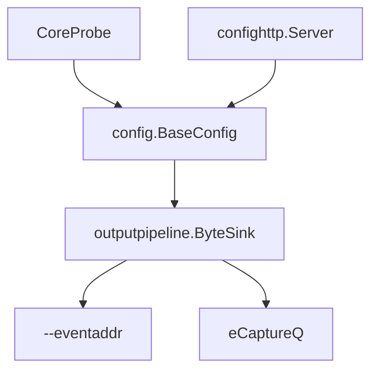
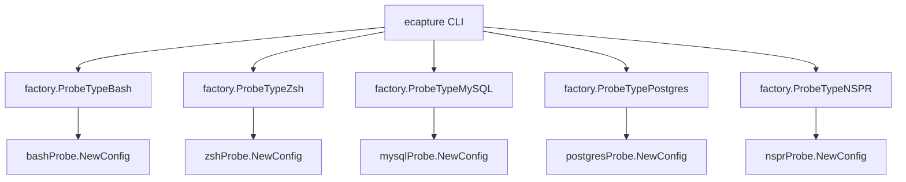

# 进阶用法

相关源文件

以下文件被用作生成此维基页面的上下文：

- [cli/cmd/bash.go](https://github.com/gojue/ecapture/blob/8c9caada/cli/cmd/bash.go)
- [cli/cmd/common_config_test.go](https://github.com/gojue/ecapture/blob/8c9caada/cli/cmd/common_config_test.go)
- [cli/cmd/mysqld.go](https://github.com/gojue/ecapture/blob/8c9caada/cli/cmd/mysqld.go)
- [cli/cmd/postgres.go](https://github.com/gojue/ecapture/blob/8c9caada/cli/cmd/postgres.go)
- [cli/cmd/zsh.go](https://github.com/gojue/ecapture/blob/8c9caada/cli/cmd/zsh.go)

## 目的与范围
本页面是操作核心 TLS 捕获的基础示例之外的用户入口。它涵盖了故障排查诊断工作流、生产集成与部署考量，并提供了对非核心模块（如 NSS/NSPR、Bash、Zsh、MySQL/MariaDB 和 PostgreSQL）的指引。作为父级页面，它总结了关键概念，并将读者引导至专用的子页面以获取深入的技术细节。

Sources: [cli/cmd/common_config_test.go:48-186](https://github.com/gojue/ecapture/blob/8c9caada/cli/cmd/common_config_test.go#L48-L186)

---

## 4.1. TLS 故障排查
在文本 (text)、密钥日志 (keylog) 和 pcapng 模式下操作 `tls` (OpenSSL/BoringSSL)、`gotls` (Go native TLS) 和 `gnutls` 探针时，操作员可能会遇到诸如库/二进制文件不匹配、版本支持限制、空事件、缺失密钥、不完整的 pcapng 文件、BTF 失败、权限错误、网络接口问题或目标路由错误等问题。

有关全面的诊断检查表、逐步排查程序和解决策略，请参阅 [TLS 故障排查](4.1-tls-troubleshooting.md)。

Sources: [cli/cmd/common_config_test.go:188-216](https://github.com/gojue/ecapture/blob/8c9caada/cli/cmd/common_config_test.go#L188-L216)

---

## 4.2. 集成与部署
生产部署需要健壮的配置管理、安全的事件转发以及高效的资源利用。核心 TLS 捕获支持通过 `--eventaddr` 转发捕获的事件，集成 `eCaptureQ` 等附加输出机制，以及通过 HTTP 端点 (`confighttp`) 进行动态配置。操作员还必须安全地处理敏感的捕获产物，并在高负载下评估性能影响。

*图 4.2：连接配置、探针和输出目标的集成与部署流程。*

Sources: [cli/cmd/common_config_test.go:25-74](https://github.com/gojue/ecapture/blob/8c9caada/cli/cmd/common_config_test.go#L25-L74)

有关生产指南、安全最佳实践和性能评估，请参阅 [集成与部署](4.2-integration-and-deployment.md)。

Sources: [cli/cmd/common_config_test.go:25-74](https://github.com/gojue/ecapture/blob/8c9caada/cli/cmd/common_config_test.go#L25-L74)

---

## 4.3. 其他模块
虽然 `ecapture` 的核心能力集中在 TLS 拦截，但代码库包含多个用于特定审计和监控用例的非核心探针。这些包括：
- **Bash & Zsh**：命令审计探针 (`bashProbe`, `zshProbe`)，用于跟踪 Shell 执行和退出代码。
- **MySQL & PostgreSQL**：数据库查询捕获探针 (`mysqlProbe`, `postgresProbe`)，用于 SQL 审计。
- **NSS/NSPR**：网络安全服务探针 (`nsprProbe`)，用于基于 NSS 的应用程序。

*图 4.3：非核心探针工厂映射与配置初始化。*

Sources: [cli/cmd/bash.go:20-24](https://github.com/gojue/ecapture/blob/8c9caada/cli/cmd/bash.go#L20-L24), [cli/cmd/mysqld.go:23-27](https://github.com/gojue/ecapture/blob/8c9caada/cli/cmd/mysqld.go#L23-L27), [cli/cmd/postgres.go:23-27](https://github.com/gojue/ecapture/blob/8c9caada/cli/cmd/postgres.go#L23-L27), [cli/cmd/zsh.go:23-27](https://github.com/gojue/ecapture/blob/8c9caada/cli/cmd/zsh.go#L23-L27), [cli/cmd/common_config_test.go:30-37](https://github.com/gojue/ecapture/blob/8c9caada/cli/cmd/common_config_test.go#L30-L37)

有关这些探针的支持目标、配置标志和用法参考，请参阅 [其他模块](4.3-other-modules.md)。

Sources: [cli/cmd/bash.go:27-40](https://github.com/gojue/ecapture/blob/8c9caada/cli/cmd/bash.go#L27-L40), [cli/cmd/mysqld.go:30-46](https://github.com/gojue/ecapture/blob/8c9caada/cli/cmd/mysqld.go#L30-L46), [cli/cmd/postgres.go:30-41](https://github.com/gojue/ecapture/blob/8c9caada/cli/cmd/postgres.go#L30-L41), [cli/cmd/zsh.go:30-41](https://github.com/gojue/ecapture/blob/8c9caada/cli/cmd/zsh.go#L30-L41), [cli/cmd/zsh.go:38-41](https://github.com/gojue/ecapture/blob/8c9caada/cli/cmd/zsh.go#L38-L41)