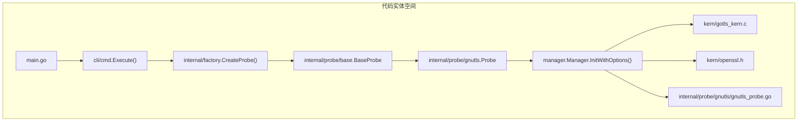
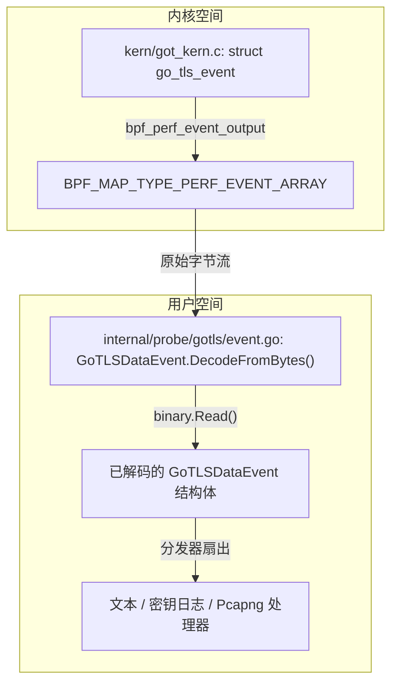

# TLS 捕获架构

相关源文件

以下文件被用作生成此维基页面的上下文：

- [AGENTS.md](https://github.com/gojue/ecapture/blob/8c9caada/AGENTS.md)
- [docs/agent/architecture.md](https://github.com/gojue/ecapture/blob/8c9caada/docs/agent/architecture.md)
- [docs/agent/build-test.md](https://github.com/gojue/ecapture/blob/8c9caada/docs/agent/build-test.md)
- [docs/agent/probe-development.md](https://github.com/gojue/ecapture/blob/8c9caada/docs/agent/probe-development.md)
- [internal/probe/gnutls/gnutls_probe.go](https://github.com/gojue/ecapture/blob/8c9caada/internal/probe/gnutls/gnutls_probe.go)
- [internal/probe/gotls/event.go](https://github.com/gojue/ecapture/blob/8c9caada/internal/probe/gotls/event.go)
- [internal/probe/gotls/event_test.go](https://github.com/gojue/ecapture/blob/8c9caada/internal/probe/gotls/event_test.go)
- [kern/go_argument.h](https://github.com/gojue/ecapture/blob/8c9caada/kern/go_argument.h)
- [kern/gotls_kern.c](https://github.com/gojue/ecapture/blob/8c9caada/kern/gotls_kern.c)
- [kern/include/openssl_masterkey_common.h](https://github.com/gojue/ecapture/blob/8c9caada/kern/include/openssl_masterkey_common.h)
- [kern/include/tls_constants.h](https://github.com/gojue/ecapture/blob/8c9caada/kern/include/tls_constants.h)
- [kern/openssl.h](https://github.com/gojue/ecapture/blob/8c9caada/kern/openssl.h)
- [kern/openssl_masterkey.h](https://github.com/gojue/ecapture/blob/8c9caada/kern/openssl_masterkey.h)
- [kern/openssl_masterkey_3.0.h](https://github.com/gojue/ecapture/blob/8c9caada/kern/openssl_masterkey_3.0.h)
- [kern/openssl_masterkey_3.2.h](https://github.com/gojue/ecapture/blob/8c9caada/kern/openssl_masterkey_3.2.h)
- [kern/openssl_untag.h](https://github.com/gojue/ecapture/blob/8c9caada/kern/openssl_untag.h)
- [kern/zsh_kern.c](https://github.com/gojue/ecapture/blob/8c9caada/kern/zsh_kern.c)
- [test/kern/openssl_tagged_pointer_test.go](https://github.com/gojue/ecapture/blob/8c9caada/test/kern/openssl_tagged_pointer_test.go)

## 目的与范围

本文档详细介绍了 eCapture 核心 TLS 捕获子系统（`tls`、`gotls` 和 `gnutls`）的内部架构。它解释了 eBPF 程序如何附加到用户态库和运行时，如何在不同版本的 OpenSSL、BoringSSL、Go 和 GnuTLS 之间解析库和符号，内核 C 结构体与用户态 Go 解码器之间的二进制 ABI 契约，以及管理文本、密钥日志和 pcapng 捕获模式的执行流。

Sources: [AGENTS.md:74-94](https://github.com/gojue/ecapture/blob/8c9caada/AGENTS.md#L74-L94), [docs/agent/architecture.md:37-49](https://github.com/gojue/ecapture/blob/8c9caada/docs/agent/architecture.md#L37-L49)

---

## eBPF 附加与探针生命周期

TLS 捕获引擎依赖 `github.com/gojue/ebpfmanager` 来管理加载到内核中的 eBPF 程序的生命周期。探针利用 `uprobe` 和 `uretprobe` 附加点来拦截目标共享库或编译后的二进制文件中的函数入口和出口。对于 `pcapng` 和数据包过滤模式，还会附加流量控制（`TC`）的出口/入口钩子。

*图 1：从 CLI 入口到 eBPF 管理器设置的初始化流程。*

Sources: [AGENTS.md:74-94](https://github.com/gojue/ecapture/blob/8c9caada/AGENTS.md#L74-L94), [internal/probe/gnutls/gnutls_probe.go:57-117](https://github.com/gojue/ecapture/blob/8c9caada/internal/probe/gnutls/gnutls_probe.go#L57-L117)

核心探针生命周期遵循严格的初始化和附加序列：
1. **配置校验**：对探针配置进行幂等校验 [docs/agent/architecture.md:99-102](https://github.com/gojue/ecapture/blob/8c9caada/docs/agent/architecture.md#L99-L102)。
2. **字节码选择**：`BaseProbe.SelectBytecode` 根据内核 BTF 可用性选择合适的 CO-RE 或非 CO-RE 对象文件 [docs/agent/probe-development.md:105-109](https://github.com/gojue/ecapture/blob/8c9caada/docs/agent/probe-development.md#L105-L109)。
3. **管理器初始化**：`manager.Manager` 使用嵌入的二进制资产初始化映射（maps）和程序 [internal/probe/gnutls/gnutls_probe.go:95-100](https://github.com/gojue/ecapture/blob/8c9caada/internal/probe/gnutls/gnutls_probe.go#L95-L100)。
4. **附加**：`bpfManager.Start()` 将 uprobes 附加到目标符号（例如 `SSL_write`、`SSL_read`、`gocryptotls_*`、`gnutls_record_send`） [internal/probe/gnutls/gnutls_probe.go:101-103](https://github.com/gojue/ecapture/blob/8c9caada/internal/probe/gnutls/gnutls_probe.go#L101-L103), [internal/probe/gnutls/gnutls_probe.go:210-212](https://github.com/gojue/ecapture/blob/8c9caada/internal/probe/gnutls/gnutls_probe.go#L210-L212)。
5. **事件循环**：Perf 或 ring-buffer 事件读取器将二进制结构从内核映射流式传输到用户态处理器 [AGENTS.md:76-88](https://github.com/gojue/ecapture/blob/8c9caada/AGENTS.md#L76-L88), [internal/probe/gnutls/gnutls_probe.go:108-114](https://github.com/gojue/ecapture/blob/8c9caada/internal/probe/gnutls/gnutls_probe.go#L108-L114)。

Sources: [AGENTS.md:74-94](https://github.com/gojue/ecapture/blob/8c9caada/AGENTS.md#L74-L94), [docs/agent/architecture.md:125-144](https://github.com/gojue/ecapture/blob/8c9caada/docs/agent/architecture.md#L125-L144), [internal/probe/gnutls/gnutls_probe.go:57-117](https://github.com/gojue/ecapture/blob/8c9caada/internal/probe/gnutls/gnutls_probe.go#L57-L117)

---

## 库与符号解析

每个 TLS 模块针对不同的运行时环境，具有不同的符号和数据结构布局：

### OpenSSL 与 BoringSSL (`tls`)
- 拦截 OpenSSL/BoringSSL API，包括 `SSL_read`、`SSL_write`、`SSL_set_fd` 以及主密钥生成函数（`SSL_write_key`） [docs/agent/architecture.md:41](https://github.com/gojue/ecapture/blob/8c9caada/docs/agent/architecture.md#L41)。
- 通过使用条件头定义，处理 OpenSSL 1.1.x、3.0.x 和 3.2+ 版本的特定结构体偏移量 [kern/openssl_masterkey.h:19-25](https://github.com/gojue/ecapture/blob/8c9caada/kern/openssl_masterkey.h#L19-L25), [kern/openssl_masterkey_3.0.h:22-25](https://github.com/gojue/ecapture/blob/8c9caada/kern/openssl_masterkey_3.0.h#L22-L25), [kern/openssl_masterkey_3.2.h:26-29](https://github.com/gojue/ecapture/blob/8c9caada/kern/openssl_masterkey_3.2.h#L26-L29)。
- 在现代架构上使用去标记用户指针（`openssl_untag_user_pointer`）来处理加壳或经过指针验证的地址 [kern/openssl_masterkey.h:35-40](https://github.com/gojue/ecapture/blob/8c9caada/kern/openssl_masterkey.h#L35-L40)。

### Go 原生 TLS (`gotls`)
- 通过挂载内部 `crypto/tls` 函数（`conn.Read`、`conn.Write`）或标准库 TCP/netFD 绑定来针对 Go 二进制文件 [docs/agent/architecture.md:42](https://github.com/gojue/ecapture/blob/8c9caada/docs/agent/architecture.md#L42)。
- 动态解析 Go 的调用约定，通过 `kern/go_argument.h` 中的辅助宏支持基于栈的 ABI（Go < 1.17）和基于寄存器的 ABI（Go >= 1.17） [kern/go_argument.h:18-128](https://github.com/gojue/ecapture/blob/8c9caada/kern/go_argument.h#L18-L128)。
- 直接从 Go 的内部 `net.netFD` 和 `net.TCPAddr` 运行时结构中提取文件描述符和 IP 元组（`src_ip`、`dst_ip`、端口） [kern/gotls_kern.c:110-187](https://github.com/gojue/ecapture/blob/8c9caada/kern/gotls_kern.c#L110-L187)。

### GnuTLS (`gnutls`)
- 挂载 GnuTLS 记录层函数，如 `gnutls_record_send` 和 `gnutls_record_recv` [internal/probe/gnutls/gnutls_probe.go:210-212](https://github.com/gojue/ecapture/blob/8c9caada/internal/probe/gnutls/gnutls_probe.go#L210-L212)。

Sources: [docs/agent/architecture.md:39-49](https://github.com/gojue/ecapture/blob/8c9caada/docs/agent/architecture.md#L39-L49), [kern/go_argument.h:18-128](https://github.com/gojue/ecapture/blob/8c9caada/kern/go_argument.h#L18-L128), [kern/openssl_masterkey.h:19-40](https://github.com/gojue/ecapture/blob/8c9caada/kern/openssl_masterkey.h#L19-L40), [kern/openssl_masterkey_3.0.h:22-25](https://github.com/gojue/ecapture/blob/8c9caada/kern/openssl_masterkey_3.0.h#L22-L25), [kern/openssl_masterkey_3.2.h:26-29](https://github.com/gojue/ecapture/blob/8c9caada/kern/openssl_masterkey_3.2.h#L26-L29)

---

## C/Go 事件 ABI 与二进制序列化

内核 eBPF 程序与用户态 Go 代码之间交换的数据构成了严格的二进制 ABI。对字段宽度、符号或填充的任何改动都会破坏解码。

*图 2：从内核 C 结构体到用户态 Go 解码器的二进制事件 ABI 流水线。*

Sources: [AGENTS.md:98-115](https://github.com/gojue/ecapture/blob/8c9caada/AGENTS.md#L98-L115), [kern/gotls_kern.c:33-50](https://github.com/gojue/ecapture/blob/8c9caada/kern/gotls_kern.c#L33-L50), [internal/probe/gotls/event.go:34-145](https://github.com/gojue/ecapture/blob/8c9caada/internal/probe/gotls/event.go#L34-L145)

### 示例：GoTLS 事件 ABI 映射
内核结构体 `struct go_tls_event` [kern/gotls_kern.c:33-50](https://github.com/gojue/ecapture/blob/8c9caada/kern/gotls_kern.c#L33-L50) 被直接映射到 Go 中的 `GoTLSDataEvent` [internal/probe/gotls/event.go:34-74](https://github.com/gojue/ecapture/blob/8c9caada/internal/probe/gotls/event.go#L34-L74)。字段使用 `binary.Read` 按照显式的小端字节序顺序反序列化 [internal/probe/gotls/event.go:77-127](https://github.com/gojue/ecapture/blob/8c9caada/internal/probe/gotls/event.go#L77-L127)：

| C 字段名称 | C 类型 | Go 字段名称 | Go 类型 | 偏移量 / 大小 |
| --- | --- | --- | --- | --- |
| `ts_ns` | `u64` | `Timestamp` | `uint64` | 0 / 8 字节 [kern/gotls_kern.c:34](https://github.com/gojue/ecapture/blob/8c9caada/kern/gotls_kern.c#L34), [internal/probe/gotls/event.go:38](https://github.com/gojue/ecapture/blob/8c9caada/internal/probe/gotls/event.go#L38) |
| `pid` | `u32` | `Pid` | `uint32` | 8 / 4 字节 [kern/gotls_kern.c:35](https://github.com/gojue/ecapture/blob/8c9caada/kern/gotls_kern.c#L35), [internal/probe/gotls/event.go:39](https://github.com/gojue/ecapture/blob/8c9caada/internal/probe/gotls/event.go#L39) |
| `tid` | `u32` | `Tid` | `uint32` | 12 / 4 字节 [kern/gotls_kern.c:36](https://github.com/gojue/ecapture/blob/8c9caada/kern/gotls_kern.c#L36), [internal/probe/gotls/event.go:40](https://github.com/gojue/ecapture/blob/8c9caada/internal/probe/gotls/event.go#L40) |
| `data_len` | `s32` | `DataLen` | `int32` | 16 / 4 字节 [kern/gotls_kern.c:37](https://github.com/gojue/ecapture/blob/8c9caada/kern/gotls_kern.c#L37), [internal/probe/gotls/event.go:41](https://github.com/gojue/ecapture/blob/8c9caada/internal/probe/gotls/event.go#L41) |
| `event_type` | `u8` | `EventType` | `uint8` | 20 / 1 字节 [kern/gotls_kern.c:38](https://github.com/gojue/ecapture/blob/8c9caada/kern/gotls_kern.c#L38), [internal/probe/gotls/event.go:42](https://github.com/gojue/ecapture/blob/8c9caada/internal/probe/gotls/event.go#L42) |
| `pad` | `u8[3]` | `pad` | `[3]byte` | 21 / 3 字节 [kern/gotls_kern.c:39](https://github.com/gojue/ecapture/blob/8c9caada/kern/gotls_kern.c#L39), [internal/probe/gotls/event.go:43](https://github.com/gojue/ecapture/blob/8c9caada/internal/probe/gotls/event.go#L43) |
| `fd` | `u32` | `Fd` | `uint32` | 24 / 4 字节 [kern/gotls_kern.c:40](https://github.com/gojue/ecapture/blob/8c9caada/kern/gotls_kern.c#L40), [internal/probe/gotls/event.go:44](https://github.com/gojue/ecapture/blob/8c9caada/internal/probe/gotls/event.go#L44) |
| `src_ip` | `u8[16]` | `SrcIP` | `[16]byte` | 28 / 16 字节 [kern/gotls_kern.c:41](https://github.com/gojue/ecapture/blob/8c9caada/kern/gotls_kern.c#L41), [internal/probe/gotls/event.go:45](https://github.com/gojue/ecapture/blob/8c9caada/internal/probe/gotls/event.go#L45) |
| `data` | `char[]` | `Data` | `[]byte` | 84 / 可变 [kern/gotls_kern.c:49](https://github.com/gojue/ecapture/blob/8c9caada/kern/gotls_kern.c#L49), [internal/probe/gotls/event.go:53](https://github.com/gojue/ecapture/blob/8c9caada/internal/probe/gotls/event.go#L53) |

Sources: [AGENTS.md:98-115](https://github.com/gojue/ecapture/blob/8c9caada/AGENTS.md#L98-L115), [kern/gotls_kern.c:33-50](https://github.com/gojue/ecapture/blob/8c9caada/kern/gotls_kern.c#L33-L50), [internal/probe/gotls/event.go:34-145](https://github.com/gojue/ecapture/blob/8c9caada/internal/probe/gotls/event.go#L34-L145)

---

## 共享与模块特定的执行流

所有三个核心 TLS 模块（`tls`、`gotls` 和 `gnutls`）在事件到达用户态后共享通用的执行流水线：
1. **读取器与解码器**：Perf 缓冲读取器对传入的原始字节切片调用 `DecodeFromBytes`，针对恶意或格式错误的输入验证长度和边界 [internal/probe/gotls/event.go:77-145](https://github.com/gojue/ecapture/blob/8c9caada/internal/probe/gotls/event.go#L77-L145)。
2. **同步分发器**：解码后的事件被传递给 `events.Dispatcher`，该分发器同步且无序地扇出到所有已注册的输出处理器 [docs/agent/architecture.md:20-24](https://github.com/gojue/ecapture/blob/8c9caada/docs/agent/architecture.md#L20-L24), [docs/agent/probe-development.md:125-128](https://github.com/gojue/ecapture/blob/8c9caada/docs/agent/probe-development.md#L125-L128)。
3. **捕获模式处理器**：
   - **文本模式 (Text)**：格式化明文缓冲区（`kSSLRead`/`kSSLWrite` 或 Go 的 read/write）并将其打印到标准输出或通过 `--eventaddr` 转发 [kern/openssl.h:23-39](https://github.com/gojue/ecapture/blob/8c9caada/kern/openssl.h#L23-L39), [kern/gotls_kern.c:25-26](https://github.com/gojue/ecapture/blob/8c9caada/kern/gotls_kern.c#L25-L26)。
   - **密钥日志模式 (Keylog)**：捕获 TLS 主密钥和客户端随机值，并将其格式化为 NSS Key Log 行 [kern/openssl_masterkey.h:35-105](https://github.com/gojue/ecapture/blob/8c9caada/kern/openssl_masterkey.h#L35-L105)。
   - **pcapng 模式**：通过 TC 钩子捕获数据包块，并将 TLS 解密密钥块 (DSB) 嵌入到输出流中 [internal/probe/gnutls/gnutls_probe.go:180-186](https://github.com/gojue/ecapture/blob/8c9caada/internal/probe/gnutls/gnutls_probe.go#L180-L186), [docs/agent/architecture.md:73-74](https://github.com/gojue/ecapture/blob/8c9caada/docs/agent/architecture.md#L73-L74)。

Sources: [AGENTS.md:74-94](https://github.com/gojue/ecapture/blob/8c9caada/AGENTS.md#L74-L94), [docs/agent/architecture.md:20-24](https://github.com/gojue/ecapture/blob/8c9caada/docs/agent/architecture.md#L20-L24), [docs/agent/probe-development.md:125-128](https://github.com/gojue/ecapture/blob/8c9caada/docs/agent/probe-development.md#L125-L128), [kern/openssl.h:23-39](https://github.com/gojue/ecapture/blob/8c9caada/kern/openssl.h#L23-L39), [kern/openssl_masterkey.h:35-105](https://github.com/gojue/ecapture/blob/8c9caada/kern/openssl_masterkey.h#L35-L105), [internal/probe/gnutls/gnutls_probe.go:180-186](https://github.com/gojue/ecapture/blob/8c9caada/internal/probe/gnutls/gnutls_probe.go#L180-L186)