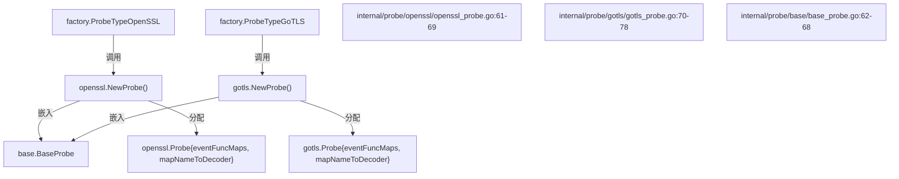
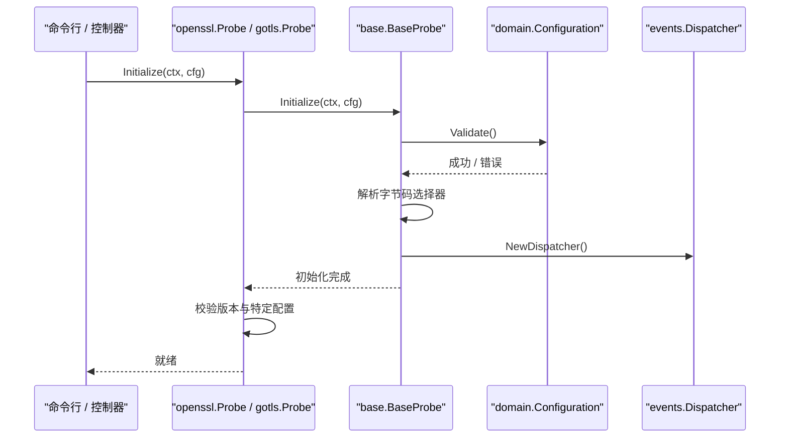
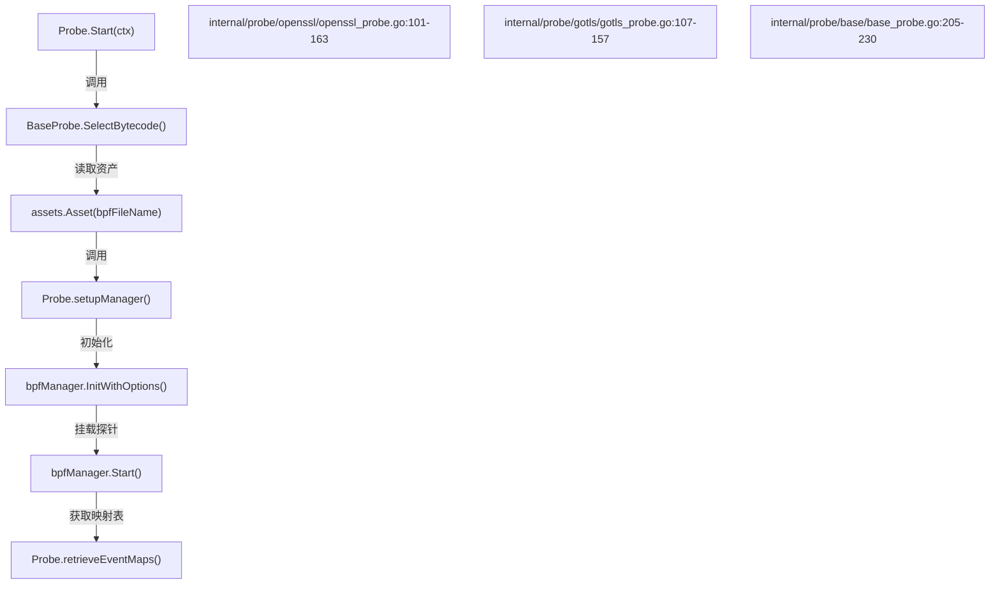
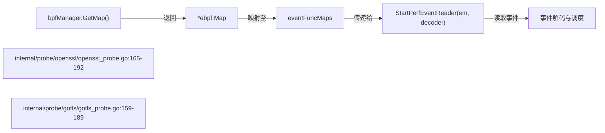
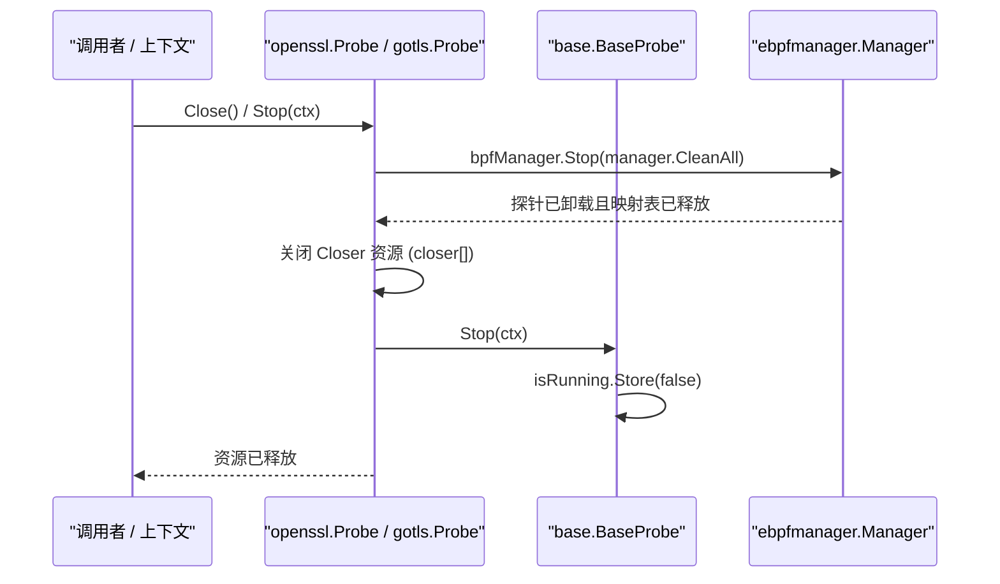

# 探针框架与生命周期

相关源文件

以下文件被用作生成此维基页面的上下文：

- [internal/config/base_config.go](https://github.com/gojue/ecapture/blob/8c9caada/internal/config/base_config.go)
- [internal/domain/configuration.go](https://github.com/gojue/ecapture/blob/8c9caada/internal/domain/configuration.go)
- [internal/probe/base/base_probe.go](https://github.com/gojue/ecapture/blob/8c9caada/internal/probe/base/base_probe.go)
- [internal/probe/gotls/config_iface.go](https://github.com/gojue/ecapture/blob/8c9caada/internal/probe/gotls/config_iface.go)
- [internal/probe/gotls/config_iface_test.go](https://github.com/gojue/ecapture/blob/8c9caada/internal/probe/gotls/config_iface_test.go)
- [internal/probe/gotls/gotls_probe.go](https://github.com/gojue/ecapture/blob/8c9caada/internal/probe/gotls/gotls_probe.go)
- [internal/probe/openssl/config_iface.go](https://github.com/gojue/ecapture/blob/8c9caada/internal/probe/openssl/config_iface.go)
- [internal/probe/openssl/config_iface_test.go](https://github.com/gojue/ecapture/blob/8c9caada/internal/probe/openssl/config_iface_test.go)
- [internal/probe/openssl/config_linux.go](https://github.com/gojue/ecapture/blob/8c9caada/internal/probe/openssl/config_linux.go)
- [internal/probe/openssl/openssl_probe.go](https://github.com/gojue/ecapture/blob/8c9caada/internal/probe/openssl/openssl_probe.go)

## 目的与范围
本文档详细介绍了 eCapture 核心 TLS 探针（`openssl` 和 `gotls`）的架构框架与生命周期管理。内容涵盖了探针工厂注册、通过 `BaseProbe` 进行的嵌入与委托、配置校验、eBPF 字节码解析、管理器挂载、事件读取器追踪以及优雅停机工作流。

Sources:
- [internal/probe/openssl/openssl_probe.go:44-69](https://github.com/gojue/ecapture/blob/8c9caada/internal/probe/openssl/openssl_probe.go#L44-L69)
- [internal/probe/gotls/gotls_probe.go:52-78](https://github.com/gojue/ecapture/blob/8c9caada/internal/probe/gotls/gotls_probe.go#L52-L78)
- [internal/probe/base/base_probe.go:46-68](https://github.com/gojue/ecapture/blob/8c9caada/internal/probe/base/base_probe.go#L46-L68)

---

## 工厂注册与实例化
具体的探针会向应用工厂注册，并暴露构造函数，用于初始化带有适当元数据和内部调度结构的探针实例。

OpenSSL 和 GoTLS 探针嵌入了 `base.BaseProbe`，并建立了内部映射表，用于将 eBPF 事件路由到各自的解码器。

Sources:
- [internal/probe/openssl/openssl_probe.go:61-69](https://github.com/gojue/ecapture/blob/8c9caada/internal/probe/openssl/openssl_probe.go#L61-L69)
- [internal/probe/gotls/gotls_probe.go:70-78](https://github.com/gojue/ecapture/blob/8c9caada/internal/probe/gotls/gotls_probe.go#L70-L78)
- [internal/probe/base/base_probe.go:62-68](https://github.com/gojue/ecapture/blob/8c9caada/internal/probe/base/base_probe.go#L62-L68)

---

## BaseProbe 生命周期与初始化
任何核心 TLS 探针的生命周期都始于 `Initialize(ctx, cfg)`。具体探针通过将共享的校验和调度器设置委托给 `base.BaseProbe.Initialize()` 来实现该方法。

在初始化期间，会进行配置校验、配置运行日志记录器、解析字节码选择模式，并实例化一个带有适当文本或发布者处理程序的事件调度器。

Sources:
- [internal/probe/openssl/openssl_probe.go:71-99](https://github.com/gojue/ecapture/blob/8c9caada/internal/probe/openssl/openssl_probe.go#L71-L99)
- [internal/probe/gotls/gotls_probe.go:80-104](https://github.com/gojue/ecapture/blob/8c9caada/internal/probe/gotls/gotls_probe.go#L80-L104)
- [internal/probe/base/base_probe.go:70-164](https://github.com/gojue/ecapture/blob/8c9caada/internal/probe/base/base_probe.go#L70-L164)
- [internal/config/base_config.go:135-158](https://github.com/gojue/ecapture/blob/8c9caada/internal/config/base_config.go#L135-L158)

---

## eBPF 挂载与管理器设置
初始化完成后，探针的 `Start(ctx)` 方法会驱动加载 eBPF 字节码资产、初始化 `ebpfmanager.Manager`、挂载 kprobes/uprobes 并获取事件映射表（maps）。

字节码资产根据 BTF 和编译时模式配置进行动态选择，从嵌入的资产中读取，并通过 `ebpfmanager` 加载到内核中。

Sources:
- [internal/probe/openssl/openssl_probe.go:101-163](https://github.com/gojue/ecapture/blob/8c9caada/internal/probe/openssl/openssl_probe.go#L101-L163)
- [internal/probe/gotls/gotls_probe.go:107-157](https://github.com/gojue/ecapture/blob/8c9caada/internal/probe/gotls/gotls_probe.go#L107-L157)
- [internal/probe/base/base_probe.go:205-230](https://github.com/gojue/ecapture/blob/8c9caada/internal/probe/base/base_probe.go#L205-L230)

---

## 读取器追踪与事件解码
在 eBPF 管理器成功挂载探针并启动后，从管理器实例中获取事件映射表并与相应的解码器配对。`StartPerfEventReader` 会启动后台读取循环，从 perf 或 ring buffer 中拉取事件。

Sources:
- [internal/probe/openssl/openssl_probe.go:165-192](https://github.com/gojue/ecapture/blob/8c9caada/internal/probe/openssl/openssl_probe.go#L165-L192)
- [internal/probe/gotls/gotls_probe.go:159-189](https://github.com/gojue/ecapture/blob/8c9caada/internal/probe/gotls/gotls_probe.go#L159-L189)

---

## 并发、停机与资源清理
探针的卸载由 `Stop(ctx)` 和 `Close()` 管理。`BaseProbe` 以原子方式管理运行状态，而具体探针则确保通过 `manager.CleanAll` 停止 eBPF 管理器以卸载探针并释放映射表，同时关闭文件句柄或读取器。

Sources:
- [internal/probe/openssl/openssl_probe.go:194-209](https://github.com/gojue/ecapture/blob/8c9caada/internal/probe/openssl/openssl_probe.go#L194-L209)
- [internal/probe/gotls/gotls_probe.go:196-215](https://github.com/gojue/ecapture/blob/8c9caada/internal/probe/gotls/gotls_probe.go#L196-L215)
- [internal/probe/base/base_probe.go:194-204](https://github.com/gojue/ecapture/blob/8c9caada/internal/probe/base/base_probe.go#L194-L204)