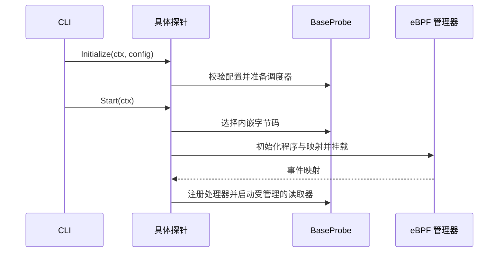

# 探针框架与生命周期

## 注册与启动

CLI 导入各模块的探针包，由其 `register.go` 的初始化函数向工厂注册构造器。`runProbe` 校验当前模块配置，调用 `factory.CreateProbe` 创建实例，再执行 `Initialize` 和 `Start`。初始化可能再次校验配置，因此校验过程必须幂等。

`BaseProbe` 管理共享的事件调度、读取器和可选的 perf 重排序窗口。具体探针持有 eBPF 管理器、挂载点、事件映射与解码器的对应关系及模式专用处理器。输出目标和监听器由 CLI 持有并提供给当前探针。[架构与资源归属](https://github.com/gojue/ecapture/blob/v2.12.0/docs/agent/architecture.md) · [BaseProbe 实现](https://github.com/gojue/ecapture/blob/v2.12.0/internal/probe/base/base_probe.go)

## 读取器与事件顺序

每个活动的事件 map 都需要匹配的解码器和已启动的读取器。`StartPerfEventReader` 和 `StartRingbufReader` 分别跟踪各自的读取循环。启用 perf 重排序时，支持此功能的解码器和事件提供原始单调时间戳，读取器可在有界延迟窗口内重排。不同读取器仍可能并发调用同一个处理器，因此编码器及写入器需要同步。

## 重载、故障和关闭

HTTP 重载会为同类探针建立一份新的配置。校验成功后，CLI 先停止上一轮探针，再启动新探针。启动失败时会尝试恢复上一份配置。每轮运行结束时会关闭相应的 TCP 和 WebSocket 连接，进程级输出设置继续生效。两轮之间可能出现捕获空档。[HTTP 更新约定](https://github.com/gojue/ecapture/blob/v2.12.0/docs/remote-config-update-api-zh_Hans.md)

实时解码流意外终止时，首次终止错误通过 `BaseProbe.Fail` 唤醒 CLI，即使此后没有新数据包也会开始清理。CLI 仍负责协调关闭。具体探针卸载管理器、释放模块资源。`BaseProbe.Close` 解除读取阻塞并等待各读取协程结束（包括待处理的重排序事件），之后再关闭调度器及其处理器。正常关闭时这个顺序让已接收的包和密钥有机会排空。终止写入错误和排空错误会返回给调用方。[读取器关闭顺序](https://github.com/gojue/ecapture/blob/v2.12.0/internal/probe/base/base_probe.go) · [解码失败与排空](https://github.com/gojue/ecapture/blob/v2.12.0/docs/agent/output-pipeline.md)
