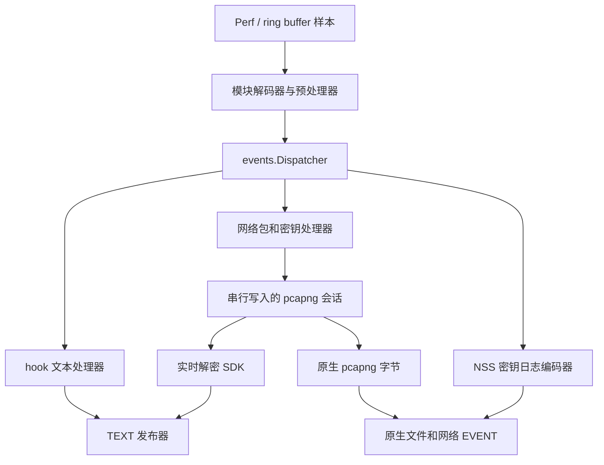

# 事件与输出流水线

## 从内核事件到调度器

perf 或 ring buffer 读取器将原始样本传给为该 map 注册的 `EventDecoder.Decode`。解码器可以实现 `EventPreprocessor`，在模块内消费 OpenSSL 连接跟踪等内部记录。对于需要输出的领域事件，`events.Dispatcher` 先校验事件，再同步调用所有通过 `Supports` 检查的处理器。处理器顺序不固定，多个读取器可并发分发。独立的 `pkg/event_processor` 不参与这条生产路径。[调度器](https://github.com/gojue/ecapture/blob/v2.12.0/internal/events/dispatcher.go) · [读取器和处理器约定](https://github.com/gojue/ecapture/blob/v2.12.0/docs/agent/probe-development.md)

## 编码与资源归属

在默认文本路径中，低延迟 pcapng 会话通过管道把数据包和解密密钥块（DSB）交给 SDK。SDK 匹配密钥、重组连接，再回调输出解码消息。即使同时保存了 pcapng 文件，回调发布的仍是 `TEXT`。显式启用 hook 文本源时，则直接格式化底层读写事件。

keylog 处理器会去重并按 NSS 格式输出。pcapng 会话在数据入队前复制包和密钥，串行写入编码器。keylog 适配器可以把待写 DSB 刷入同一会话。关闭时，处理器排空密钥和数据包，刷新编码器，再关闭它拥有的输出。适配器只借用会话，最终的关闭操作由所有者执行。[输出架构](https://github.com/gojue/ecapture/blob/v2.12.0/docs/agent/output-pipeline.md) · [Keylog 处理器](https://github.com/gojue/ecapture/blob/v2.12.0/internal/probe/base/handlers/keylog_handler.go)

## v2 记录的输出位置

`writers.ByteSink` 为字节输出提供 `Write`、`Name`、`Flush` 和 `Close`。CLI 在整个进程生命周期内持有发布器，每轮探针运行只借用这些对象。WebSocket 订阅服务位于 `internal/output/stream`，实现类型化运行日志和捕获事件接口。接收程序可以导入公开的 `github.com/gojue/ecapture/v2/protobuf/gen/v2` 类型。

| 目标 | 数据表示 |
| --- | --- |
| 终端 | 附带标签的可读文本。v2.12.0 中 pcapng 事件在终端以字节数摘要显示。 |
| `--output` 文件 | 每行一条 ProtoJSON。文本模式包含捕获事件，keylog/pcapng 模式下 JSON 文件仅含运行日志。 |
| `--output` TCP | 每行一条 ProtoJSON，keylog/pcapng 模式也传输原生事件。 |
| `--stream-listen` WebSocket | 每条二进制消息包含一个 v2 `LogEntry`。客户端需协商 `ecapture.v2` 子协议。 |
| 本地原生文件 | `--keylogfile` 和 `--pcapfile` 分别保存实际的 NSS 或 pcapng 字节。 |

收到 `EVENT` 后，用 `event_payload.capture_format` 选择对应的 `text`、`keylog` 或 `pcapng` 成员。转发 `TEXT` 时应保留可用的进程参数、截断状态、网络元组及 TLS 观测字段。遇到原生事件，则在本次连接内依次追加解码后的字节，一个 pcapng 块可能跨越多条记录。配置重载时，采集器排空并结束本轮网络连接。参见[文件完成与重连](../4-advanced-usage/4.2-integration-and-deployment.md)。[协议参考](https://github.com/gojue/ecapture/blob/v2.12.0/protobuf/PROTOCOLS-zh_Hans.md)
