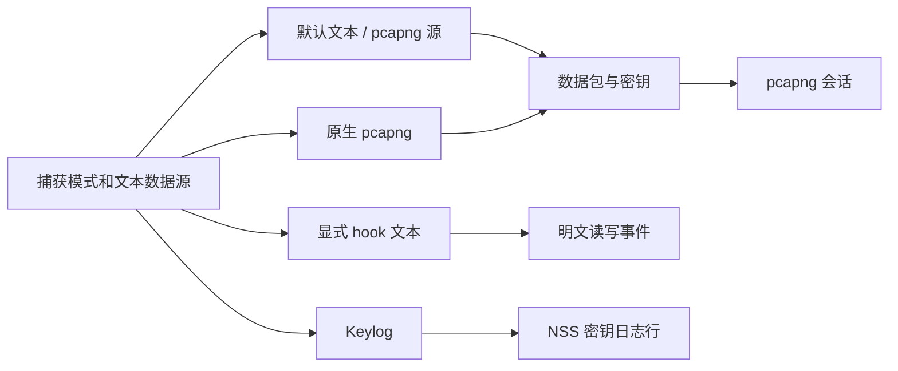

# 扩展 TLS 探针

## 同步挂载映射与解码器

修改现有 TLS 探针时，需同时核对 eBPF 对象和 Go 管理器。C 中的 section、BPF 函数、map 名称均须与管理器注册信息一致。目标符号应在实际使用的库或 Go 可执行文件中解析。为事件 map 注册解码器后，还要启动相应的受管理读取器。跨越 C/Go 边界的字段应保持位宽、有符号性、字节序、填充及长度校验一致。用过短、畸形、最大长度和带合法尾部填充的样本验证解码器。per-CPU 重排序依赖原始单调时间戳。[探针开发指南](https://github.com/gojue/ecapture/blob/v2.12.0/docs/agent/probe-development.md)

## 与版本相关的字节码

OpenSSL 的多个补丁版本可能共享实测布局。核对 `sslVersionBpfMap` 的版本映射，分别检查 CO-RE 和非 CO-RE 对象能否解析到所需的基础名称。GnuTLS 3.8.10 和 3.8.11 使用不同的布局，3.8.12 和 3.8.13 映射到 3.8.11 对象。GoTLS 则在指定可执行文件中解析所需函数。新增库布局时，应以实际库进行捕获验证，并测试版本映射。[OpenSSL 版本映射](https://github.com/gojue/ecapture/blob/v2.12.0/internal/probe/openssl/libs.go) · [GnuTLS 版本映射](https://github.com/gojue/ecapture/blob/v2.12.0/internal/probe/gnutls/config.go) · [Go 符号解析](https://github.com/gojue/ecapture/blob/v2.12.0/internal/probe/gotls/config_symbol.go)

## 验证受影响的模式

修改密钥提取会影响默认文本、keylog 和原生 pcapng。应检查真实请求进行时能否输出重建文本，再分别用保存的 NSS 密钥文件和只含内嵌 DSB 的 pcapng 独立解密。若修改了读写事件，另行验证旧的 hook 数据源。在 GnuTLS 中，基于包的文本模式和 pcapng 模式都经相同的包采集路径，前者送入解码器，后者生成原生文件。[GnuTLS 管理器](https://github.com/gojue/ecapture/blob/v2.12.0/internal/probe/gnutls/gnutls_probe.go) · [端到端断言](../6-build-testing-and-release/6.2-tls-test-and-e2e-strategy.md)

扩展 v2 TEXT 元数据时，需保留已有字段编号和字段缺失时的含义。从协议定义重新生成 Go 类型，再用同一次捕获核对终端、JSON Lines 和 WebSocket。对原生模式，应核验编码后的字节以及单独写入的本地文件。[协议定义](https://github.com/gojue/ecapture/blob/v2.12.0/protobuf/proto/v2/ecaptureq.proto) · [Protobuf 生成方法](https://github.com/gojue/ecapture/blob/v2.12.0/protobuf/README.md)
