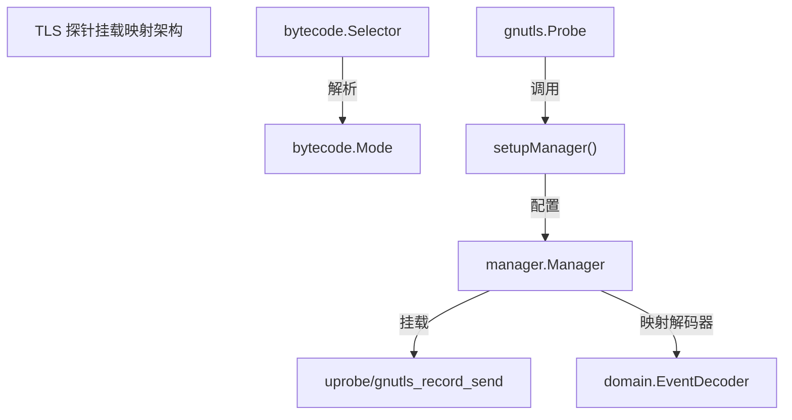
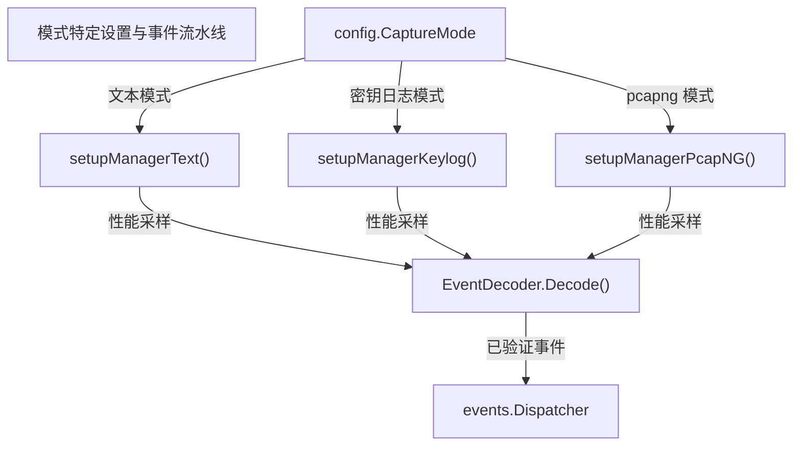

# 扩展 TLS 探针

相关源文件

以下文件被用作生成此维基页面的上下文：

- [AGENTS.md](https://github.com/gojue/ecapture/blob/8c9caada/AGENTS.md)
- [docs/agent/architecture.md](https://github.com/gojue/ecapture/blob/8c9caada/docs/agent/architecture.md)
- [docs/agent/build-test.md](https://github.com/gojue/ecapture/blob/8c9caada/docs/agent/build-test.md)
- [docs/agent/probe-development.md](https://github.com/gojue/ecapture/blob/8c9caada/docs/agent/probe-development.md)
- [internal/probe/bytecode/selector.go](https://github.com/gojue/ecapture/blob/8c9caada/internal/probe/bytecode/selector.go)
- [internal/probe/gnutls/gnutls_probe.go](https://github.com/gojue/ecapture/blob/8c9caada/internal/probe/gnutls/gnutls_probe.go)
- [internal/probe/gotls/config_symbol.go](https://github.com/gojue/ecapture/blob/8c9caada/internal/probe/gotls/config_symbol.go)
- [internal/probe/gotls/config_symbol_test.go](https://github.com/gojue/ecapture/blob/8c9caada/internal/probe/gotls/config_symbol_test.go)

## 目的与范围
扩展核心 TLS 探针（`tls`、`gotls` 或 `gnutls`）需要维护基础的系统契约，包括挂载映射（attachment mappings）、事件二进制 ABI、版本支持矩阵、CO-RE 与非 CO-RE 字节码资产解析，以及特定模式的执行行为 [AGENTS.md:98-132](https://github.com/gojue/ecapture/blob/8c9caada/AGENTS.md#L98-L132)。在添加新的挂钩点（hook points）、字段或目标库时，开发人员必须协调 C eBPF 程序、Go 管理器初始化、符号/版本解析器以及解码流水线之间的变更 [docs/agent/probe-development.md:13-67](https://github.com/gojue/ecapture/blob/8c9caada/docs/agent/probe-development.md#L13-L67)。

Sources: [AGENTS.md:98-132](https://github.com/gojue/ecapture/blob/8c9caada/AGENTS.md#L98-L132), [docs/agent/probe-development.md:13-67](https://github.com/gojue/ecapture/blob/8c9caada/docs/agent/probe-development.md#L13-L67)

---

## 挂载映射与目标解析
每个 TLS 探针都在 C eBPF 节标记（`SEC("...")`）、目标函数或符号（`AttachToFuncName`）、库或二进制路径（`BinaryPath`）以及 Go 管理器配置之间建立原子关系 [docs/agent/probe-development.md:50-67](https://github.com/gojue/ecapture/blob/8c9caada/docs/agent/probe-development.md#L50-L67)。当使用新挂钩扩展探针时：
1. 在匹配目标库内部函数签名的 C 源文件中定义 uprobe 或 uretprobe 节。
2. 注册相应的 `manager.Probe` 条目，指定 `Section`、`EbpfFuncName`、`AttachToFuncName` 和 `BinaryPath` [internal/probe/gnutls/gnutls_probe.go:210-212](https://github.com/gojue/ecapture/blob/8c9caada/internal/probe/gnutls/gnutls_probe.go#L210-L212)。
3. 对于动态 Go 二进制目标（`gotls`），确保使用 ELF 和 Go 符号解析器准确计算符号表、节偏移量和指令返回位置 [internal/probe/gotls/config_symbol.go:24-90](https://github.com/gojue/ecapture/blob/8c9caada/internal/probe/gotls/config_symbol.go#L24-L90)。

Sources: [docs/agent/probe-development.md:50-67](https://github.com/gojue/ecapture/blob/8c9caada/docs/agent/probe-development.md#L50-L67), [internal/probe/gnutls/gnutls_probe.go:39-117](https://github.com/gojue/ecapture/blob/8c9caada/internal/probe/gnutls/gnutls_probe.go#L39-L117), [internal/probe/gnutls/gnutls_probe.go:169-202](https://github.com/gojue/ecapture/blob/8c9caada/internal/probe/gnutls/gnutls_probe.go#L169-L202), [internal/probe/gotls/config_symbol.go:24-90](https://github.com/gojue/ecapture/blob/8c9caada/internal/probe/gotls/config_symbol.go#L24-L90)

---

## 事件 ABI 与二进制契约
通过 eBPF perf 或 ring buffers 跨越内核-用户边界的数据依赖于严格的二进制 ABI [docs/agent/probe-development.md:71-88](https://github.com/gojue/ecapture/blob/8c9caada/docs/agent/probe-development.md#L71-L88)。扩展事件结构需要同时更新 C 结构体定义和 Go 的 `DecodeFromBytes` 实现 [docs/agent/probe-development.md:73-88](https://github.com/gojue/ecapture/blob/8c9caada/docs/agent/probe-development.md#L73-L88)。
- **字段布局：** 保持精确的字段顺序、固定宽度、符号性、显式填充以及数组维度 [AGENTS.md:110-115](https://github.com/gojue/ecapture/blob/8c9caada/AGENTS.md#L110-L115)。
- **验证：** 在 `Event.Validate()` 中实现幂等的、非破坏性的验证逻辑 [docs/agent/probe-development.md:83-84](https://github.com/gojue/ecapture/blob/8c9caada/docs/agent/probe-development.md#L83-L84)。
- **填充容差：** 通过验证最小结构体大小加负载判别器，而不是依赖精确的字节长度，来考虑末尾的 perf-sample 对齐填充 [docs/agent/probe-development.md:78-80](https://github.com/gojue/ecapture/blob/8c9caada/docs/agent/probe-development.md#L78-L80)。

Sources: [AGENTS.md:110-115](https://github.com/gojue/ecapture/blob/8c9caada/AGENTS.md#L110-L115), [docs/agent/probe-development.md:71-88](https://github.com/gojue/ecapture/blob/8c9caada/docs/agent/probe-development.md#L71-L88)

---

## 版本支持与动态偏移量
核心 TLS 探针通过动态偏移量解析和版本验证门控处理不同的库版本：
- **GoTLS：** 解析 `.gopclntab` 或 `.data.rel.ro.gopclntab` ELF 节，检查不同 Go 运行时版本的魔数头（例如 Go 1.18+ 的相对函数偏移量），并解析虚拟地址 [internal/probe/gotls/config_symbol.go:92-208](https://github.com/gojue/ecapture/blob/8c9caada/internal/probe/gotls/config_symbol.go#L92-L208)。
- **GnuTLS：** 在构造探针挂载之前，在配置初始化期间验证支持的版本范围 [internal/probe/gnutls/gnutls_probe.go:57-78](https://github.com/gojue/ecapture/blob/8c9caada/internal/probe/gnutls/gnutls_probe.go#L57-L78)。

Sources: [internal/probe/gnutls/gnutls_probe.go:57-78](https://github.com/gojue/ecapture/blob/8c9caada/internal/probe/gnutls/gnutls_probe.go#L57-L78), [internal/probe/gotls/config_symbol.go:92-208](https://github.com/gojue/ecapture/blob/8c9caada/internal/probe/gotls/config_symbol.go#L92-L208)

---

## CO-RE 与非 CO-RE 资产集成
eCapture 通过 `bytecode.Selector` 管理编译变体，该选择器在运行时根据可用的嵌入资产评估请求的 BTF 模式 [internal/probe/bytecode/selector.go:78-226](https://github.com/gojue/ecapture/blob/8c9caada/internal/probe/bytecode/selector.go#L78-L226)。
- **模式解析：** 选择器根据内核能力和资产目录检查用户参数（`BTFModeCore`、`BTFModeNonCore` 或 `BTFModeAutoDetect`） [internal/probe/bytecode/selector.go:133-193](https://github.com/gojue/ecapture/blob/8c9caada/internal/probe/bytecode/selector.go#L133-L193)。
- **资产后缀：** 具体的基础名称被映射到 `_core.o` 或 `_noncore.o` 后缀 [internal/probe/bytecode/selector.go:229-239](https://github.com/gojue/ecapture/blob/8c9caada/internal/probe/bytecode/selector.go#L229-L239)。当使用新的字节码源扩展探针时，确保 CO-RE 和非 CO-RE 编译流水线都能生成预期的产物，而不会在解析后引入硬回退 [internal/probe/bytecode/selector.go:202-226](https://github.com/gojue/ecapture/blob/8c9caada/internal/probe/bytecode/selector.go#L202-L226)。

Sources: [docs/agent/architecture.md:20-25](https://github.com/gojue/ecapture/blob/8c9caada/docs/agent/architecture.md#L20-L25), [internal/probe/bytecode/selector.go:78-239](https://github.com/gojue/ecapture/blob/8c9caada/internal/probe/bytecode/selector.go#L78-L239), [internal/probe/gnutls/gnutls_probe.go:169-202](https://github.com/gojue/ecapture/blob/8c9caada/internal/probe/gnutls/gnutls_probe.go#L169-L202)

---

## 模式特定行为与处理器
TLS 探针根据选择的捕获表示形式（`text`、`keylog` 或 `pcapng`）调整其管理器设置 [internal/probe/gnutls/gnutls_probe.go:169-202](https://github.com/gojue/ecapture/blob/8c9caada/internal/probe/gnutls/gnutls_probe.go#L169-L202)。
- **文本模式 (Text Mode)：** 挂载专用于明文负载拦截的 uprobes/uretprobes [internal/probe/gnutls/gnutls_probe.go:204-212](https://github.com/gojue/ecapture/blob/8c9caada/internal/probe/gnutls/gnutls_probe.go#L204-L212)。
- **密钥日志模式 (Keylog Mode)：** 捕获加密主密钥和 TLS 握手，用于外部解密工作流 [internal/probe/gnutls/gnutls_probe.go:178-179](https://github.com/gojue/ecapture/blob/8c9caada/internal/probe/gnutls/gnutls_probe.go#L178-L179)。
- **pcapng 模式：** 集成流量捕获挂钩、TC（流量控制）ingress/egress 程序以及指令修补器，用于实现带有嵌入式解密块的数据包级序列化 [internal/probe/gnutls/gnutls_probe.go:180-186](https://github.com/gojue/ecapture/blob/8c9caada/internal/probe/gnutls/gnutls_probe.go#L180-L186)。

Sources: [internal/probe/gnutls/gnutls_probe.go:169-202](https://github.com/gojue/ecapture/blob/8c9caada/internal/probe/gnutls/gnutls_probe.go#L169-L202)