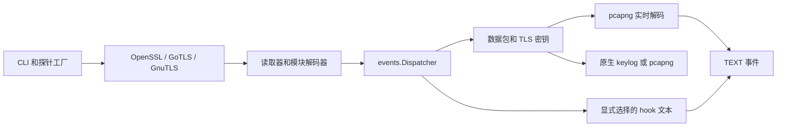

# 架构与探针开发

在 v2.12.0 中，`tls`、`gotls`、`gnutls` 分别使用面向目标库或运行时的探针，为默认文本模式提供网络包和 TLS 密钥。三个模块共用实时解码器、事件调度器和 v2 输出发布器。因此，pcapng 文件和解码后的文本可以来自同一批流量，但对外提供不同的表示形式。

- [TLS 捕获架构](5.1-tls-capture-architecture.md)介绍模块、捕获数据源和 C/Go 事件布局。
- [探针框架与生命周期](5.2-probe-framework-and-lifecycle.md)解释启动、读取器管理、关闭和重载。
- [事件与输出流水线](5.3-event-and-output-pipeline.md)说明事件调度、类型化事件、原生编码器及传输格式。
- [扩展 TLS 探针](5.4-extending-a-tls-probe.md)介绍版本映射、字节码变体与各模式的验证方式。
