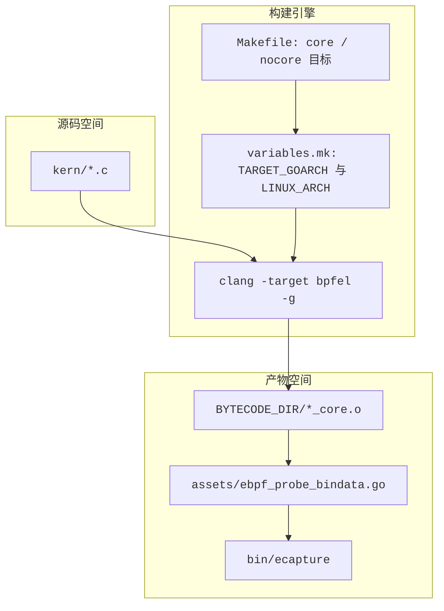
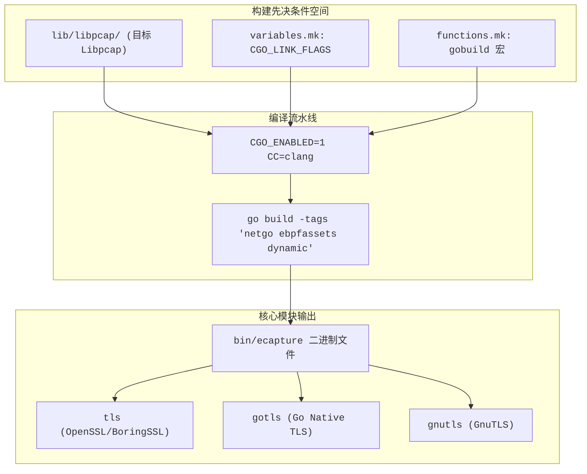

# 编译构建与字节码资产

<details>
<summary>相关源文件</summary>

以下文件被用作生成此维基页面的上下文：

- [Makefile](https://github.com/gojue/ecapture/blob/8c9caada/Makefile)
- [builder/Dockerfile](https://github.com/gojue/ecapture/blob/8c9caada/builder/Dockerfile)
- [builder/Makefile.release](https://github.com/gojue/ecapture/blob/8c9caada/builder/Makefile.release)
- [builder/init_env.sh](https://github.com/gojue/ecapture/blob/8c9caada/builder/init_env.sh)
- [docs/compilation.md](https://github.com/gojue/ecapture/blob/8c9caada/docs/compilation.md)
- [functions.mk](https://github.com/gojue/ecapture/blob/8c9caada/functions.mk)
- [go.mod](https://github.com/gojue/ecapture/blob/8c9caada/go.mod)
- [go.sum](https://github.com/gojue/ecapture/blob/8c9caada/go.sum)
- [variables.mk](https://github.com/gojue/ecapture/blob/8c9caada/variables.mk)

</details>

## 目的与范围

本页面详细介绍了构建系统、架构变体、CO-RE（一次编译，到处运行）与非 CO-RE 字节码生成策略，以及编译 `ecapture` 及其核心模块（用于 OpenSSL/BoringSSL 的 `tls`、用于 Go 原生 TLS 的 `gotls` 和用于 GnuTLS 的 `gnutls`）所需的工具链先决条件。它解释了 eBPF C 程序如何被编译成特定架构的对象文件并嵌入到 Go 二进制文件中。

Sources: [Makefile:4-16](https://github.com/gojue/ecapture/blob/8c9caada/Makefile#L4-L16), [variables.mk:1-120](https://github.com/gojue/ecapture/blob/8c9caada/variables.mk#L1-L120), [docs/compilation.md:1-36](https://github.com/gojue/ecapture/blob/8c9caada/docs/compilation.md#L1-L36)

---

## 1. 支持的构建环境与先决条件

构建 `ecapture` 需要现代 Linux 开发环境（通过辅助脚本官方支持 Ubuntu 20.04 或更高版本）以及特定的工具链版本 [docs/compilation.md:28-44](https://github.com/gojue/ecapture/blob/8c9caada/docs/compilation.md#L28-L44)。

### 所需工具链版本
* **Golang**: `1.26.0` 或更高版本 (`go.mod:3` [], `functions.mk:25-34` [])。
* **Clang/LLVM**: `9.0` 或更高版本（对于高级架构，建议使用 Clang `14` 或 `18`） [docs/compilation.md:34-36](https://github.com/gojue/ecapture/blob/8c9caada/docs/compilation.md#L34-L36)。
* **库与头文件**: `libelf-dev`、`pkgconf`、`linux-tools-common`、`linux-tools-generic` 以及目标内核头文件 [docs/compilation.md:52-55](https://github.com/gojue/ecapture/blob/8c9caada/docs/compilation.md#L52-L55)。

可以通过提供的引导脚本自动完成环境初始化：
```shell
/bin/bash -c "$(curl -fsSL https://raw.githubusercontent.com/gojue/ecapture/master/builder/init_env.sh)"
```
该脚本会检测宿主机操作系统发行版 [builder/init_env.sh:10-40](https://github.com/gojue/ecapture/blob/8c9caada/builder/init_env.sh#L10-L40)，安装所需的系统软件包 [builder/init_env.sh:73-75](https://github.com/gojue/ecapture/blob/8c9caada/builder/init_env.sh#L73-L75)，配置 `clang`、`llc` 和 `llvm-strip` 的符号链接 [builder/init_env.sh:76-80](https://github.com/gojue/ecapture/blob/8c9caada/builder/init_env.sh#L76-L80)，并设置 Go 工具链 [builder/init_env.sh:95-98](https://github.com/gojue/ecapture/blob/8c9caada/builder/init_env.sh#L95-L98)。

Sources: [builder/init_env.sh:1-108](https://github.com/gojue/ecapture/blob/8c9caada/builder/init_env.sh#L1-L108), [functions.mk:13-36](https://github.com/gojue/ecapture/blob/8c9caada/functions.mk#L13-L36), [docs/compilation.md:24-57](https://github.com/gojue/ecapture/blob/8c9caada/docs/compilation.md#L24-L57)

---

## 2. 架构变体与工具链映射

构建系统 (`variables.mk`) 将目标架构规范化为特定的目标三元组、架构构建目录和 C 编译标志 [variables.mk:72-120](https://github.com/gojue/ecapture/blob/8c9caada/variables.mk#L72-L120)。

| 目标架构 (`TARGET_GOARCH`) | Linux 内核架构 (`LINUX_ARCH`) | BPF 目标三元组 (`BPF_TARGET_TRIPLE`) | 最低内核版本 |
| :--- | :--- | :--- | :--- |
| `amd64` | `x86` | `x86_64` | Linux 4.18+ [docs/compilation.md:28](https://github.com/gojue/ecapture/blob/8c9caada/docs/compilation.md#L28) |
| `arm64` | `arm64` | `aarch64` | Linux 5.5+ [docs/compilation.md:28](https://github.com/gojue/ecapture/blob/8c9caada/docs/compilation.md#L28) |
| `loong64` | `loongarch` | `loongarch64-linux-gnu` | Linux 6.6+ [docs/compilation.md:28](https://github.com/gojue/ecapture/blob/8c9caada/docs/compilation.md#L28) |

### 交叉编译与 Loong64 支持
交叉编译通过设置 `CROSS_ARCH` 环境变量来驱动（例如 `CROSS_ARCH=arm64 make`） [docs/compilation.md:107-112](https://github.com/gojue/ecapture/blob/8c9caada/docs/compilation.md#L107-L112)。对于 `loong64`，有严格的要求：必须在 Ubuntu 24.04 `x86_64` 上使用 LLVM 18 (`CLANG_NUM=18`) 进行构建，并且需要 `LOONG64_VMLINUX` 和内核头文件 [variables.mk:91-117](https://github.com/gojue/ecapture/blob/8c9caada/variables.mk#L91-L117), [docs/compilation.md:114-131](https://github.com/gojue/ecapture/blob/8c9caada/docs/compilation.md#L114-L131)。

Sources: [variables.mk:72-120](https://github.com/gojue/ecapture/blob/8c9caada/variables.mk#L72-L120), [docs/compilation.md:79-131](https://github.com/gojue/ecapture/blob/8c9caada/docs/compilation.md#L79-L131)

---

## 3. CO-RE 与非 CO-RE 字节码资产生成

eBPF 字节码由 `kern/` 目录下的 C 源文件编译成特定架构的对象文件（`_core.o` 或非 CO-RE 等效文件），随后通过资产生成过程打包进 Go 源文件 [Makefile:174-190](https://github.com/gojue/ecapture/blob/8c9caada/Makefile#L174-L190)。

### 构建目标
* `make all` (或 `make build`): 编译 CO-RE 和非 CO-RE 字节码资产并构建 `ecapture` 二进制文件 [Makefile:4-6](https://github.com/gojue/ecapture/blob/8c9caada/Makefile#L4-L6)。
* `make core`: 仅使用 **CO-RE（一次编译，到处运行）资产**构建 eCapture [Makefile:9-11](https://github.com/gojue/ecapture/blob/8c9caada/Makefile#L9-L11)。
* `make nocore`: 仅使用 **非 CO-RE 资产**构建 eCapture，为旧版本内核绕过 BTF 依赖 [Makefile:13-15](https://github.com/gojue/ecapture/blob/8c9caada/Makefile#L13-L15), [docs/compilation.md:69-77](https://github.com/gojue/ecapture/blob/8c9caada/docs/compilation.md#L69-L77)。

### 编译流程
`Makefile` 针对 `kern/` 中匹配 `KERN_OBJECTS` 的每个源文件，调用 `clang` 并配合适当的目标标志 (`-target bpfel`)、调试符号 (`-g`) 和依赖生成 [Makefile:174-185](https://github.com/gojue/ecapture/blob/8c9caada/Makefile#L174-L185)。


Sources: [Makefile:1-190](https://github.com/gojue/ecapture/blob/8c9caada/Makefile#L1-L190), [variables.mk:140-176](https://github.com/gojue/ecapture/blob/8c9caada/variables.mk#L140-L176)

---

## 4. TLS、GoTLS 和 GnuTLS 的构建先决条件

核心 TLS 探针（`tls`、`gotls`、`gnutls`）依赖于静态链接的 `libpcap` 和 `functions.mk` 中定义的 CGO 配置 [functions.mk:47-57](https://github.com/gojue/ecapture/blob/8c9caada/functions.mk#L47-L57)。

### CGO 与链接器配置
`gobuild` 宏定义了传递给 Go 编译器的精确环境变量和构建标志 [functions.mk:47-57](https://github.com/gojue/ecapture/blob/8c9caada/functions.mk#L47-L57)：
* `CGO_ENABLED=1` [functions.mk:49](https://github.com/gojue/ecapture/blob/8c9caada/functions.mk#L49) 确保数据包捕获功能（`pcapng` 模式）可以链接到位于 `LIBPCAP_BUILD_DIR` 的捆绑 `libpcap` 归档文件 [functions.mk:50-51](https://github.com/gojue/ecapture/blob/8c9caada/functions.mk#L50-L51)。
* 构建标签包括 `netgo`、`ebpfassets`、`dynamic` 以及特定模块标签如 `ecap_android` [variables.mk:152-176](https://github.com/gojue/ecapture/blob/8c9caada/variables.mk#L152-L176), [functions.mk:54](https://github.com/gojue/ecapture/blob/8c9caada/functions.mk#L54)。
* Ldflags 去除二进制符号 (`-w -s`) 并注入 git 版本和字节码配置 [functions.mk:54](https://github.com/gojue/ecapture/blob/8c9caada/functions.mk#L54)。


Sources: [functions.mk:47-57](https://github.com/gojue/ecapture/blob/8c9caada/functions.mk#L47-L57), [variables.mk:52-124](https://github.com/gojue/ecapture/blob/8c9caada/variables.mk#L52-L124)