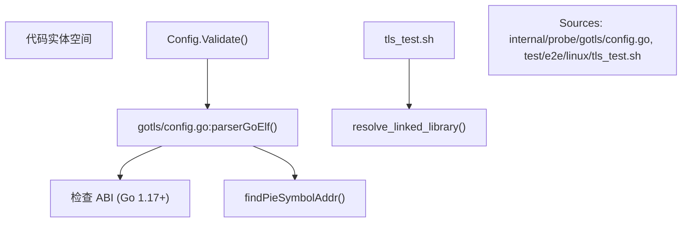
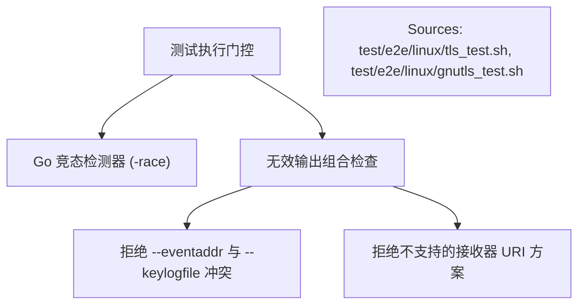
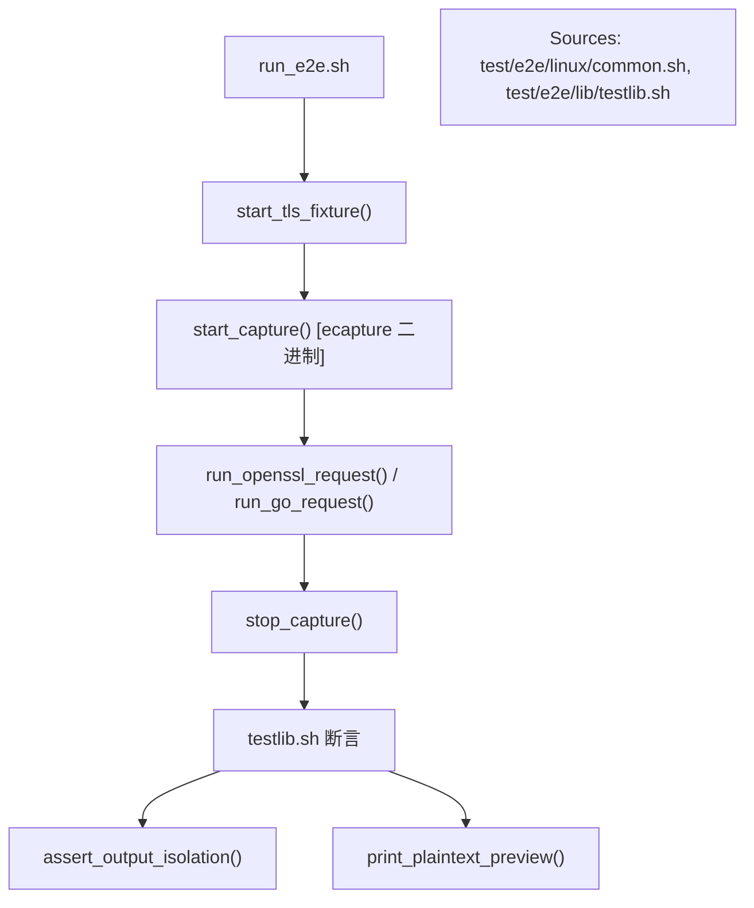
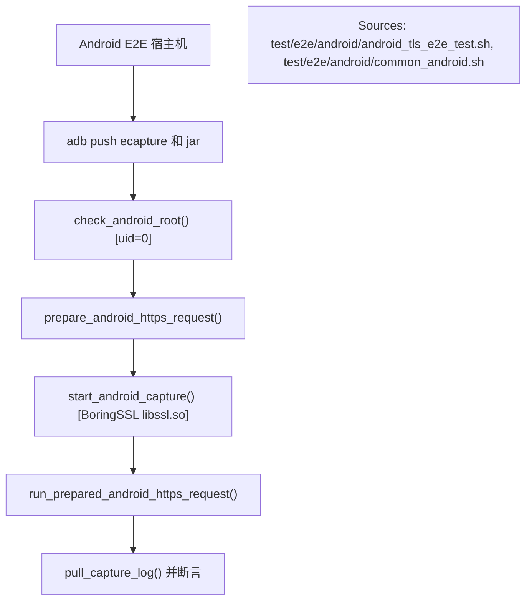

# TLS 测试与端到端 (E2E) 策略

相关源文件

以下文件被用作生成此维基页面的上下文：

- [internal/probe/gotls/config.go](https://github.com/gojue/ecapture/blob/8c9caada/internal/probe/gotls/config.go)
- [test/e2e/README.md](https://github.com/gojue/ecapture/blob/8c9caada/test/e2e/README.md)
- [test/e2e/android/android_tls_e2e_test.sh](https://github.com/gojue/ecapture/blob/8c9caada/test/e2e/android/android_tls_e2e_test.sh)
- [test/e2e/android/common_android.sh](https://github.com/gojue/ecapture/blob/8c9caada/test/e2e/android/common_android.sh)
- [test/e2e/android/setup_android_env.sh](https://github.com/gojue/ecapture/blob/8c9caada/test/e2e/android/setup_android_env.sh)
- [test/e2e/common.sh](https://github.com/gojue/ecapture/blob/8c9caada/test/e2e/common.sh)
- [test/e2e/fixtures/pcapng_check/main.go](https://github.com/gojue/ecapture/blob/8c9caada/test/e2e/fixtures/pcapng_check/main.go)
- [test/e2e/gnutls_e2e_test.sh](https://github.com/gojue/ecapture/blob/8c9caada/test/e2e/gnutls_e2e_test.sh)
- [test/e2e/go_https_client.go](https://github.com/gojue/ecapture/blob/8c9caada/test/e2e/go_https_client.go)
- [test/e2e/gotls_e2e_test.sh](https://github.com/gojue/ecapture/blob/8c9caada/test/e2e/gotls_e2e_test.sh)
- [test/e2e/lib/testlib.sh](https://github.com/gojue/ecapture/blob/8c9caada/test/e2e/lib/testlib.sh)
- [test/e2e/linux/common.sh](https://github.com/gojue/ecapture/blob/8c9caada/test/e2e/linux/common.sh)
- [test/e2e/linux/gnutls_test.sh](https://github.com/gojue/ecapture/blob/8c9caada/test/e2e/linux/gnutls_test.sh)
- [test/e2e/linux/gotls_test.sh](https://github.com/gojue/ecapture/blob/8c9caada/test/e2e/linux/gotls_test.sh)
- [test/e2e/linux/tls_test.sh](https://github.com/gojue/ecapture/blob/8c9caada/test/e2e/linux/tls_test.sh)
- [test/e2e/tls_e2e_test.sh](https://github.com/gojue/ecapture/blob/8c9caada/test/e2e/tls_e2e_test.sh)

## 目的与范围
本页面详细介绍了 eCapture 核心 TLS 模块（适用于 OpenSSL/BoringSSL 的 `tls`、适用于 Go 原生 TLS 的 `gotls` 以及适用于 GnuTLS 的 `gnutls`）的测试与端到端 (E2E) 验证策略。内容涵盖了针对性的单元测试模式、字节级 ABI 检查、竞态条件检测、生产标记门控，以及用于验证文本 (text)、密钥日志 (keylog) 和 pcapng 输出模式的严格 Linux/Android E2E 执行框架。

Sources: [test/e2e/README.md:1-76](https://github.com/gojue/ecapture/blob/8c9caada/test/e2e/README.md#L1-L76), [test/e2e/linux/common.sh:1-76](https://github.com/gojue/ecapture/blob/8c9caada/test/e2e/linux/common.sh#L1-L76)

---

## 6.2.1 针对性单元测试与字节级 ABI 检查
核心 TLS 探针依赖于精确的二进制结构检查和 ABI 兼容性。单元测试和配置验证器在 eBPF 程序挂载前验证二进制属性：
- **Go 二进制 ABI 检查**：`gotls` 模块解析 ELF 符号，检测 Go 运行时版本，并为 Go 1.17+ 二进制文件配置基于寄存器的 ABI 标志 ([internal/probe/gotls/config.go:141-190](https://github.com/gojue/ecapture/blob/8c9caada/internal/probe/gotls/config.go#L141-L190))。它负责解析位置无关可执行文件 (PIE) 的符号偏移量 ([internal/probe/gotls/config.go:216-228](https://github.com/gojue/ecapture/blob/8c9caada/internal/probe/gotls/config.go#L216-L228))。
- **库链接与解析**：OpenSSL 和 GnuTLS 探针解析链接的共享对象（`libssl.so`, `libgnutls.so`），以确保目标函数符号（`SSL_read`, `gnutls_record_recv`）位于预期的偏移位置 [test/e2e/linux/tls_test.sh:13-19](https://github.com/gojue/ecapture/blob/8c9caada/test/e2e/linux/tls_test.sh#L13-L19), [test/e2e/linux/gnutls_test.sh:13-26](https://github.com/gojue/ecapture/blob/8c9caada/test/e2e/linux/gnutls_test.sh#L13-L26)。

Sources: [internal/probe/gotls/config.go:114-228](https://github.com/gojue/ecapture/blob/8c9caada/internal/probe/gotls/config.go#L114-L228), [test/e2e/linux/tls_test.sh:13-19](https://github.com/gojue/ecapture/blob/8c9caada/test/e2e/linux/tls_test.sh#L13-L19)

---

## 6.2.2 竞态条件与生产标记门控
为了保证并发用户态控制循环和 eBPF 事件环形缓冲区 (ring buffers) 的安全性，测试套件强制执行严格的构建和运行时检查：
- **竞态检测器集成**：Go 测试和组件在 Go 竞态检测器 (`-race`) 下执行，以捕获事件分发器和输出接收器中的并发 map 读写。
- **输出隔离与冲突门控**：测试用例验证 eCapture 是否严格区分运行日志 (`--logaddr`) 与捕获事件 (`--eventaddr` 或 stdout)，拒绝冲突的参数，例如同时使用 stdout 或无效的接收器 URI 方案 [test/e2e/linux/tls_test.sh:59-79](https://github.com/gojue/ecapture/blob/8c9caada/test/e2e/linux/tls_test.sh#L59-L79)。

Sources: [test/e2e/linux/tls_test.sh:59-79](https://github.com/gojue/ecapture/blob/8c9caada/test/e2e/linux/tls_test.sh#L59-L79), [test/e2e/linux/gnutls_test.sh:36-56](https://github.com/gojue/ecapture/blob/8c9caada/test/e2e/linux/gnutls_test.sh#L36-L56)

---

## 6.2.3 Linux E2E 框架与测试矩阵
维护的 Linux E2E 测试在 GitHub Actions 的 Ubuntu 22.04+ 环境中运行，需要 root 权限和内核版本 4.18+（ARM64 为 5.5+）[test/e2e/linux/common.sh:30-63](https://github.com/gojue/ecapture/blob/8c9caada/test/e2e/linux/common.sh#L30-L63)。
- **框架结构**：运行程序在回环地址上启动一个本地隔离的 TLS 测试装置 (`test_server`)，执行原生客户端（`openssl_client`, `go_https_client`, `gnutls_client`），并在后台运行 eCapture 捕获特定模式（`text`, `keylog`, `pcapng`）[test/e2e/linux/tls_test.sh:81-158](https://github.com/gojue/ecapture/blob/8c9caada/test/e2e/linux/tls_test.sh#L81-L158), [test/e2e/linux/gotls_test.sh:53-129](https://github.com/gojue/ecapture/blob/8c9caada/test/e2e/linux/gotls_test.sh#L53-L129), [test/e2e/linux/gnutls_test.sh:58-134](https://github.com/gojue/ecapture/blob/8c9caada/test/e2e/linux/gnutls_test.sh#L58-L134)。
- **断言库**：`testlib.sh` 中的共享验证工具用于验证文件非空、无捕获错误、包含特定令牌以及严格的输出隔离 ([test/e2e/lib/testlib.sh:54-107](https://github.com/gojue/ecapture/blob/8c9caada/test/e2e/lib/testlib.sh#L54-L107))。

Sources: [test/e2e/linux/common.sh:30-207](https://github.com/gojue/ecapture/blob/8c9caada/test/e2e/linux/common.sh#L30-L207), [test/e2e/lib/testlib.sh:1-211](https://github.com/gojue/ecapture/blob/8c9caada/test/e2e/lib/testlib.sh#L1-L211), [test/e2e/linux/tls_test.sh:81-158](https://github.com/gojue/ecapture/blob/8c9caada/test/e2e/linux/tls_test.sh#L81-L158)

---

## 6.2.4 Android E2E 框架与 Conscrypt 验证
Android E2E 测试针对已 root 的设备或模拟器上的 API 33+ (Android 13 至 16)，利用平台 Conscrypt/BoringSSL ([test/e2e/android/common_android.sh:72-155](https://github.com/gojue/ecapture/blob/8c9caada/test/e2e/android/common_android.sh#L72-L155))。
- **负载部署**：推送编译好的 `ecapture` 二进制文件和一个通过 `adb` 执行 HTTPS 请求的 `app_process` Java 客户端 (`AndroidHttpsClient`) [test/e2e/android/android_tls_e2e_test.sh:19-46](https://github.com/gojue/ecapture/blob/8c9caada/test/e2e/android/android_tls_e2e_test.sh#L19-L46)。
- **门控执行**：利用文件门控 (`prepare_android_https_request`) 将 eCapture 的挂载与目标 Java 进程的精确 PID 同步，以避免在繁忙的模拟器镜像上出现 perf 缓冲区溢出 [test/e2e/android/android_tls_e2e_test.sh:66-92](https://github.com/gojue/ecapture/blob/8c9caada/test/e2e/android/android_tls_e2e_test.sh#L66-L92)。

Sources: [test/e2e/android/android_tls_e2e_test.sh:19-154](https://github.com/gojue/ecapture/blob/8c9caada/test/e2e/android/android_tls_e2e_test.sh#L19-L154), [test/e2e/android/common_android.sh:65-155](https://github.com/gojue/ecapture/blob/8c9caada/test/e2e/android/common_android.sh#L65-L155)

---

## 6.2.5 输出模式验证 (Text, Keylog, 与 pcapng)
E2E 测试套件验证所有三种捕获模式的产物完整性：
- **文本模式 (Text)**：断言匹配 E2E 测试运行的明文令牌出现在事件流中，且未泄露到运行日志中 [test/e2e/linux/tls_test.sh:81-99](https://github.com/gojue/ecapture/blob/8c9caada/test/e2e/linux/tls_test.sh#L81-L99)。
- **密钥日志模式 (Keylog)**：在 eCapture 写入 NSS 密钥日志文件的同时，通过 `tshark` 并发捕获原始数据包。验证 TLS 1.2 `CLIENT_RANDOM` 和 TLS 1.3 流量密钥的存在，然后使用带有 `-o tls.keylog_file` 参数的 `tshark` 成功解密捕获的数据包 [test/e2e/linux/tls_test.sh:101-137](https://github.com/gojue/ecapture/blob/8c9caada/test/e2e/linux/tls_test.sh#L101-L137), [test/e2e/lib/testlib.sh:185-205](https://github.com/gojue/ecapture/blob/8c9caada/test/e2e/lib/testlib.sh#L185-L205)。
- **pcapng 模式**：使用 `pcapng_check` 根据结构要求验证生成的 pcapng 产物，确保存在分段标头块 (SHB)、接口描述块 (IDB)、增强型数据包块 (EPB) 以及 TLS 解密密钥块 (DSB) [test/e2e/README.md:41-47](https://github.com/gojue/ecapture/blob/8c9caada/test/e2e/README.md#L41-L47), [test/e2e/linux/tls_test.sh:139-158](https://github.com/gojue/ecapture/blob/8c9caada/test/e2e/linux/tls_test.sh#L139-L158)。

Sources: [test/e2e/README.md:30-58](https://github.com/gojue/ecapture/blob/8c9caada/test/e2e/README.md#L30-L58), [test/e2e/linux/tls_test.sh:81-158](https://github.com/gojue/ecapture/blob/8c9caada/test/e2e/linux/tls_test.sh#L81-L158), [test/e2e/lib/testlib.sh:185-211](https://github.com/gojue/ecapture/blob/8c9caada/test/e2e/lib/testlib.sh#L185-L211)