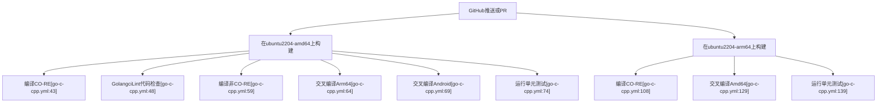
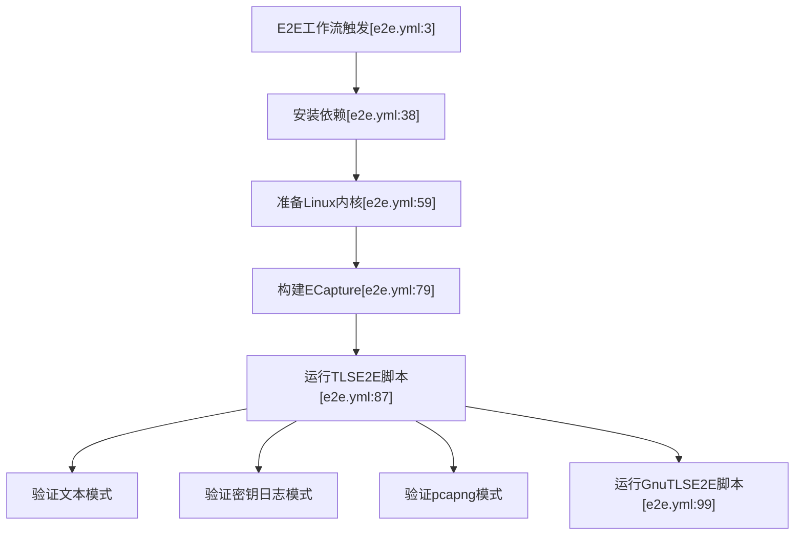

# CI、打包与发布

<details>
<summary>相关源文件</summary>

以下文件被用作生成此维基页面的上下文：

- [.github/workflows/android_e2e.yml](https://github.com/gojue/ecapture/blob/8c9caada/.github/workflows/android_e2e.yml)
- [.github/workflows/codeql-analysis.yml](https://github.com/gojue/ecapture/blob/8c9caada/.github/workflows/codeql-analysis.yml)
- [.github/workflows/e2e.yml](https://github.com/gojue/ecapture/blob/8c9caada/.github/workflows/e2e.yml)
- [.github/workflows/go-c-cpp.yml](https://github.com/gojue/ecapture/blob/8c9caada/.github/workflows/go-c-cpp.yml)
- [.github/workflows/pr_build_debug.yml](https://github.com/gojue/ecapture/blob/8c9caada/.github/workflows/pr_build_debug.yml)
- [.github/workflows/release.yml](https://github.com/gojue/ecapture/blob/8c9caada/.github/workflows/release.yml)
- [builder/rpmBuild.spec](https://github.com/gojue/ecapture/blob/8c9caada/builder/rpmBuild.spec)

</details>

## 目的与范围
本页面详细介绍了 `ecapture` 的持续集成 (CI) 流水线、自动化测试矩阵、安全分析工作流、打包规范以及发布编排机制。范围限定在核心 TLS 模块（`tls`、`gotls` 和 `gnutls`）及其随附的字节码资产、交叉编译目标和分发产物 [.github/workflows/go-c-cpp.yml:1-76](https://github.com/gojue/ecapture/blob/8c9caada/.github/workflows/go-c-cpp.yml#L1-L76), [.github/workflows/e2e.yml:1-122](https://github.com/gojue/ecapture/blob/8c9caada/.github/workflows/e2e.yml#L1-L122)。

---

## 1. 持续集成 (CI) 架构与覆盖范围
CI 架构依赖于 GitHub Actions 工作流，分为编译矩阵、单元测试套件、静态分析作业以及跨多个 Linux 发行版和 Android API 级别的端到端 (E2E) 验证环境 [.github/workflows/go-c-cpp.yml:1-141](https://github.com/gojue/ecapture/blob/8c9caada/.github/workflows/go-c-cpp.yml#L1-L141), [.github/workflows/e2e.yml:1-122](https://github.com/gojue/ecapture/blob/8c9caada/.github/workflows/e2e.yml#L1-L122), [.github/workflows/android_e2e.yml:1-164](https://github.com/gojue/ecapture/blob/8c9caada/.github/workflows/android_e2e.yml#L1-L164)。

### 构建矩阵与架构支持
核心构建流水线 (`GO/C/C++ CI`) 在 Ubuntu 运行节点（`ubuntu-22.04` 和 `ubuntu-24.04`）上执行，支持 `x86_64` (amd64) 和 `arm64` 架构 [.github/workflows/go-c-cpp.yml:9-140](https://github.com/gojue/ecapture/blob/8c9caada/.github/workflows/go-c-cpp.yml#L9-L140)。它会同时编译 CO-RE（一次编译，到处运行）和非 CO-RE（通过构建标签嵌入的字节码资产）变体 [.github/workflows/go-c-cpp.yml:43-63](https://github.com/gojue/ecapture/blob/8c9caada/.github/workflows/go-c-cpp.yml#L43-L63)。


*图 1：CI 构建矩阵工作流映射。*

Sources: [.github/workflows/go-c-cpp.yml:1-140](https://github.com/gojue/ecapture/blob/8c9caada/.github/workflows/go-c-cpp.yml#L1-L140)

---

## 2. 自动化测试关卡（单元、Race 与 E2E）
测试通过三个不同的关卡强制执行：启用竞态检测 (race detection) 的 Go 单元测试、覆盖 TLS/GoTLS/GnuTLS 模式的 Linux E2E 测试套件，以及 Android E2E 模拟器流水线 [.github/workflows/go-c-cpp.yml:74-75](https://github.com/gojue/ecapture/blob/8c9caada/.github/workflows/go-c-cpp.yml#L74-L75), [.github/workflows/e2e.yml:19-110](https://github.com/gojue/ecapture/blob/8c9caada/.github/workflows/e2e.yml#L19-L110), [.github/workflows/android_e2e.yml:19-155](https://github.com/gojue/ecapture/blob/8c9caada/.github/workflows/android_e2e.yml#L19-L155)。

### 单元与竞态验证
单元测试在启用竞态检测器的情况下执行，以识别探针管理、字节接收器 (byte sinks) 和环形缓冲区读取器中的并发风险：
```bash
go test -v -race ./...
```
*Sources: [.github/workflows/go-c-cpp.yml:74-75](https://github.com/gojue/ecapture/blob/8c9caada/.github/workflows/go-c-cpp.yml#L74-L75)*

### 端到端 (E2E) 工作负载关卡
E2E 工作流 (`tls-e2e`) 在针对 `master`、`v2` 和 `v1` 分支的拉取请求 (PR) 和推送时运行 [.github/workflows/e2e.yml:1-10](https://github.com/gojue/ecapture/blob/8c9caada/.github/workflows/e2e.yml#L1-L10)。它会安装所需的开发包（`libssl-dev`、`libgnutls28-dev`、`tshark`），并在 `text`、`keylog` 和 `pcapng` 模式下为 `tls`、`gotls` 和 `gnutls` 执行测试脚本 [.github/workflows/e2e.yml:38-110](https://github.com/gojue/ecapture/blob/8c9caada/.github/workflows/e2e.yml#L38-L110)。


*图 2：E2E 执行流程与验证关卡。*

Sources: [.github/workflows/e2e.yml:1-122](https://github.com/gojue/ecapture/blob/8c9caada/.github/workflows/e2e.yml#L1-L122)

---

## 3. 最小权限工作流边界与安全扫描
工作流通过显式限制 GITHUB_TOKEN 权限并仅在特定的测试执行步骤中隔离提权操作（如 `sudo` 或 `setcap`），来强制执行最小权限边界规则 [.github/workflows/codeql-analysis.yml:27-31](https://github.com/gojue/ecapture/blob/8c9caada/.github/workflows/codeql-analysis.yml#L27-L31), [.github/workflows/android_e2e.yml:52-56](https://github.com/gojue/ecapture/blob/8c9caada/.github/workflows/android_e2e.yml#L52-L56)。

### CodeQL 静态分析
CodeQL 工作流按计划和在 PR 时分析 C++ 和 Go 源代码，并将安全发现和覆盖率报告上传到 Codecov [.github/workflows/codeql-analysis.yml:14-92](https://github.com/gojue/ecapture/blob/8c9caada/.github/workflows/codeql-analysis.yml#L14-L92)。
- **分析语言**：`cpp`, `go` [.github/workflows/codeql-analysis.yml:35](https://github.com/gojue/ecapture/blob/8c9caada/.github/workflows/codeql-analysis.yml#L35)
- **构建集成**：在静态验证之前执行 `make env` 和 `make nocore` [.github/workflows/codeql-analysis.yml:85-87](https://github.com/gojue/ecapture/blob/8c9caada/.github/workflows/codeql-analysis.yml#L85-L87)

Sources: [.github/workflows/codeql-analysis.yml:1-92](https://github.com/gojue/ecapture/blob/8c9caada/.github/workflows/codeql-analysis.yml#L1-L92), [.github/workflows/android_e2e.yml:52-56](https://github.com/gojue/ecapture/blob/8c9caada/.github/workflows/android_e2e.yml#L52-L56)

---

## 4. 打包与发布流水线
发布会在发布匹配 `v*` 模式的 git 标签时自动触发 [.github/workflows/release.yml:1-5](https://github.com/gojue/ecapture/blob/8c9caada/.github/workflows/release.yml#L1-L5)。

### 发布产物生成
发布流水线 (`Release`) 为 Linux（`amd64`、`arm64`、`loong64`）和 Android 变体构建二进制文件，生成压缩的 tarball 和 Debian (`.deb`) 软件包 [.github/workflows/release.yml:16-190](https://github.com/gojue/ecapture/blob/8c9caada/.github/workflows/release.yml#L16-L190)。通过 RPM spec 文件配置支持 RPM 打包 [builder/rpmBuild.spec:1-63](https://github.com/gojue/ecapture/blob/8c9caada/builder/rpmBuild.spec#L1-L63)。

```yaml
Name:       ecapture
Version:    v1.1.0
Release:    2025%{?dist}
Summary:    使用 eBPF 在无需 CA 证书的情况下捕获 SSL/TLS 明文内容
License:    Apache-2.0
URL:        https://ecapture.cc
```
*Sources: [builder/rpmBuild.spec:1-6](https://github.com/gojue/ecapture/blob/8c9caada/builder/rpmBuild.spec#L1-L6)*

### 调试与 PR 产物
对于拉取请求，`PR Build (Debug)` 工作流会为 Android 和 Linux 的多个架构编译调试产物，确保在合并前验证交叉编译的完整性 [.github/workflows/pr_build_debug.yml:1-180](https://github.com/gojue/ecapture/blob/8c9caada/.github/workflows/pr_build_debug.yml#L1-L180)。

Sources: [.github/workflows/release.yml:1-190](https://github.com/gojue/ecapture/blob/8c9caada/.github/workflows/release.yml#L1-L190), [.github/workflows/pr_build_debug.yml:1-177](https://github.com/gojue/ecapture/blob/8c9caada/.github/workflows/pr_build_debug.yml#L1-L177), [builder/rpmBuild.spec:1-63](https://github.com/gojue/ecapture/blob/8c9caada/builder/rpmBuild.spec#L1-L63)