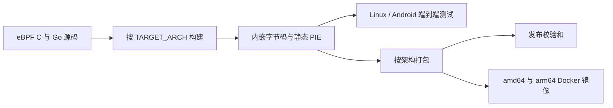

# 构建、测试与发布

v2.12.0 的发布流水线在 Linux 主机上构建各架构的 Linux 和 Android 程序。验证时应检查构建是否内嵌预期的 eBPF 对象、探针能否在真实目标内核上运行，以及分发包是否包含正确的可执行文件。

| 要确认的问题 | 章节 |
| --- | --- |
| 目标架构使用哪套工具链、内核头文件及内嵌对象？ | [编译构建与字节码资产](6.1-build-and-bytecode-assets.md) |
| 如何独立验证解码文本、NSS 密钥和原生 pcapng？ | [TLS 测试与端到端策略](6.2-tls-test-and-e2e-strategy.md) |
| 哪些任务负责生成软件包、执行真机测试和发布容器镜像？ | [CI、打包与发布](6.3-ci-packaging-and-release.md) |
