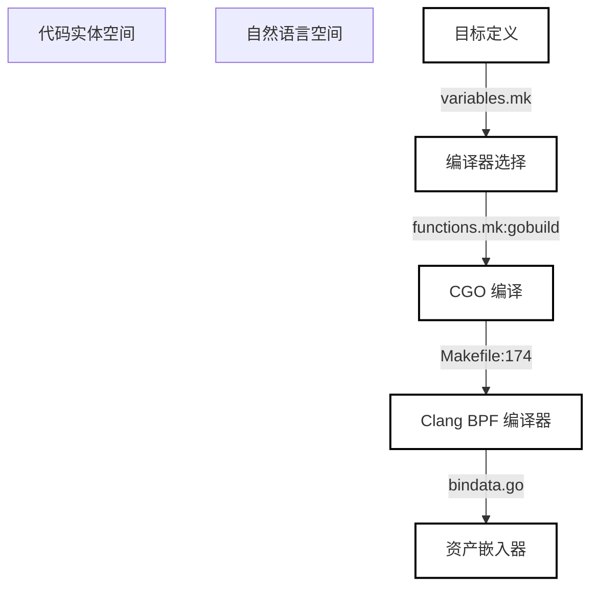
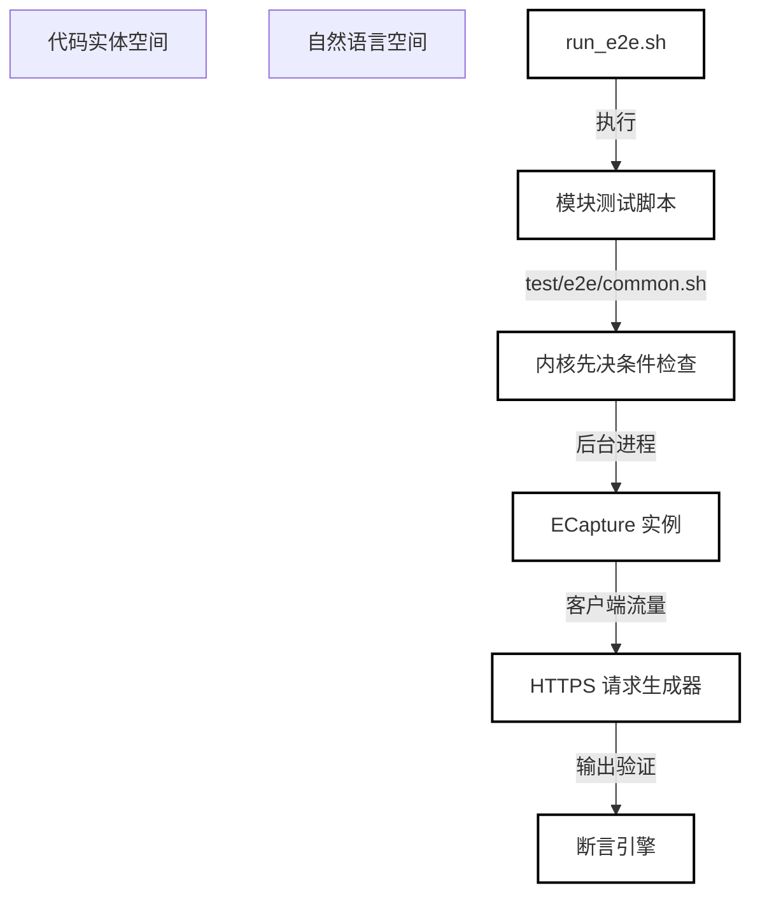

# 构建、测试与发布

相关源文件

以下文件被用作生成此 Wiki 页面的上下文：

- [Makefile](https://github.com/gojue/ecapture/blob/8c9caada/Makefile)
- [builder/Makefile.release](https://github.com/gojue/ecapture/blob/8c9caada/builder/Makefile.release)
- [docs/compilation.md](https://github.com/gojue/ecapture/blob/8c9caada/docs/compilation.md)
- [docs/e2e-tests.md](https://github.com/gojue/ecapture/blob/8c9caada/docs/e2e-tests.md)
- [functions.mk](https://github.com/gojue/ecapture/blob/8c9caada/functions.mk)
- [test/e2e/run_e2e.sh](https://github.com/gojue/ecapture/blob/8c9caada/test/e2e/run_e2e.sh)
- [variables.mk](https://github.com/gojue/ecapture/blob/8c9caada/variables.mk)

## 目的与范围
本 Wiki 父页面作为开发者编译、测试、打包和发布 `eCapture` 的入口。它涵盖了三个核心 TLS 模块（`tls`、`gotls` 和 `gnutls`）的构建流水线、架构字节码资产、针对 text、keylog 和 pcapng 模式的端到端测试策略以及发布工作流。

如需深入了解技术细节，请参阅子页面：
- [编译构建与字节码资产](6.1-build-and-bytecode-assets.md)
- [TLS 测试与端到端 (E2E) 策略](6.2-tls-test-and-e2e-strategy.md)
- [CI、打包与发布](6.3-ci-packaging-and-release.md)

---

## 6.1 编译构建与字节码资产

构建 `eCapture` 需要通过 `clang` 编排基于 C 的 eBPF 字节码编译，并将用户态 Go 应用程序与固定的 `libpcap` 存档进行链接 [docs/compilation.md:59-60](https://github.com/gojue/ecapture/blob/8c9caada/docs/compilation.md#L59-L60)。构建系统支持跨多个架构目标（包括 `amd64`、`arm64` 和 `loong64`）的 CO-RE（一次编译，到处运行）和非 CO-RE 字节码资产 [Makefile:174-185, variables.mk:77-120](https://github.com/gojue/ecapture/blob/8c9caada/Makefile:174-185, variables.mk#L77-L120)。

编译工作流通过顶层 `Makefile` 和 `functions.mk` 进行管理，其中 `make core`、`make nocore` 和 `TARGET_ARCH=<arch> make` 等目标控制着资产的生成 [Makefile:10-15, variables.mk:72](https://github.com/gojue/ecapture/blob/8c9caada/Makefile:10-15, variables.mk#L72)。CGO 被严格启用（`CGO_ENABLED=1`），以便将 `libpcap` 库静态链接到最终的可执行文件中 [variables.mk:54, functions.mk:49-54]。

*图 1：构建与字节码生成流水线，将配置变量链接到字节码嵌入。*

有关支持的 Linux 构建环境、架构变体、生成的 CO-RE 和非 CO-RE 资产以及构建先决条件的详细信息，请参阅 [编译构建与字节码资产](6.1-build-and-bytecode-assets.md)。

Sources: [Makefile:1-190](https://github.com/gojue/ecapture/blob/8c9caada/Makefile#L1-L190), [variables.mk:1-120](https://github.com/gojue/ecapture/blob/8c9caada/variables.mk#L1-L120), [functions.mk:47-57](https://github.com/gojue/ecapture/blob/8c9caada/functions.mk#L47-L57), [docs/compilation.md:1-131](https://github.com/gojue/ecapture/blob/8c9caada/docs/compilation.md#L1-L131)

---

## 6.2 TLS 测试与端到端 (E2E) 策略

验证核心 TLS 探针（`tls`、`gotls` 和 `gnutls`）需要全面的测试套件，以验证字节级 ABI 兼容性、事件序列化以及多模式输出的正确性（text、keylog 和 pcapng）[docs/e2e-tests.md:15-19](https://github.com/gojue/ecapture/blob/8c9caada/docs/e2e-tests.md#L15-L19)。端到端测试实现了内核能力检查、辅助进程执行和基于正则表达式的输出断言的自动化 [docs/e2e-tests.md:96-124](https://github.com/gojue/ecapture/blob/8c9caada/docs/e2e-tests.md#L96-L124)。

位于 `test/e2e/` 的测试运行脚本负责协调先决条件验证、目标程序执行（如 `curl`、自定义 Go HTTPS 客户端和系统二进制文件）以及环境清理 [test/e2e/run_e2e.sh:1-31, docs/e2e-tests.md:76-92](https://github.com/gojue/ecapture/blob/8c9caada/test/e2e/run_e2e.sh:1-31, docs/e2e-tests.md#L76-L92)。

*图 2：跨 TLS 探针模块的端到端测试执行流。*

有关针对性单元测试、字节级 ABI 检查、race 和 production-tag 门禁以及严格的 Linux/Android E2E 案例的详细信息，请参阅 [TLS 测试与端到端 (E2E) 策略](6.2-tls-test-and-e2e-strategy.md)。

Sources: [test/e2e/run_e2e.sh:1-31](https://github.com/gojue/ecapture/blob/8c9caada/test/e2e/run_e2e.sh#L1-L31), [docs/e2e-tests.md:1-229](https://github.com/gojue/ecapture/blob/8c9caada/docs/e2e-tests.md#L1-L229)

---

## 6.3 CI、打包与发布

发布工程和打包通过自动化脚本和 Makefile 处理，这些脚本构建压缩的发布 tar 包、Debian (`.deb`) 包和 RPM 规范 [builder/Makefile.release:10-157](https://github.com/gojue/ecapture/blob/8c9caada/builder/Makefile.release#L10-L157)。最小特权工作流边界和自动化发布检查确保二进制文件经过妥善的 `strip` 处理，通过 Git 元数据进行版本标记，并附带 SHA-256 校验和 [builder/Makefile.release:114-130](https://github.com/gojue/ecapture/blob/8c9caada/builder/Makefile.release#L114-L130)。

发布目标通过 `builder/Makefile.release` 协调跨平台编译资产的打包和 GitHub Release 发布 [builder/Makefile.release:10-130](https://github.com/gojue/ecapture/blob/8c9caada/builder/Makefile.release#L10-L130)。

有关核心 TLS CI 覆盖范围、最小特权工作流边界、打包和发布检查的详细信息，请参阅 [CI、打包与发布](6.3-ci-packaging-and-release.md)。

Sources: [builder/Makefile.release:1-158](https://github.com/gojue/ecapture/blob/8c9caada/builder/Makefile.release#L1-L158)